<p align="center">
  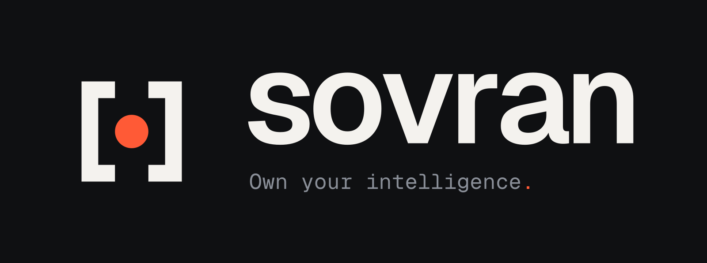
</p>

<h3 align="center">The open-source AI coding agent for VS Code that runs on <em>your</em> models.</h3>

<p align="center">
  Local, self-hosted, or behind your company's gateway.<br>
  No Sovran backend. No account. No telemetry.
</p>

<p align="center">
  <a href="https://github.com/Minells/sovran/releases"></a>
  <a href="https://github.com/Minells/sovran/releases"></a>
  <a href="https://github.com/Minells/sovran/actions/workflows/ci.yml"></a>
  <a href="LICENSE"></a>
  <a href="package.json"></a>
  <a href="SECURITY.md"></a>
</p>

<p align="center">
  <a href="https://github.com/Minells/sovran/releases"><strong>Download</strong></a> ·
  <a href="#quick-start">Quick start</a> ·
  <a href="docs/USER_GUIDE.md">User guide</a> ·
  <a href="https://minells.github.io/Sovran-Website/">Website</a> ·
  <a href="CHANGELOG.md">Changelog</a> ·
  <a href="https://github.com/Minells/sovran/issues">Issues</a>
</p>

<p align="center">
  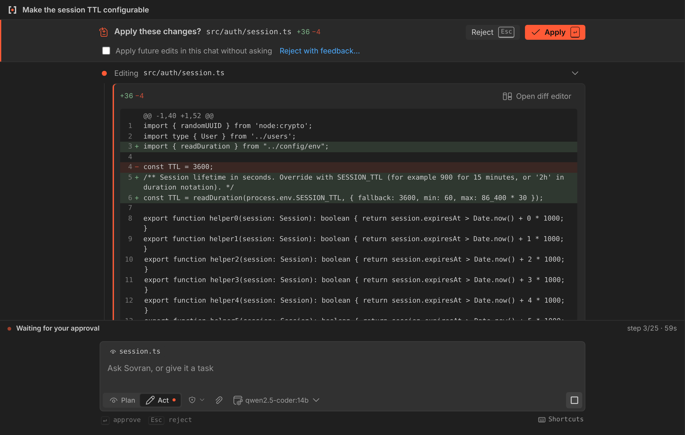
</p>

> **0.1.0 is the first public pre-release.** Download the VSIX from
> [GitHub Releases](https://github.com/Minells/sovran/releases). The VS Code Marketplace listing is not published yet,
> and compatibility testing on real model servers is still in progress. Reports from your setup are very welcome.

## Why Sovran

Most AI coding assistants assume a cloud model and a vendor account. Sovran assumes the opposite: **you already run a
model**, on a laptop with Ollama, a GPU server with vLLM, or an internal gateway, and you want an agent that works with
it, inside the editor you already use.

<table>
  <tr>
    <td width="33%" valign="top">
      <strong>Private by architecture</strong><br><br>
      Sovran talks to one endpoint: the one you configure. There is no relay server and no analytics. Keys live in VS
      Code Secret Storage, and protected files such as <code>.env</code> or SSH keys always ask before they are read.
    </td>
    <td width="33%" valign="top">
      <strong>You stay in charge</strong><br><br>
      Explore read-only in <strong>Plan</strong>, change things in <strong>Act</strong>. Every edit is a native VS Code
      diff, every command is shown before it runs, and the agent's file edits can be undone with one click.
    </td>
    <td width="33%" valign="top">
      <strong>Built for real-world models</strong><br><br>
      Tools load only when a chat needs them, older turns are compacted, and a context meter shows what is left. Models
      without native tool calling fall back to a prompted protocol automatically.
    </td>
  </tr>
</table>

## How it works

```text
┌────────────── your machine ──────────────┐            ┌──────── you choose ────────┐
│                                          │            │                            │
│  VS Code ─▶ Sovran ─▶ files, terminal,   │   HTTPS    │  Ollama · LM Studio · vLLM │
│             agent      Git, diagnostics  ├───────────▶│  LiteLLM · company gateway │
│             loop                         │            │                            │
│                                          │            │  + MCP servers you enable  │
│  keys in Secret Storage · chats on disk  │            │                            │
│                                          │            │                            │
└──────────────────────────────────────────┘            └────────────────────────────┘
          no Sovran server · no account · no telemetry
```

The agent reads and searches your code, proposes edits, runs approved commands and uses the results to continue the
task. The code and context you attach are sent **only to the provider you choose**.

## Quick start

**1. Install.** Download `sovran-<version>.vsix` from the [latest release](https://github.com/Minells/sovran/releases)
and install it:

```bash
code --install-extension sovran-0.1.0.vsix
```

Or use **Extensions → … → Install from VSIX…**. Each release lists the file's SHA-256 so you can check the download.

**2. Start a model server.** For example, with [Ollama](https://ollama.com):

```bash
ollama pull qwen2.5-coder:14b
```

**3. Connect.** Click **Sovran** in the Activity Bar. The guided setup asks where your model runs, tests the
connection and lists the models your server reports.

**4. Ask.** Start in **Plan** to explore, then press <kbd>Alt+M</kbd> to switch to **Act** when you want changes.

```text
/explain                                   with a function selected
/review @src/auth/session.ts               review a file you mention
Find the failing validation path, propose a fix and add a regression test.
```

Results depend on your model and its context window. The examples in this README use `qwen2.5-coder:14b` with a 32k
context window.

## Works with your model server

| Server | Default endpoint | Notes |
|---|---|---|
| **Ollama** | `http://localhost:11434/v1` | No key needed |
| **LM Studio** | `http://localhost:1234/v1` | No key needed |
| **vLLM** | `http://localhost:8000/v1` | Enable tool parsing for native tool calls |
| **LiteLLM** | `http://localhost:4000/v1` | Virtual keys supported |
| **Any OpenAI-compatible endpoint** | Your URL | Bearer key or a custom header (for example `api-key`) for company gateways |

Sovran reads context window and output limits from the server when it reports them. When a server is busy (HTTP 429,
502, 503 or 504), Sovran retries with backoff before it reports an error. See the
[provider examples](docs/USER_GUIDE.md#provider-setup-examples).

## What it can do

<p align="center">
  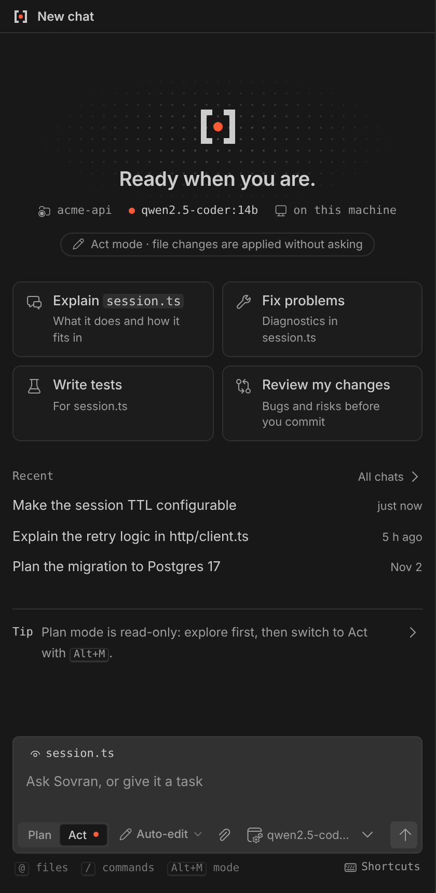
  &nbsp;
  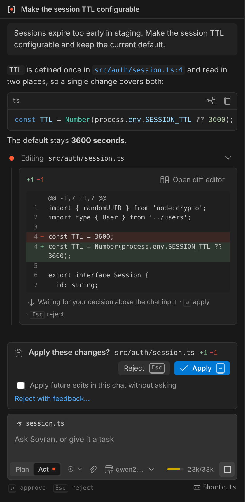
  &nbsp;
  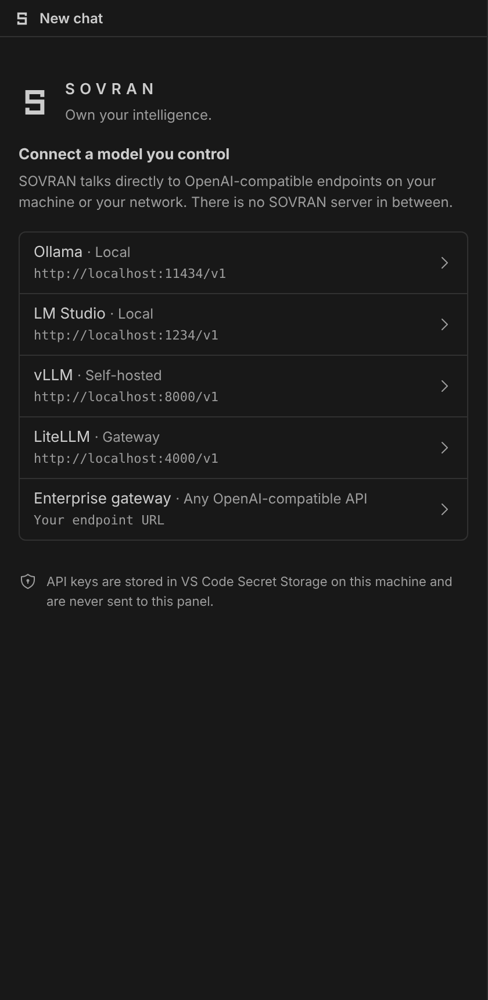
</p>

### An agent you can trust with your repository

- **Plan and Act modes.** Plan is read-only by construction. Act edits files and runs commands. Each mode can use its
  own model, for example a fast one for exploring and a strong one for editing.
- **Three approval levels.** **Ask** reviews everything, **Auto-edit** applies file edits automatically, and **Auto**
  also runs commands. Guardrails still ask in every mode: recursive deletes, `sudo`, `curl | sh`, pushes, publishing,
  credential files and paths outside the workspace.
- **Reviewable changes.** Native VS Code diffs and an approval bar above the chat input. <kbd>Enter</kbd> approves and
  <kbd>Esc</kbd> rejects, or you can reject with feedback.
- **Undo anything the agent wrote.** Each response that edits files saves a checkpoint, and **Undo changes** restores
  it. You can also retry a response, or edit an earlier message and rewind.

### Tools that understand your project

| Tool | What it does |
|---|---|
| **Files and search** | Read, list and search files (ripgrep, `.gitignore`-aware), and edit them with exact search and replace |
| **Terminal** | Runs approved commands, mirrored in a Sovran terminal, with a timeout |
| **Native Git** | Status, diff, log, show and branches. In Act, approved staging, commits, fetch, push, fast-forward pull and rebase |
| **Diagnostics** | Reads the editor's Problems for a file or folder, filtered by severity |
| **Semantic navigation** | File symbols, go to definition and find references, using your language extensions |
| **`web_fetch`** | Reads one public URL as text with its source links, after you approve that URL |
| **Documents and images** | Reads PDF, Word, Excel, PowerPoint and OpenDocument files as text on your machine. Images go to vision models |

**Tools load when needed.** Each request carries the file, editing and terminal tools. Git, diagnostics, symbols, Web
and MCP tools join a chat only when it needs them. On a 32k context window, the first request carries about
**1,400 tokens** of tool definitions instead of 4,800.

### Integrations through MCP

Open **Settings → Tools → MCP integrations → Browse Catalog** for reviewed, ready-made connections. You can also add
your own stdio or Streamable HTTP server and import its JSON snippet from Claude Desktop, Cursor, Cline or VS Code.

| Integration | Use it to |
|---|---|
| **Playwright** · **Chrome DevTools** | Drive and inspect web apps in a separate browser session |
| **GitHub** · **GitLab** | Work with issues, pull requests, merge requests and pipelines |
| **Context7** | Look up current library documentation and examples |
| **Grafana** · **Terraform** · **OpenSearch** | Query metrics, logs, workspaces and indexes on remote, operator-managed endpoints. Optional write profiles ask before every change |

Every MCP tool has an **Off / Ask / Allow** switch and asks before it runs until you allow it. Tokens are kept in
Secret Storage. See the [MCP guide](docs/USER_GUIDE.md#mcp-servers).

### A workspace that feels native

- **Chats in editor tabs** that run in parallel, next to your code, and come back after a restart.
- **Searchable history** for each workspace, with chat titles written by the model.
- **Context you can see**: `@` file mentions, a context meter, automatic compaction and `/compact`.
- **Slash commands**: `/explain`, `/fix`, `/test`, `/review`, `/doc`, `/compact` and `/new`, plus your own Markdown
  prompts in `.sovran/commands/`.
- **Theme-aware** in dark, light and high contrast, and fully usable from the keyboard.

<details>
<summary><strong>More screenshots</strong></summary>
<br>
<p align="center">
  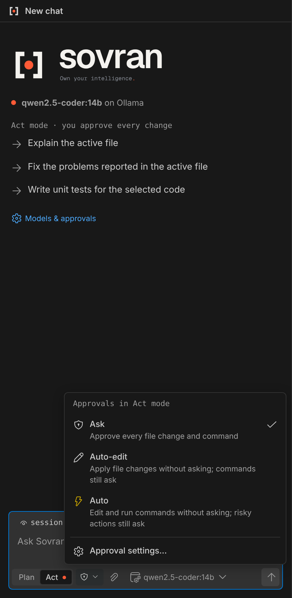
  &nbsp;
  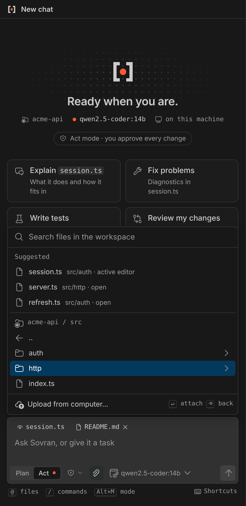
  &nbsp;
  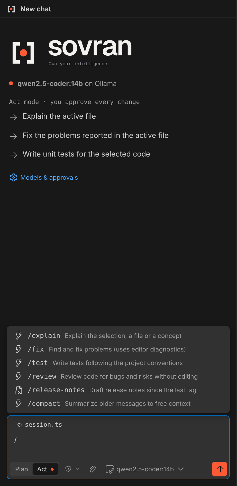
</p>
<p align="center">
  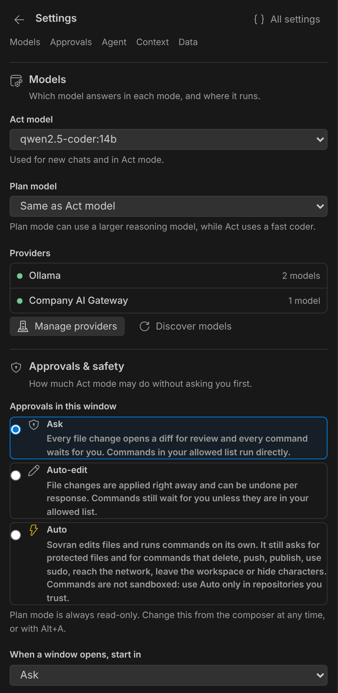
  &nbsp;
  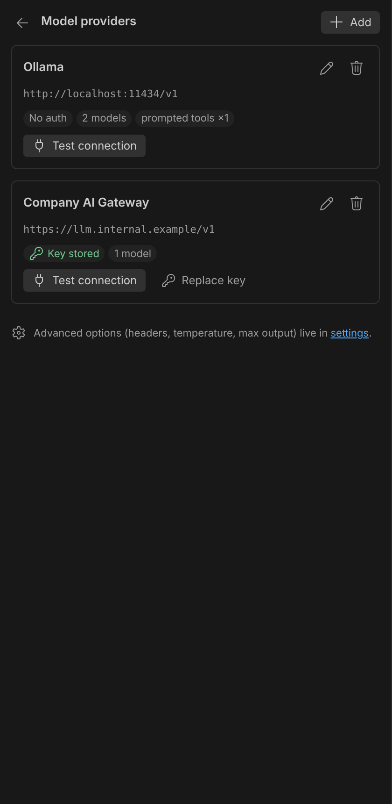
  &nbsp;
  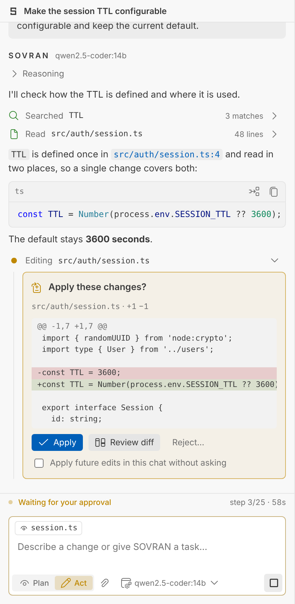
</p>
</details>

## Keyboard shortcuts

| Keys | Action |
|---|---|
| <kbd>Enter</kbd> / <kbd>Shift+Enter</kbd> | Send / new line |
| <kbd>Alt+M</kbd> | Switch between Plan and Act |
| <kbd>Alt+A</kbd> | Cycle approval modes: Ask, Auto-edit, Auto |
| <kbd>Enter</kbd> / <kbd>Esc</kbd> while an approval is pending | Approve / reject |
| <kbd>Esc</kbd> | Stop the run |
| <kbd>Ctrl+Enter</kbd> (<kbd>Cmd+Enter</kbd>) in the proposal's diff editor | Apply the change |

## Configuration

Use the gear in the Sovran view for **Models**, **Approvals**, **Agent**, **Tools**, **Context** and **Data**.
Provider and security settings are read from **user** scope only, so a cloned repository cannot change them.

<details>
<summary><strong>Prefer a file? <code>~/.sovran/config.yaml</code></strong></summary>
<br>

Run **Sovran: Open Model Config File (config.yaml)**. The file and Settings stay in sync both ways, and problems are
underlined in the editor with fix hints.

```yaml
providers:
  - id: ollama
    name: Ollama
    baseUrl: http://localhost:11434/v1
    auth: none
    models:
      - id: qwen2.5-coder:14b
        contextWindow: 32768

defaultModel: ollama/qwen2.5-coder:14b
```

Never put API keys in YAML or settings. Use **Sovran: Set Provider API Key…** instead.
</details>

<details>
<summary><strong>Key settings</strong></summary>
<br>

| Setting | Default | Purpose |
|---|---|---|
| `sovran.providers` | `[]` | OpenAI-compatible endpoints |
| `sovran.defaultModel` / `sovran.planModel` | `""` | Act / Plan model. A blank Plan model uses the Act model |
| `sovran.approvals.mode` | `ask` | `ask`, `edits` (Auto-edit) or `auto` |
| `sovran.tools.loading` | `auto` | Load tools when needed, or send `all` with every request |
| `sovran.tools.disabled` / `sovran.tools.forceAsk` | `[]` | Disable native tools, or always review their calls |
| `sovran.agent.maxIterations` | `25` | Model round-trips per request |
| `sovran.terminal.timeoutSeconds` | `120` | Command timeout |
| `sovran.terminal.hideSecretVariables` | `false` | Hide credential-like environment variables from agent commands |
| `sovran.context.autoCompact` | `true` | Summarize older turns when the context is full |
| `sovran.sessions.persist` | `true` | Save chats across restarts |
| `sovran.mcp.servers` | `[]` | Your MCP servers |

The [full settings reference](docs/USER_GUIDE.md#settings) covers the rest.
</details>

## Security and limits

Sovran is designed so that a mistake is visible before it happens and cheap to undo afterwards:

- **Restricted Mode** (untrusted workspaces) keeps the agent in Plan: it can read and explain, but not edit or run anything.
- **Protected paths** (`.env`, keys, cloud credentials, `.git/hooks` and more) are checked where symbolic links really
  lead, and always ask before they are read or written.
- **Guardrails** are heuristics on the command text, not a sandbox. Choose endpoints and MCP servers you trust.

Current limits: chats and images are stored **unencrypted** in the workspace storage. Terminal side effects are not
checkpointed. Documents provide text, not layout or embedded images. MCP supports tools only (no OAuth sign-in,
resources, prompts or SSE-only servers). Read the [known limitations](docs/USER_GUIDE.md#known-limitations) and the
[security model](SECURITY.md), and report vulnerabilities privately as described there.

## Build from source

```bash
git clone https://github.com/Minells/sovran.git
cd sovran
npm ci --ignore-scripts
npm run package               # builds and creates sovran-<version>.vsix
```

Use Node.js 22, the CI version. Press <kbd>F5</kbd> in VS Code to open an Extension Development Host.

<details>
<summary><strong>Architecture and development commands</strong></summary>
<br>

A portable TypeScript core owns the agent loop, tools, providers, permissions and context. The VS Code host owns I/O,
sessions, secrets and approval decisions. A sandboxed React webview renders state and sends validated intents.

```text
src/core/          portable agent engine, tools, providers, policy, documents, MCP
src/extension/     VS Code host, controller, adapters, sessions, Secret Storage
src/shared/        validated host/webview protocol
webview/           theme-aware React interface
tests/             unit, integration, component and VS Code smoke tests
```

```bash
npm run build
npm run check             # strict TypeScript, ESLint, unit/integration/component tests
npm run test:extension    # smoke tests in a real VS Code (downloads VS Code)
```

See [development](docs/DEVELOPMENT.md), [architecture](docs/ARCHITECTURE.md) and
[releasing](docs/RELEASING.md).
</details>

## Roadmap and contributing

What is next: Marketplace and Open VSX publication, compatibility reports from real servers, and a stable `0.2`. The
[roadmap](docs/ROADMAP.md) and [implementation status](docs/IMPLEMENTATION_STATUS.md) track progress. Roadmap items
are plans, not promises.

Contributions are welcome: focused fixes, tests, documentation and, above all, **reports from real endpoint
configurations**. Read [CONTRIBUTING.md](CONTRIBUTING.md) and the [code of conduct](CODE_OF_CONDUCT.md), and open an
[issue](https://github.com/Minells/sovran/issues) before a larger change.

## License

[MIT](LICENSE) © 2026 Minells and SOVRAN contributors. Dependency licenses are listed in
[THIRD_PARTY_NOTICES.md](THIRD_PARTY_NOTICES.md) and [MCP_THIRD_PARTY_NOTICES.md](MCP_THIRD_PARTY_NOTICES.md).
