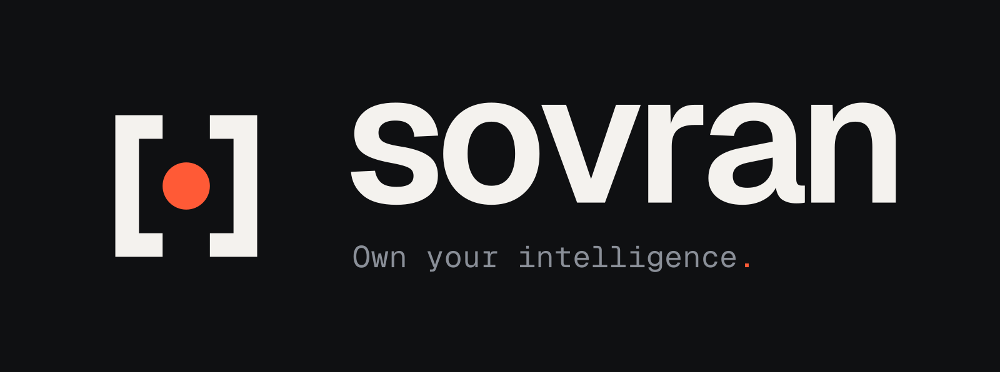
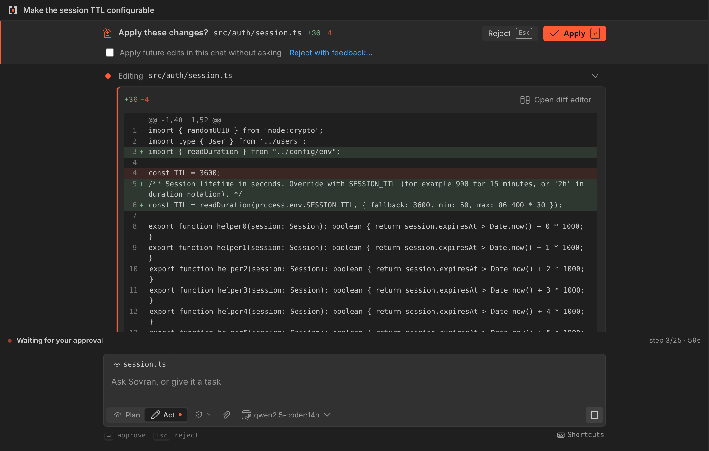
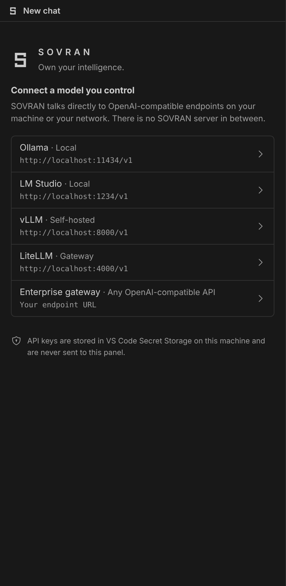
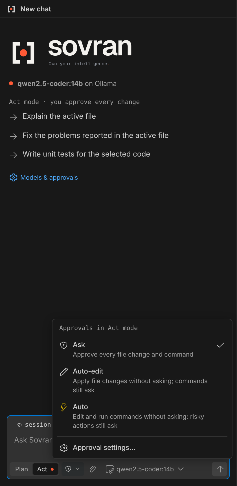

<p align="center">
  
</p>

<p align="center">An open-source AI coding agent for VS Code, built for the models you control.<br>Local, self-hosted, or behind your company's gateway.</p>

<p align="center">
  <a href="https://github.com/Minells/sovran/actions/workflows/ci.yml"></a>
  <a href="LICENSE"></a>
  <a href="package.json"></a>
</p>

<p align="center">
  <a href="https://minells.github.io/Sovran-Website/"><strong>Official website</strong></a> ·
  <a href="https://minells.github.io/Sovran-Website/documentation/">Documentation</a> ·
  <a href="https://marketplace.visualstudio.com/items?itemName=minells.sovran">VS Code Marketplace</a> ·
  <a href="https://github.com/Minells/sovran/issues">Issues</a>
</p>

> **Preview (0.1).** Real-server compatibility testing is ongoing. The manifest identifies the extension as
> `minells.sovran`; Marketplace publication is still marked pending in the project documentation. If the listing is
> unavailable, use the source/VSIX instructions below. The website URL becomes live after Pages is enabled in the
> separate [website repository](https://github.com/Minells/Sovran-Website).

## Why SOVRAN

Connect an OpenAI-compatible Chat Completions endpoint to your workspace. Sovran reads and searches code, proposes
edits, runs approved commands, and uses the results to continue a task. It connects directly to your chosen provider:
there is no SOVRAN backend, account, or telemetry. Code and context you attach are sent to that provider.

## Features

- **Your model infrastructure:** presets for Ollama, LM Studio, vLLM, and LiteLLM, plus custom endpoints and company
  gateways. Native tool calls can fall back to a prompted protocol; quality depends on the model and server.
- **Plan and Act:** read-only exploration in Plan; file edits and command execution in Act. You can choose a different
  model for each mode.
- **Reviewable changes:** native VS Code diffs, undoable file edits, configurable Ask / Auto-edit / Auto approvals,
  and protected-path and risky-command guardrails.
- **Recovery:** per-response checkpoints, retry, and message editing with optional rewind. Checkpoints cover the
  agent's file tools, not terminal side effects.
- **Visible context:** `@` file mentions, a context meter, automatic compaction, and `/explain`, `/fix`, `/test`,
  `/review`, `/doc`, `/compact`, and `/new`. Add custom Markdown prompts under `.sovran/commands/`.
- **Attachments:** extract text locally from PDF, modern Office, and OpenDocument files; list ZIP contents. Paste or
  attach images for vision-capable models.
- **Native Git inspection:** status, diff, history, commit/file inspection and branches in trusted Plan and Act workspaces.
- **MCP tools:** user-configured stdio and Streamable HTTP servers, with per-tool Off / Ask / Allow controls.
- **Native workspace experience:** theme-aware chat, editor-tab chats, terminal output, and searchable per-workspace
  history that can persist across restarts.

<p align="center">
  
</p>
<p align="center"><em>Example session from the repository's screenshot gallery.</em></p>

<details>
<summary>Setup and approval screenshots</summary>
<p align="center">
  
  
</p>
</details>

## Installation

Requires **VS Code 1.95+** and an OpenAI-compatible model endpoint. Local inference also needs a running model server
and hardware suitable for the chosen model.

Check [VS Code Marketplace](https://marketplace.visualstudio.com/items?itemName=minells.sovran) for publication. To
build and install the current preview from source, use Node.js 22 (the current extension CI version):

```bash
git clone https://github.com/Minells/sovran.git
cd sovran
npm ci --ignore-scripts
npm run package
code --install-extension sovran-0.1.0.vsix
```

`npm run package` builds the extension before creating the VSIX. If the version changes, use the generated filename.
Alternatively, choose **Extensions → … → Install from VSIX…**.

## Getting started

1. Open a workspace and select **Sovran** in the Activity Bar.
2. Choose a provider in guided setup, then confirm its base URL and authentication.
3. Select a model reported by your server or enter its ID. Keys stay in VS Code Secret Storage.
4. Ask a question in **Plan**. Switch to **Act** when you want changes, and review proposals above the composer.

Try `/explain` with a selected function, `/review @src/example.ts` with an actual workspace file, or “Find the failing
validation path, propose a fix, and add a regression test.” The agent's result depends on your model and context.

<kbd>Alt+M</kbd> switches modes, <kbd>Alt+A</kbd> cycles approvals, and <kbd>Esc</kbd> stops a run. While an approval is
pending, <kbd>Enter</kbd> approves from the empty input and <kbd>Esc</kbd> rejects. See the
[complete user guide](docs/USER_GUIDE.md) for shortcuts, attachments, recovery, and MCP configuration.

## Configuration

Use the gear in the Sovran view title for **Models**, **Approvals**, **Agent**, **MCP**, **Context**, and **Data**.
Provider and security-sensitive settings are read from user scope; a repository cannot override them.

For YAML configuration, run **Sovran: Open Model Config File (config.yaml)** to create `~/.sovran/config.yaml`.
The file and provider settings stay in sync. This example assumes the listed model is available in Ollama:

```yaml
providers:
  - id: ollama
    name: Ollama
    baseUrl: http://localhost:11434/v1
    auth: none
    models:
      - id: qwen2.5-coder:14b
        contextWindow: 32768

defaultModel: ollama/qwen2.5-coder:14b
```

Never put API keys in YAML or settings. Use **Sovran: Set Provider API Key…**.

| Setting | Default | Purpose |
|---|---|---|
| `sovran.providers` | `[]` | OpenAI-compatible endpoints |
| `sovran.defaultModel` / `sovran.planModel` | `""` | Act / Plan model; blank Plan inherits Act |
| `sovran.approvals.mode` | `ask` | `ask`, `edits` (Auto-edit), or `auto` |
| `sovran.tools.disabled` / `sovran.tools.forceAsk` | `[]` | Disable native tools or always review their calls |
| `sovran.agent.maxIterations` | `25` | Model round-trips per request |
| `sovran.terminal.timeoutSeconds` | `120` | Command timeout |
| `sovran.context.autoCompact` | `true` | Summarize older turns when needed |
| `sovran.sessions.persist` | `true` | Save chats across restarts |
| `sovran.mcp.servers` | `[]` | User-configured MCP servers |

See the [full settings reference](docs/USER_GUIDE.md#settings),
[provider examples](docs/USER_GUIDE.md#provider-setup-examples), and
[configuration sync behavior](docs/USER_GUIDE.md#configuration-file-configyaml).

## Safety and current limits

Ask mode reviews file changes and commands, except explicitly allowed command prefixes. Auto-edit and Auto are
optional; protected files and risky commands still ask. Plan mode cannot edit or execute, and Restricted Mode stays
in Plan. MCP tools ask until you explicitly allow each one.

Choose endpoints and MCP servers you trust. Chat files and images are **not encrypted at rest**. Terminal side effects
are not checkpointed. Documents supply text, not layout or embedded images; scanned PDFs need OCR elsewhere. MCP
currently supports tools, without OAuth sign-in, resources, prompts, or older SSE-only servers. Compatibility with
all real servers has not been verified.

Read [known limitations](docs/USER_GUIDE.md#known-limitations) and the [security model](SECURITY.md). Report
vulnerabilities through the private reporting route described there, without posting sensitive details publicly.

## Architecture and development

The portable TypeScript core owns the agent loop, tools, providers, permissions, and context. The VS Code host owns
I/O, sessions, secrets, and approval decisions. A sandboxed React webview renders state and sends validated intents.
The official Astro website lives in an independent repository; it adds no dependencies here.

```text
src/core/          portable agent engine, tools, providers, policy, documents, MCP
src/extension/     VS Code host, controller, adapters, sessions, Secret Storage
src/shared/        validated host/webview protocol
webview/           theme-aware React interface
tests/            unit, integration, component, and VS Code smoke tests
```

```bash
npm ci --ignore-scripts
npm run build
npm run check             # strict TypeScript, ESLint, unit/integration/component tests
npm run test:extension    # smoke tests in real VS Code; downloads VS Code
npm run package           # rebuild and create a VSIX
```

Press <kbd>F5</kbd> in VS Code to open an Extension Development Host. See [development](docs/DEVELOPMENT.md),
[architecture](docs/ARCHITECTURE.md), and [release instructions](docs/RELEASING.md).

## Contributing

Read [CONTRIBUTING.md](CONTRIBUTING.md) and the [code of conduct](CODE_OF_CONDUCT.md). Useful contributions include
focused fixes, documentation, tests, and reports from real endpoint configurations. Open an
[issue](https://github.com/Minells/sovran/issues) before a larger change. GitHub Discussions is not enabled.

The [roadmap](docs/ROADMAP.md), [implementation status](docs/IMPLEMENTATION_STATUS.md), and [changelog](CHANGELOG.md)
record plans and progress. Roadmap items are not a promise of availability.

## License

[MIT](LICENSE), © 2026 Minells and SOVRAN contributors. Dependency licenses are listed in
[THIRD_PARTY_NOTICES.md](THIRD_PARTY_NOTICES.md).
