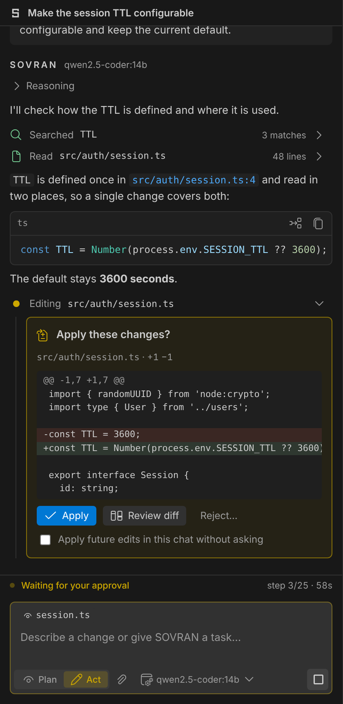
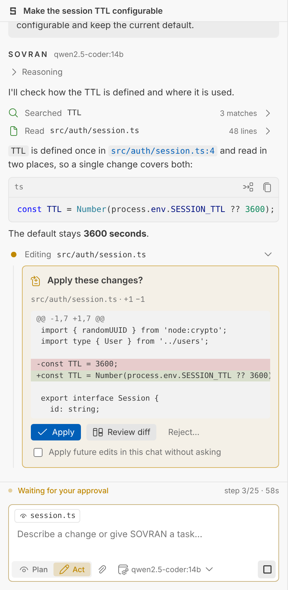

<p align="center">
  
</p>

<h1 align="center">SOVRAN</h1>
<p align="center"><strong>Own Your Intelligence.</strong><br>
An agentic AI coding assistant for VS Code that runs on the models <em>you</em> control:<br>
local, self-hosted, or behind your company's AI gateway.</p>

<p align="center">
  
  &nbsp;
  
</p>

> **Status: preview (0.1).** The core engine, tools, UI and security controls are implemented and covered by automated
> tests. Real-world compatibility testing against every server type is ongoing. See [Known limitations](#known-limitations).

---

## Why SOVRAN

Most AI coding tools assume a specific vendor, a cloud account or a separate editor. SOVRAN assumes none of that.

- **Your models.** SOVRAN works with any OpenAI-compatible Chat Completions endpoint, including Ollama, LM Studio, vLLM, LiteLLM, llama.cpp, LocalAI and internal gateways.
- **Your infrastructure.** The extension talks directly to your endpoint. There is no SOVRAN server, no account and no telemetry.
- **Your code.** Nothing leaves your machine except the requests you send to endpoints you configured.
- **Your control.** Every file change is previewed in VS Code's diff editor, and every command needs your approval. Plan mode is read-only by construction, not by prompt.

## Features

**A real agent, not a chat box.** SOVRAN runs a full agent loop:

1. It reads and searches the workspace.
2. It proposes edits and runs commands.
3. It reads the results and continues until the task is done, with a step limit, a loop guard and cancellation at any time.

It works through ten built-in tools:

| Tool | What it does |
|---|---|
| `read_file` | Reads a file or a line range of it |
| `list_directory` | Lists the contents of a folder |
| `find_files` | Finds files by glob pattern |
| `search_files` | Searches file contents for text or a regular expression |
| `get_workspace_info` | Reports the workspace layout, OS, shell and git branch |
| `get_active_editor_context` | Reads the open file, selection, tabs and diagnostics |
| `write_file` | Creates a new file or replaces one |
| `edit_file` | Replaces one exact piece of text in a file |
| `apply_diff` | Applies several exact edits to one file at once |
| `execute_terminal` | Runs a shell command after you approve it |

**Plan and Act modes.**

| | Plan | Act |
|---|---|---|
| Read & search the workspace | ✓ | ✓ |
| Produce a structured plan | ✓ | ✓ |
| Edit files | ✗ (tools are not even offered) | ✓ with diff approval |
| Run commands | ✗ | ✓ with approval |

The current mode is always visible: blue means read-only, amber means the agent can change things.

**Built for imperfect servers.** "OpenAI-compatible" covers a wide range of behavior, so SOVRAN detects what each model supports:

- **Rejected tool definitions:** when a server rejects native tool calling, SOVRAN switches that model to a prompted tool protocol automatically and remembers it.
- **Unusual response formats:** it handles servers that ignore streaming and models that emit `<tool_call>` or `<think>` tags as text.
- **Reasoning output:** reasoning streams (`reasoning_content`) are shown separately and never sent back to the model.

Errors tell you what went wrong and how to fix it.

**Native to VS Code.** Proposed edits open in the native diff editor and are applied as undoable edits (Ctrl+Z works). Commands are mirrored in a SOVRAN terminal. Other native touches:

- The model picker is a Quick Pick, and the status bar shows the model and mode.
- The UI follows your theme, including high contrast.
- Keyboard first: <kbd>Enter</kbd> sends, <kbd>Shift+Enter</kbd> adds a newline, <kbd>Esc</kbd> stops, <kbd>Alt+M</kbd> switches mode.

**Context you can see.** The active file or selection is attached as a chip you can toggle. You can add more files from a Quick Pick. Large files are paged and long conversations are trimmed to the model's context window.

**Conversations that persist.** Chats are saved per workspace and restored after restart, and you can search, rename or delete them.

## Installation

From the VS Code Marketplace (once published): search for **SOVRAN** in the Extensions view.

From a VSIX file:

```bash
code --install-extension sovran-0.1.0.vsix
```

Requires VS Code 1.95 or later.

## Quick start

1. Click the **SOVRAN** icon in the Activity Bar.
2. Pick a preset (Ollama, LM Studio, vLLM, LiteLLM) or **Enterprise gateway**, and adjust the URL.
3. If the endpoint needs a key, VS Code asks for it in a secure input. Keys are stored in VS Code Secret Storage, never in settings.
4. Click **Test connection**, add a discovered model, and start a chat.

<p align="center"></p>

## Provider setup examples

Providers live in your **user** settings (`sovran.providers`). Workspace settings are ignored for security; see [Security](#security).

**Ollama (local)**
```jsonc
{ "id": "ollama", "name": "Ollama", "baseUrl": "http://localhost:11434/v1",
  "auth": { "type": "none" }, "models": [{ "id": "qwen2.5-coder:14b", "contextWindow": 32768 }] }
```

**LM Studio (local)**
```jsonc
{ "id": "lmstudio", "name": "LM Studio", "baseUrl": "http://localhost:1234/v1", "auth": { "type": "none" },
  "models": [{ "id": "your-loaded-model" }] }
```

**vLLM on a GPU server**
```jsonc
{ "id": "vllm", "name": "GPU cluster", "baseUrl": "https://vllm.internal.example/v1",
  "auth": { "type": "bearer" }, "timeoutSeconds": 300,
  "models": [{ "id": "my-coder", "contextWindow": 131072, "toolMode": "native" }] }
```
For native tool calling, start vLLM with tool parsing enabled (for example `--enable-auto-tool-choice --tool-call-parser <parser>`). Otherwise use `"toolMode": "prompted"`.

**Enterprise gateway with a custom auth header**
```jsonc
{ "id": "corp", "name": "Company AI Gateway", "baseUrl": "https://ai-gateway.example.com/v1",
  "auth": { "type": "header", "headerName": "api-key" },
  "headers": { "X-Team": "platform" },
  "models": [{ "id": "coder-large", "contextWindow": 128000 }] }
```

### Model options

| Field | Meaning |
|---|---|
| `contextWindow` | Tokens the model accepts. SOVRAN never guesses; the default is 32 768 |
| `maxOutputTokens` | Reserved for the reply (default 4 096) |
| `toolMode` | `auto` (detect, the default), `native`, `prompted` or `none` |
| `temperature` | Sent only when set |

## Settings

| Setting | Default | Description |
|---|---|---|
| `sovran.providers` | `[]` | Model endpoints. User scope only |
| `sovran.defaultModel` | `""` | `providerId/modelId` for new chats |
| `sovran.agent.maxIterations` | `25` | Maximum model round-trips per request |
| `sovran.approvals.fileEdits` | `ask` | `ask` shows a diff for every change. `auto` applies changes without asking, but protected paths still ask |
| `sovran.approvals.allowedCommands` | `[]` | Commands that run without asking, for example `npm test`. Never applies to commands that contain shell operators |
| `sovran.security.protectedPaths` | `.env`, keys, `.git/` and others | Always ask before reading or changing these. Their contents are excluded from search |
| `sovran.terminal.timeoutSeconds` | `120` | Command timeout |
| `sovran.terminal.mirrorToTerminal` | `true` | Show command output in a SOVRAN terminal |
| `sovran.context.includeActiveEditor` | `true` | Attach the active file or selection by default |
| `sovran.context.maxToolResultChars` | `20000` | Size cap for each tool result sent to the model |
| `sovran.context.projectInstructions` | `true` | Use `AGENTS.md` from the workspace root (trusted workspaces only) |
| `sovran.sessions.persist` | `true` | Save chats in VS Code workspace storage |
| `sovran.diff.openOnProposal` | `true` | Open the diff editor automatically for proposed edits |

## Security

SOVRAN executes actions on your behalf, so its safety controls are enforced in code rather than in the prompt:

- **Credentials:** API keys stay in Secret Storage and in the extension host. They are never sent to the UI and are redacted from logs and errors.
- **Approvals:** every file write is reviewed in a diff and checked for changes made while it waited. Every command is previewed, and the preview warns about risky patterns and invisible characters.
- **Workspace boundary:** paths are confined to the workspace, including through symlinks. Commands run inside the workspace with a timeout and can be cancelled.
- **Untrusted repositories:** a cloned repository cannot change your providers, approval policy or allow-list, because those settings are read from user scope only. In Restricted Mode, SOVRAN stays in Plan mode.

Read [SECURITY.md](SECURITY.md) for the threat model and known limitations. Choose endpoints you trust: everything the agent reads is sent to the model you configured.

## Known limitations

- **Quality depends on the model.** Tool-trained coding models work best. Small models may need `"toolMode": "prompted"`, and some still struggle with multi-step tasks.
- **No checkpoints yet.** Edits are undoable per file with Ctrl+Z, but there is no one-click rollback of a whole run (planned).
- **No MCP support yet** (planned).
- **Search is built in.** It skips files over 1 MB and is slower than ripgrep on very large repositories (planned improvement).
- **Long-running commands time out.** Watchers and dev servers are not supported as agent commands.
- **Session files are plaintext.** They are not encrypted at rest.
- **Not yet verified on every server.** Compatibility is covered by mocked-server tests, and the real-server compatibility matrix is still being run. See [docs/IMPLEMENTATION_STATUS.md](docs/IMPLEMENTATION_STATUS.md).

## Development

```bash
npm install
npm run build
npm run check
```

`npm run check` runs typecheck, lint and tests. Press <kbd>F5</kbd> in VS Code to launch an Extension Development Host. See [docs/DEVELOPMENT.md](docs/DEVELOPMENT.md) for the architecture, the UI dev harness and the testing strategy, and [CONTRIBUTING.md](CONTRIBUTING.md) for guidelines.

Documentation: [Architecture](docs/ARCHITECTURE.md) · [Product requirements](docs/PRODUCT_REQUIREMENTS.md) · [Roadmap](docs/ROADMAP.md) · [Decisions](docs/DECISIONS.md) · [Releasing](docs/RELEASING.md)

## License

SOVRAN is released under the [MIT License](LICENSE). Third-party components and their licenses are listed in [THIRD_PARTY_NOTICES.md](THIRD_PARTY_NOTICES.md).
