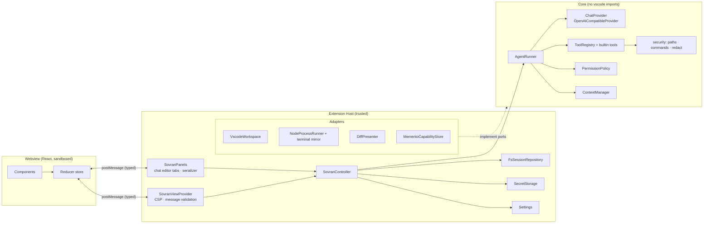
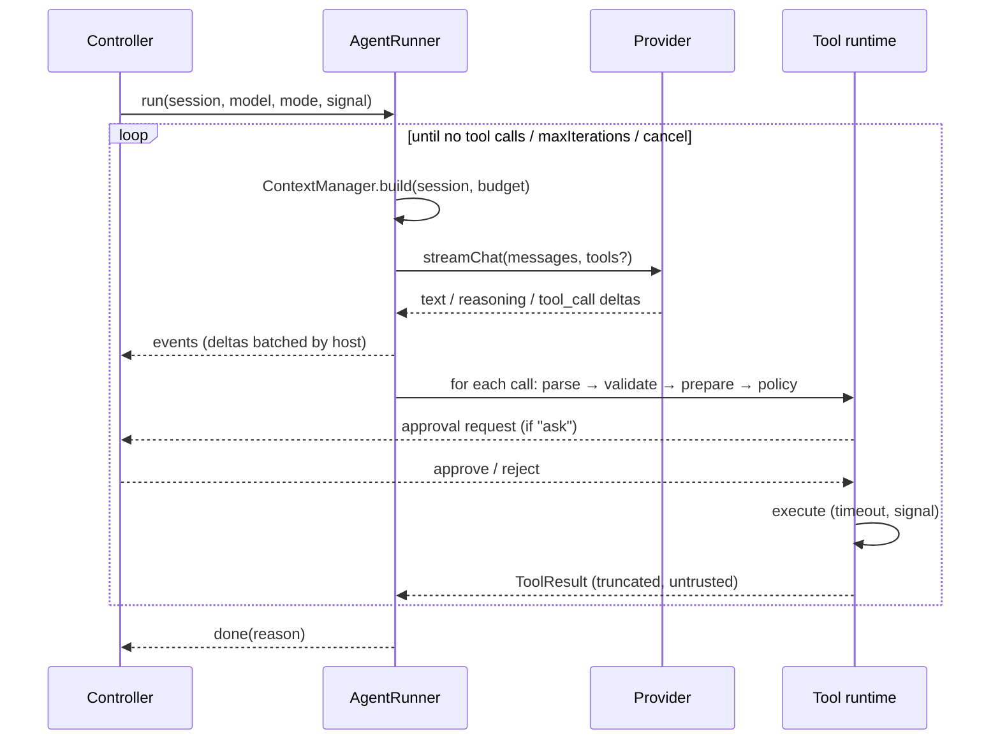
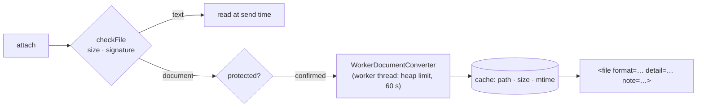
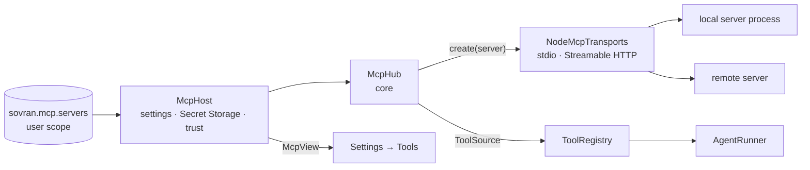

# SOVRAN Architecture

## 1. Principles

1. **The host is authoritative.** The Extension Host owns sessions, runs, approvals, credentials and
   all network and file I/O. Each webview (the Activity Bar view, or a chat in an editor tab) is a disposable
   projection: it can be destroyed at any time and rehydrates from a full state snapshot.
2. **The core is portable.** `src/core/**` never imports `vscode` (ESLint `no-restricted-imports`).
   VS Code capabilities reach the core through **ports** (interfaces) implemented by **adapters** in
   `src/extension/adapters`.
3. **Policy lives in code, not in prompts.** Mode restrictions, path confinement and approvals are enforced by the
   tool runtime. The system prompt only *describes* them.
4. **Everything external is untrusted.** This covers model output, tool arguments, file contents, terminal output and
   webview messages. All of them are validated or treated as data.

## 2. Layering



## 3. Source layout

```
src/
  core/                      portable engine (no vscode)
    ports.ts                 WorkspacePort · ProcessPort · ApprovalPort · Logger
    providers/               ChatProvider, OpenAI-compatible adapter, SSE, errors, capabilities
    agent/                   AgentRunner, events, system prompt, tagged-stream parser, prompted tools
    tools/                   registry (built-in tools plus tool sources), tool types, edit engine, builtin tools
    mcp/                     MCP client: settings rules and schema, launch resolution, McpHub, tool names, results
    permissions/             policy, command analysis
    security/                path confinement, secret redaction, globs
    context/                 token estimation, context budget & truncation
    documents/               document attachments: signature sniffing, safe ZIP/XML readers, converters to Markdown
    config/                  config.yaml parsing and validation (positions for diagnostics), provider merging
    sessions/                session model, repository interface, generated titles
  shared/protocol.ts         host ⇄ webview message contracts (types + zod schemas)
  extension/                 VS Code integration (composition root)
    extension.ts · SovranViewProvider.ts · SovranPanels.ts · webviewHtml.ts · SovranController.ts · config.ts · configFileHost.ts · mcpHost.ts · services.ts
    adapters/                VscodeWorkspace · NodeProcessRunner · DiffPresenter · FsSessionRepository · MementoCapabilityStore · NodeMcpTransports ·
                             WorkerDocumentConverter + documentWorker (bundled separately as dist/documentWorker.js)
webview/                     React app (Vite) → dist/webview
tests/                       unit · integration (mock OpenAI server) · fixtures · extension (test-electron)
```

## 4. Provider layer

```ts
interface ChatProvider {
  readonly id: string;
  listModels(signal?: AbortSignal): Promise<string[]>;
  streamChat(req: ChatRequest, signal: AbortSignal): AsyncIterable<ProviderEvent>;
}
type ProviderEvent =
  | { type: 'text'; text: string }
  | { type: 'reasoning'; text: string }
  | { type: 'tool_call_delta'; index: number; id?: string; name?: string; argumentsDelta?: string }
  | { type: 'finish'; reason: string | null }
  | { type: 'usage'; promptTokens?: number; completionTokens?: number };
```

`OpenAICompatibleProvider` behavior:

- Requests are `POST {baseUrl}/chat/completions` with `stream: true`. Only widely supported fields are
  sent (`model`, `messages`, `stream`, `tools`, `temperature`, `max_tokens`). `tool_choice`,
  `parallel_tool_calls` and `stream_options` are deliberately omitted because several servers reject
  them.
- Auth is `none`, `bearer` (`Authorization: Bearer <key>`) or a custom `header` (for example
  `api-key`, `x-api-key`). The key is fetched lazily from SecretStorage per request.
- Responses are dispatched on `content-type`: `text/event-stream` goes to the SSE parser, JSON goes to the single-shot parser. Servers
  that ignore `stream:true` still work.
- The SSE parser tolerates `\r\n`, multi-line `data:`, comments, `[DONE]` and a missing `[DONE]`.
- Reasoning can arrive as `delta.reasoning_content` or `delta.reasoning`. Inline `<think>` tags are split by
  the agent's tagged-stream parser.
- Timeouts: a connect/first-byte timeout plus an **idle** timeout between chunks. Local servers
  may need a minute to load a model, so the default is 120 s and it is configurable per provider.
- Errors are normalized to `ProviderError{kind, status, message, hint}`. The kinds are `auth`, `not_found`,
  `rate_limit`, `context_length`, `tools_unsupported`, `bad_request`, `server`, `network`, `tls`,
  `timeout`, `cancelled` and `invalid_response`. Messages are redacted. Hints are actionable (for example
  *"404 on /models: does the base URL need a `/v1` suffix?"*).

**Capability resolution.** Each model has a `toolMode` of `auto | native | prompted | none` and an optional
`contextWindow` / `maxOutputTokens`. `auto` resolves through the `CapabilityStore` (persisted in
globalState). A `tools_unsupported` error while in native mode downgrades the model to `prompted`,
emits a notice and retries the same iteration once.

**Vision.** `vision` is `true`, `false` or unset. Unset, images are sent until a server refuses them: a refusal
(`vision_unsupported`, read from a 4xx/5xx that mentions images when the request carried some, and not a size or count
limit) stores `vision: false` in the `CapabilityStore`, emits a notice and retries the iteration with each image's
label in its place. The refusal applies to the rest of the run even if the store does not keep it.

## 5. Agent loop



- **Iteration limit.** `sovran.agent.maxIterations` (default 25). Reaching it ends the run with a clear notice.
- **Loop guard.** The same tool and identical arguments failing 3 times in a row stops the run.
- **Self-correction.** Unknown tools, invalid JSON, schema violations, failed edits and denied actions
  become tool results that the model can read and react to.
- **Prompted mode.** Tool schemas are rendered into the system prompt. The model replies with
  `<tool_call>{"name": "...", "arguments": {...}}</tool_call>`. Results come back as
  `<tool_result name="..." id="...">...</tool_result>` in a user message. A streaming
  `TaggedStreamParser` hides `<tool_call>` and `<think>` blocks from visible text as they stream.
- **Sequential execution.** Calls execute one at a time, even when the model emits several (safer
  approvals, deterministic diffs).

### Events (core → host)

`assistant_started`, `text_delta`, `reasoning_delta`, `tool_calls` (parsed, pending),
`tool_status` (`awaiting_approval | running`), `tool_output` (streamed terminal chunks),
`message_committed` (assistant or tool message finalized), `notice`, `done` (`completed | cancelled |
max_iterations | error`).

## 6. Tools

```ts
interface ToolDefinition<A> {
  name: string; description: string; schema: z.ZodType<A>;
  risk: 'read' | 'write' | 'execute';
  prepare?(args: A, ctx): Promise<Prepared>;       // e.g. compute diff, resolve cwd; errors → tool error
  execute(args: A, ctx, prepared): Promise<ToolResult>;
}
interface ToolResult { content: string; display?: ToolDisplay; isError?: boolean }
```

| Tool | Risk | Notes |
|---|---|---|
| `read_file` | read | Optional line range. Output is capped, with a hint to page by range. Reads **unsaved editor buffers** when open |
| `list_directory` | read | Depth ≤ 3. Skips VCS and dependency folders. Capped |
| `find_files` | read | Glob through `workspace.findFiles` (respects `files.exclude`) |
| `search_files` | read | Literal or regex. Skips binary and >1 MB files. Results capped |
| `get_workspace_info` | read | Roots, OS, shell, git branch (from `.git/HEAD`), top-level entries |
| `get_active_editor_context` | read | Active file, selection, open tabs, diagnostics of the active file |
| `get_diagnostics` | read | Cached Problems for workspace/active file; literal file/folder, severity and count filters; protected and external paths omitted |
| `list_document_symbols` | read | Document symbols from the VS Code language provider in a trusted workspace |
| `go_to_definition` | read | Definition locations for a file, line and column in a trusted workspace |
| `find_references` | read | Reference locations for a file, line and column in a trusted workspace |
| `web_fetch` | read | One approved public URL in trusted Plan/Act; robots and same-origin redirects share the direct IP-bound transport; bounded HTML/robots worker |
| `write_file` | write | Create or overwrite. The diff is computed in `prepare` |
| `edit_file` | write | Exact `old_string` → `new_string`. Must be unique unless `replace_all` |
| `apply_diff` | write | N search/replace blocks applied atomically. All of them must match uniquely |
| `execute_terminal` | execute | `cwd` confined to the workspace. Timeout, abort, output cap, process-tree kill |

**Edit engine.** Matching normalizes CRLF → LF and writes back using the file's original EOL style. A
**staleness check** (content hash at `prepare` versus at `execute`) refuses to overwrite a file that
changed while it awaited approval. Writes go through `WorkspaceEdit` so they are **undoable**
(Ctrl+Z) and respect open editors.

**Plan mode** registers only `read` tools with the model, *and* the runtime rejects any non-read call.

**Semantic navigation.** The optional `WorkspacePort.querySemantic` capability passes through the checkpoint
decorator to the VS Code adapter. The adapter opens the text document to use its current buffer and invokes the
language provider on demand. The core checks lexical and canonical paths before querying and before returning
locations, and bounds scanned candidates, result count and output size. The adapter stops waiting after ten
seconds or on cancellation and discards late results. VS Code provider commands do not expose cancellation tokens.

**Tool sources.** Besides the built-in tools, the registry asks its `ToolSource`s for tools on every request, so tools
can come and go during a run (the next model round-trip sees the change). A source never shadows a built-in tool. A
tool may give its JSON Schema directly (`ToolDefinition.parameters`) instead of deriving it from its zod schema; such
schemas are not cached. The MCP hub is the only source today (section 12).

**On-demand loading** (`core/tools/loading.ts`, `core/tools/routing.ts`, ADR-034). Every tool belongs to a *unit*:
`core` (files, editing, terminal, workspace and editor context) is always offered; `diagnostics`, `symbols`, `web`,
`git`, `git.changes`, `git.remote` and one `mcp:<server>` per MCP server are offered once the chat has loaded them
(`Session.toolUnits`). With `sovran.tools.loading: auto`, `AgentRunner.run` starts each run with: the units of the tool
calls already in the chat (first run only), every unit when all definitions fit 10% of the input budget (else every
native unit when those fit), and what `routeToolUnits` reads in the user's message and slash command. During the run
the model can call `load_tools`, a virtual tool the runner builds from the current index, or call a tool it has not
loaded, which loads the unit and returns without running it. Loading only adds visibility: availability stays with the
registry and permissions with the policy, and dispatch still requires the definition to have been offered in that
request.

Units accumulate and their tools follow `load_tools`, after the core; the index lists every loadable unit in a stable
order. Without a new load the system prompt and the tools array are byte-identical between steps, and a load leaves the
earlier tools as a prefix, which keeps server prompt caches valid. Units are chosen afresh only when that cache is gone
anyway: `Session.toolUnitsBasis` records the model and compaction boundary they were chosen for, and when either
changes (another model, `/compact`, or a compaction inside a run) the chat keeps the units its visible messages called
or loaded, plus budget and router units.

Two smaller savings apply in every mode. `ToolRegistry.schema` drops JSON Schema constraints that tell the model nothing
(`minLength: 1`, guard `maxLength`s of 1,000 or more, zod's safe-integer bounds) while zod still validates them. The
result limit given to tools is the user's `maxToolResultChars`, lowered to 15% of a small window's input budget, so
tools page at a size the model can afford. With every unit loaded the request is the same as
with loading off (`all`). The router is pattern matching over the user's own words (English and Italian), never over
attachments, files or tool results; `tests/fixtures/routingCorpus.ts` measures its precision and recall per unit.

## 7. Permissions

`PermissionPolicy.decide(tool, args, ctx) → allow | ask | deny`:

| Risk | Plan | Act |
|---|---|---|
| read | allow (ask if path matches `protectedPaths`) | same |
| write | **deny** | `ask` in Ask mode · `allow` in Auto-edit and Auto mode, or when a session grant exists. Protected paths always ask |
| execute (MCP tool) | **deny** | `ask` in every approval mode, Auto included, unless the user allowed that tool (`allowedTools`): then `allow`, labelled *auto* |
| execute | **deny** | Guardrails first: high-risk patterns, protected paths or paths outside the workspace named in the command, and invisible characters always **ask**. Otherwise `allow` if the command matches `approvals.allowedCommands` (no shell metacharacters `; & \| \` $ > < ( ) { }` or newlines) or the mode is Auto, else `ask` |

**Approval modes** (`ask` · `edits` · `auto`) decide how much Act mode may do without asking. The mode is per window,
starts from `sovran.approvals.mode`, and is read before every action (`RunOptions.policy`), so a change during a run
applies to the next action. Actions that run without asking carry `ToolMessage.autoApproved` with the policy's reason,
which the transcript shows as an *auto* badge.

Act mode is unavailable when the workspace is untrusted (Restricted Mode).

## 8. Context management

- **Budget** = `contextWindow` (configured, or 32 768 by default) − `maxOutputTokens` (4 096) − tool-schema estimate.
- **Token estimate** ≈ `chars / 3.5`. It is intentionally conservative, because code tokenizes densely.
- **Assembly order:** system prompt (mode rules, tool protocol, environment, `AGENTS.md` project
  instructions in trusted workspaces) → history → the latest user message with attached context blocks
  (`<context><file path=… lines=…>…</file></context>`).
- **Images.** A user message without images stays a plain string. With images, its content becomes parts: for each
  image a text label (`<image name=… type=… size=…/>`) and an `image_url` part with a data URL, then the text. When
  the model does not take images, or an image is gone from the store, only the label is sent, with a `note` saying
  why. Image parts count in the budget by an estimate from their size (`estimateImageTokens`, at most 1 600).
- **Over budget:**
  1. Elide old tool results outside the last two turns.
  2. Drop the oldest whole turns, never splitting an assistant tool-call message from its tool results.
  3. Middle-truncate the largest remaining tool results.
- Individual tool results are capped at `context.maxToolResultChars` (20 000) with head and tail kept.

### Document attachments

Attached files are classified by their first bytes (`sniffFile`), never by extension: text (UTF-8, or UTF-16 with a
byte-order mark), a document container (PDF, ZIP) or an unsupported family (image, audio, video, legacy Office,
archive, executable), each refused with its own message.



- **Converters** (`src/core/documents`): `pdf.ts` (pdf.js, text layer only, `## Page N`), `docx.ts`, `xlsx.ts`,
  `pptx.ts` (following OPC relationships, not fixed paths), `odf.ts` (all three OpenDocument kinds) and a listing for
  plain ZIP archives. They write into a `MarkdownBudget` and stop reading once it is full, so a 300-page PDF costs
  only the pages that are sent; the result says how far it got (`pages 1–40 of 300`).
- **Isolation.** `convert.ts` is the only entry point and runs only in `documentWorker.ts` (ESLint forbids importing
  the parsers elsewhere in `src/extension`). The host talks to it through `DocumentConverterPort`.
- **When.** A document is converted when it is attached (so problems show at once) and checked again at send time;
  an unchanged file comes from a small cache keyed by path, size and mtime. Protected files ask before anything is read.
- **For the model.** The attachment carries `format`, `detail` and a `note` saying the text was extracted and that
  images, charts and layout are not included. A file that only looked like a document (it is not a valid PDF or ZIP)
  and has no binary content is attached as text, as before.
- **`read_file`.** The tool converts documents through the same `DocumentReader` (a larger budget, 400 000
  characters, which the agent pages through by line), decodes UTF-16 text and explains images. It needs
  `WorkspacePort.readBytes` and `ToolContext.documents`; without them it behaves as before. The `CheckpointRecorder`
  that wraps the workspace during a run forwards `readBytes`.

### Image attachments

PNG, JPEG, WebP and GIF files (recognized by signature, in binary files only) and images pasted into the chat input
(`attachImage`, base64 bounded by the zod schema and checked again by the host) become `AttachmentView.image` chips
with their size. When the message is sent, `collectImages` reads each file again, stores the bytes in the
`ImageStorePort` under the chat (`FsImageStore`: `images/<session>/<sha256>.<ext>` in workspace storage;
`MemoryImageStore` when chats are not persisted) and records `UserMessage.images` (name, type, size, never bytes).
Before a run, the controller loads the chat's images as data URLs (`RunOptions.images`), unless the model is known
not to take them. The webview never receives image bytes; images are deleted with the chat.

## 9. Sessions and persistence

Canonical messages are stored provider-agnostic:

```ts
type SessionMessage =
  | { role: 'user'; id; content; attachments?: ContextAttachment[]; createdAt }
  | { role: 'assistant'; id; content; reasoning?; toolCalls?: ToolCall[]; model?; error?; createdAt }
  | { role: 'tool'; id; toolCallId; toolName; content; status: 'success'|'error'|'denied'|'cancelled'; display?; durationMs; createdAt };
```

The wire format (native `tool_calls` versus prompted text) is derived at request time, so switching
models mid-conversation works. Sessions are stored as one JSON file per session plus an `index.json`
under the workspace storage directory (`ExtensionContext.storageUri`, falling back to
`globalStorageUri`). Writes are atomic (temporary file, then rename). Secrets are never stored in sessions.
Interrupted runs are restored as `cancelled`.

## 10. Host ⇄ webview protocol

All contracts are in `src/shared/protocol.ts`.

**Webview → host** messages (validated with zod and rejected if malformed):
- Chat and runs: `ready`, `send`, `cancel`, `approval` (with an optional `allowCommand` for "Always allow", checked
  against the approved command by the host), `openApprovalDiff`, `retry`, `editMessage`, `compact`, `restoreCheckpoint`
- Sessions: `newSession`, `openSession`, `openSessionInEditor`, `renameSession`, `deleteSession`
- Surfaces: `focused` (the webview got keyboard focus; commands without a surface of their own target the last one)
- Modes and models: `setMode`, `setApprovalMode`, `pickModel`, `selectModel`, `setModel`, `addModels`, `discoverModels`
- Context: `attachFiles`, `attachPath`, `removeAttachment`, `setIncludeEditor`, `suggestFiles`, `listDirectory` (one workspace
  folder for the attach menu, confined like every path) and `uploadFiles` (opens the system file dialog: the only way to
  attach a file from outside the workspace, because the user picks it in a host-owned dialog)
- Editor: `openFile`, `openExternal` (http/https only), `insertCode`
- Providers: `saveProvider` (with an optional `requestId` for the guided setup), `deleteProvider`, `testProvider`, `setApiKey`
- MCP servers: `saveMcpServer` (with an optional `token` for Secret Storage, never sent back), `deleteMcpServer` (the
  host confirms), `setMcpServerEnabled`, `restartMcpServer`, `setMcpToolPolicy` (`off`, `ask` or `allow`) and
  `setMcpToken` (a native password box). `approval` takes `allowTool` for *Always allow* on an MCP call; the host takes
  the server and tool from the pending request, never from the webview
- Settings and views: `updateSetting` (a discriminated union of the keys the Settings view may change, each with its
  own value schema), `openSettings`, `showLogs`, `setView`. `setNativeToolOverride` adds or removes one name
  from a native override list. The host serializes these edits and reads the latest user value before writing.

**Host → webview** messages:
- `state`: a full snapshot for one surface (its kind, its chat, run, approvals, screen and composer context, plus the
  shared state: providers without secrets, `hasKey` booleans, sessions index, live sessions, modes, settings view,
  workspace and trust info, and the MCP servers with their status and tools, `hasToken` booleans)
- `patch` (partial state), and the incremental `messageUpsert`, `messageDelta` and `messageRemoved`
- `toolOutput`, `notice`, `providerTest`, `providerSaved`, `fileSuggestions` (with an `active`/`open` hint for files open in
  the editor), `directoryListing` and `focusComposer`

The host batches text deltas (about 40 ms) to limit message traffic, and flushes them before any full snapshot so a
delta never adds text the snapshot already has. The webview keeps only UI ephemera (draft text, the chat it shows,
expanded rows) in `vscode.setState`.

### Surfaces

The controller serves several webviews at once, called *surfaces*: the Activity Bar view (`sidebar`, always present,
its webview attached while the view is resolved) and any number of chats in editor tabs (`panel`, from
`SovranPanels`). Every webview → host message carries the surface it came from (`handle(msg, surfaceId)`).

- **Per surface:** the chat shown, the screen (`view`), attachments and the include-editor toggle. Panels only show
  chats: `setView` for a list or settings from a panel opens it in the sidebar.
- **Per chat (session):** the run, pending approvals, grants and the debounced save. Chats run in parallel; one chat runs
  at most one run, and tools within a run still execute one at a time. Each run gets its own `ApprovalPort`, so its
  requests are tagged with the chat and reach only the surface that shows it.
- **Shared:** providers, models, Plan/Act mode, approval mode, settings, the sessions index and `liveSessions` (chats
  open in a tab or running, with `needsApproval`), broadcast to every surface.
- **One place per chat.** A chat is shown by at most one surface: opening a chat that is already shown focuses that
  surface, and moving the view's chat to an editor tab gives the view a new chat. A run continues when its tab closes;
  an approval nobody can see raises a notification whose *Review* reopens the chat.
- **Routing.** Chat messages (`messageUpsert`/`Delta`/`Removed`, `toolOutput`, run, approvals, usage) go to the surface
  showing the chat; replies (`fileSuggestions`, `directoryListing`, `providerSaved`, `providerTest`) go to the
  requester, because request ids are only unique within one webview.
- **Editor context.** A focused chat tab is VS Code's active editor, which reports no active text editor. While a chat
  tab is active, the last text editor counts as "the active file" as long as it is still visible (the code beside the
  chat). Files and diffs opened from a chat tab open beside it, never over it.
- **Restore.** The webview saves the id of the chat it shows; `registerWebviewPanelSerializer` reopens a tab with that
  chat after a restart (the id is validated, and an unknown id gives a new chat).

### Approvals in the UI

The decision for a pending approval is a card between the conversation and the chat input (`ApprovalBar`), so it never
scrolls away, and it is where the eyes are after sending a message; it replaces the run status line while it waits. It
uses neutral surfaces and VS Code's own button colours (`--vscode-button-*`), not the brand accent. It holds every decision (approve, reject, reject with feedback, always allow, apply future edits in this
chat) and the short facts a decision needs (the command, warnings, the reason an unattended mode still asks). A long
proposal (the diff) is read inline under its tool call (`ApprovalDetail`), which cannot be folded while pending.

### Pinned message

While the conversation scrolls, `StickyPrompt` pins the user message whose answer is being read: the last one whose top
has reached the top of the view (`pickPinned`), so it behaves like `position: sticky` on each message, including the
next message pushing it out. It is a separate overlay rather than CSS sticky so that a long message shows in two lines
without anything in the conversation changing size. It listens to the scroll area itself (one animation frame per
burst of scroll events) and applies the push-out offset directly, so the conversation is not rendered again while
scrolling. The transcript's `scroll-padding-top` keeps revealed proposals clear of it.

Enter approves and Escape rejects (`approvalKey`). Keys already in use keep their meaning: text being typed in any
field (the empty chat input passes them on), menus, lists and dialogs, a focused button (Enter presses it), handlers
that called `preventDefault`, modified keys and auto-repeat. Enter is ignored for 400 ms after the bar appears so an
Enter meant for something else cannot approve an unseen action; Escape, the safe direction, is never delayed. The
proposal's diff editor contributes Apply and Reject (`sovran.acceptProposal`/`rejectProposal`, enabled by the
`sovran.approvalPending` context key; Ctrl/Cmd+Enter applies), which resolve the approval named by the diff's URI.

## 11. Checkpoints, rewind and compaction (v0.2)

- **Checkpoints.** For each run, the host wraps the workspace port in a `CheckpointRecorder` (decorator). It snapshots a file
  right before the run's *first* write to it, recording whether the file existed and its original content, plus the
  hash of the final content. Tools are unaware of it.
  - The snapshots are saved per user message (`UserMessage.checkpoint`) in workspace storage.
  - `planRestore` marks each file *clean* or *modified* (changed after the agent wrote it). `restoreFiles` writes files back or
    deletes created ones through undoable `WorkspaceEdit`s.
  - Retrying while keeping files merges the snapshots: the earliest "before" and the latest "after" win.
- **Rewind.** Retry and edit truncate the conversation at a user message. Discarded responses' checkpoints can be
  restored in reverse chronological order.
- **Compaction.** `planCompaction` cuts at a user-message boundary, so tool calls are never split from their results.
  `summarize` runs a tool-free completion with a structured prompt. `Session.compaction.firstKeptId` marks the boundary:
  `messagesForModel()` sends only later messages, and `buildContext` puts the summary in the system prompt. The UI still
  shows the full transcript. Auto-compaction triggers at most once per run, and only when whole turns would otherwise be dropped.
- **Search.** `WorkspacePort.searchText` is optional. The VS Code host implements it with the bundled ripgrep, passing
  only negative globs, because a positive `--glob` would override `.gitignore`.

## 12. MCP client



- **Core (`src/core/mcp`).** `McpHub` keeps one SDK `Client` per configured server and turns each tool of a connected
  server into a `ToolDefinition` with `risk: 'execute'`, its JSON Schema as `parameters` and a model-facing name
  `mcp__<server>__<tool>` (cleaned and given a short hash when it is not a valid function name or longer than 64
  characters). Transports come from an injected `McpTransportFactory`, so the core spawns nothing itself and tests
  connect real SDK servers in memory. Connections carry a generation number, so callbacks of a replaced or stopped
  connection do nothing. The SDK's `listChanged` option keeps tool lists current.
- **Settings.** `sovran.mcp.servers` follows the `command`/`url` shape every MCP host uses. Changes are applied in place:
  names, timeouts and tool policies (`allowedTools`, `disabledTools`) never reconnect; the command, arguments,
  environment, folder, URL, headers or auth do. In the UI, editing a connection saves it disconnected and removes
  its old credential before changing the destination. User settings entries Sovran cannot read stay in place. `rules.ts` holds what the webview form shares with the host's zod schema, without zod.
- **Launch (`launch.ts`).** `${workspaceFolder}`, `${userHome}` and `${env:NAME}` are expanded; any other variable, or
  one without a value, is reported instead of becoming an empty string. The token from Secret Storage goes to
  `Authorization: Bearer`, a named header, or an environment variable. Local servers start in the first workspace
  folder with the SDK's minimal environment plus proxy, certificate, locale and temp variables (`MCP_INHERITED_ENV`).
- **Calls.** Arguments are shown in the approval card as indented JSON. A call has the server's timeout (reset by
  progress, at most one hour in total) and is cancelled with the run. Results become text (`results.ts`): images, audio
  and binary resources become labels, structured content is shown as JSON when there is no text. The runner then masks
  secrets, including the MCP tokens, and truncates the result like any other.
- **Policy.** MCP tools are offered in Act mode only and never in untrusted workspaces (servers do not even start there).
  `PolicyInput.mcp` makes them ask in every approval mode until the user allows the tool; the hub reads the policy at
  call time, so a tool turned off mid-run is refused.
- **Lifecycle.** Servers start in the background at activation (and when the workspace is trusted), never blocking it;
  `deactivate` awaits `McpHost.dispose()`, which ends HTTP sessions and stops local processes. Disconnect withdraws
  tools before closing the transport. Restart checks its generation after closing so it cannot revive a replaced or
  disabled connection.

### Managed profiles and chat selection

`core/mcp/catalog.ts` holds reviewed versions, profiles and explicit tool allowlists. The host owns installation in
extension global storage via bundled lockfiles and `npm ci --ignore-scripts`. Managed browser launch checks Node and
known system Chrome and resolves the installed entrypoint. Hosted launch validates the registry endpoint, headers and
authentication placement before retrieving a credential. GitHub requires a token. Context7 can connect without a key
and uses the same Secret Storage bearer path when a key is present. The registry holds connection defaults and
reviewed profiles. User settings hold server IDs, enabled state and tool policies. Custom-server conversion is explicit. Remote extension-profile attachment is unavailable. Hub discovery,
list refresh and dispatch retain the profile bound independently of Off/Ask/Allow. Browser outputs remain outside
chat retention; returned local paths are data and are never dereferenced by the client.

`Session.excludedToolGroups` stores chat exclusions; absence preserves existing behavior. `ToolRegistry` is still the
single registry: model visibility and execution use the same selection, with current session exclusions read again
before/after approval and by delayed-effect revalidation. Native user disabled/force-Ask overrides stay global.
The controller projects available group counts and estimated schema cost per surface, refreshing after MCP, mode,
trust or settings changes. Cost is an estimate, not a budget-based eviction mechanism. The UI keeps the internal
`mcp` settings route for compatibility. **Browse Catalog** and **Custom MCP Server** both create disconnected entries
and use the same status projection. Only the custom editor and advanced details show connection mechanics.

Tool discovery and transport stay behind the hub. A future tool lookup or Code Mode can use the existing registry and
controlled dispatch boundary, including live workspace trust, approvals, group exclusions and cancellation. The
[catalog assessment](plans/2026-11-12-mcp-catalog-expansion.md) records the upstream review and follow-up criteria.

## 13. Extension points for the future

- **MCP:** resources and prompts (as attachments and slash commands), OAuth for remote servers, the server's
  `instructions` in the system prompt, servers in `config.yaml`, and loading the SDK only when a server is configured.
- **Checkpoints:** the edit engine already centralizes writes, so a snapshot store can hook in there.
- **CLI:** a Node composition root that implements the ports with `fs`, `child_process` and a TTY approval prompt.
- **Copilot bridge:** a `LanguageModelChatProvider` that wraps `ChatProvider`.
