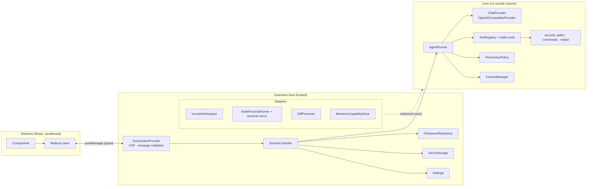
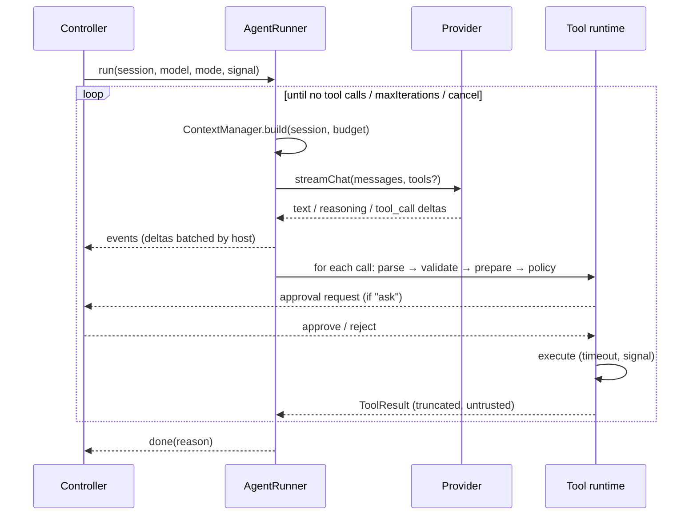

# SOVRAN Architecture

## 1. Principles

1. **The host is authoritative.** The Extension Host owns sessions, runs, approvals, credentials and
   all network and file I/O. The webview is a disposable projection: it can be destroyed at any time
   and rehydrates from a full state snapshot.
2. **The core is portable.** `src/core/**` never imports `vscode` (ESLint `no-restricted-imports`).
   VS Code capabilities reach the core through **ports** (interfaces) implemented by **adapters** in
   `src/extension/adapters`.
3. **Policy lives in code, not in prompts.** Mode restrictions, path confinement and approvals are enforced by the
   tool runtime. The system prompt only *describes* them.
4. **Everything external is untrusted.** This covers model output, tool arguments, file contents, terminal output and
   webview messages. All of them are validated or treated as data.

## 2. Layering



## 3. Source layout

```
src/
  core/                      portable engine (no vscode)
    ports.ts                 WorkspacePort · ProcessPort · ApprovalPort · Logger
    providers/               ChatProvider, OpenAI-compatible adapter, SSE, errors, capabilities
    agent/                   AgentRunner, events, system prompt, tagged-stream parser, prompted tools
    tools/                   registry, tool types, edit engine, builtin tools
    permissions/             policy, command analysis
    security/                path confinement, secret redaction, globs
    context/                 token estimation, context budget & truncation
    sessions/                session model, repository interface
  shared/protocol.ts         host ⇄ webview message contracts (types + zod schemas)
  extension/                 VS Code integration (composition root)
    extension.ts · SovranViewProvider.ts · SovranController.ts · config.ts · statusBar.ts · logger.ts
    adapters/                VscodeWorkspace · NodeProcessRunner · DiffPresenter · FsSessionRepository · MementoCapabilityStore
webview/                     React app (Vite) → dist/webview
tests/                       unit · integration (mock OpenAI server) · fixtures · extension (test-electron)
```

## 4. Provider layer

```ts
interface ChatProvider {
  readonly id: string;
  listModels(signal?: AbortSignal): Promise<string[]>;
  streamChat(req: ChatRequest, signal: AbortSignal): AsyncIterable<ProviderEvent>;
}
type ProviderEvent =
  | { type: 'text'; text: string }
  | { type: 'reasoning'; text: string }
  | { type: 'tool_call_delta'; index: number; id?: string; name?: string; argumentsDelta?: string }
  | { type: 'finish'; reason: string | null }
  | { type: 'usage'; promptTokens?: number; completionTokens?: number };
```

`OpenAICompatibleProvider` behavior:

- Requests are `POST {baseUrl}/chat/completions` with `stream: true`. Only widely supported fields are
  sent (`model`, `messages`, `stream`, `tools`, `temperature`, `max_tokens`). `tool_choice`,
  `parallel_tool_calls` and `stream_options` are deliberately omitted because several servers reject
  them.
- Auth is `none`, `bearer` (`Authorization: Bearer <key>`) or a custom `header` (for example
  `api-key`, `x-api-key`). The key is fetched lazily from SecretStorage per request.
- Responses are dispatched on `content-type`: `text/event-stream` goes to the SSE parser, JSON goes to the single-shot parser. Servers
  that ignore `stream:true` still work.
- The SSE parser tolerates `\r\n`, multi-line `data:`, comments, `[DONE]` and a missing `[DONE]`.
- Reasoning can arrive as `delta.reasoning_content` or `delta.reasoning`. Inline `<think>` tags are split by
  the agent's tagged-stream parser.
- Timeouts: a connect/first-byte timeout plus an **idle** timeout between chunks. Local servers
  may need a minute to load a model, so the default is 120 s and it is configurable per provider.
- Errors are normalized to `ProviderError{kind, status, message, hint}`. The kinds are `auth`, `not_found`,
  `rate_limit`, `context_length`, `tools_unsupported`, `bad_request`, `server`, `network`, `tls`,
  `timeout`, `cancelled` and `invalid_response`. Messages are redacted. Hints are actionable (for example
  *"404 on /models: does the base URL need a `/v1` suffix?"*).

**Capability resolution.** Each model has a `toolMode` of `auto | native | prompted | none` and an optional
`contextWindow` / `maxOutputTokens`. `auto` resolves through the `CapabilityStore` (persisted in
globalState). A `tools_unsupported` error while in native mode downgrades the model to `prompted`,
emits a notice and retries the same iteration once.

## 5. Agent loop



- **Iteration limit.** `sovran.agent.maxIterations` (default 25). Reaching it ends the run with a clear notice.
- **Loop guard.** The same tool and identical arguments failing 3 times in a row stops the run.
- **Self-correction.** Unknown tools, invalid JSON, schema violations, failed edits and denied actions
  become tool results that the model can read and react to.
- **Prompted mode.** Tool schemas are rendered into the system prompt. The model replies with
  `<tool_call>{"name": "...", "arguments": {...}}</tool_call>`. Results come back as
  `<tool_result name="..." id="...">...</tool_result>` in a user message. A streaming
  `TaggedStreamParser` hides `<tool_call>` and `<think>` blocks from visible text as they stream.
- **Sequential execution.** Calls execute one at a time, even when the model emits several (safer
  approvals, deterministic diffs).

### Events (core → host)

`assistant_started`, `text_delta`, `reasoning_delta`, `tool_calls` (parsed, pending),
`tool_status` (`awaiting_approval | running`), `tool_output` (streamed terminal chunks),
`message_committed` (assistant or tool message finalized), `notice`, `done` (`completed | cancelled |
max_iterations | error`).

## 6. Tools

```ts
interface ToolDefinition<A> {
  name: string; description: string; schema: z.ZodType<A>;
  risk: 'read' | 'write' | 'execute';
  prepare?(args: A, ctx): Promise<Prepared>;       // e.g. compute diff, resolve cwd; errors → tool error
  execute(args: A, ctx, prepared): Promise<ToolResult>;
}
interface ToolResult { content: string; display?: ToolDisplay; isError?: boolean }
```

| Tool | Risk | Notes |
|---|---|---|
| `read_file` | read | Optional line range. Output is capped, with a hint to page by range. Reads **unsaved editor buffers** when open |
| `list_directory` | read | Depth ≤ 3. Skips VCS and dependency folders. Capped |
| `find_files` | read | Glob through `workspace.findFiles` (respects `files.exclude`) |
| `search_files` | read | Literal or regex. Skips binary and >1 MB files. Results capped |
| `get_workspace_info` | read | Roots, OS, shell, git branch (from `.git/HEAD`), top-level entries |
| `get_active_editor_context` | read | Active file, selection, open tabs, diagnostics of the active file |
| `write_file` | write | Create or overwrite. The diff is computed in `prepare` |
| `edit_file` | write | Exact `old_string` → `new_string`. Must be unique unless `replace_all` |
| `apply_diff` | write | N search/replace blocks applied atomically. All of them must match uniquely |
| `execute_terminal` | execute | `cwd` confined to the workspace. Timeout, abort, output cap, process-tree kill |

**Edit engine.** Matching normalizes CRLF → LF and writes back using the file's original EOL style. A
**staleness check** (content hash at `prepare` versus at `execute`) refuses to overwrite a file that
changed while it awaited approval. Writes go through `WorkspaceEdit` so they are **undoable**
(Ctrl+Z) and respect open editors.

**Plan mode** registers only `read` tools with the model, *and* the runtime rejects any non-read call.

## 7. Permissions

`PermissionPolicy.decide(tool, args, ctx) → allow | ask | deny`:

| Risk | Plan | Act |
|---|---|---|
| read | allow (ask if path matches `protectedPaths`) | same |
| write | **deny** | `ask` (default) · `allow` if `approvals.fileEdits = auto` or a session grant exists. Protected paths always ask |
| execute | **deny** | `ask` · `allow` only if the command matches `approvals.allowedCommands` **and** contains no shell metacharacters (`; & \| \` $ > < ( ) { }` and newlines) |

Act mode is unavailable when the workspace is untrusted (Restricted Mode).

## 8. Context management

- **Budget** = `contextWindow` (configured, or 32 768 by default) − `maxOutputTokens` (4 096) − tool-schema estimate.
- **Token estimate** ≈ `chars / 3.5`. It is intentionally conservative, because code tokenizes densely.
- **Assembly order:** system prompt (mode rules, tool protocol, environment, `AGENTS.md` project
  instructions in trusted workspaces) → history → the latest user message with attached context blocks
  (`<context><file path=… lines=…>…</file></context>`).
- **Over budget:**
  1. Elide old tool results outside the last two turns.
  2. Drop the oldest whole turns, never splitting an assistant tool-call message from its tool results.
  3. Middle-truncate the largest remaining tool results.
- Individual tool results are capped at `context.maxToolResultChars` (20 000) with head and tail kept.

## 9. Sessions and persistence

Canonical messages are stored provider-agnostic:

```ts
type SessionMessage =
  | { role: 'user'; id; content; attachments?: ContextAttachment[]; createdAt }
  | { role: 'assistant'; id; content; reasoning?; toolCalls?: ToolCall[]; model?; error?; createdAt }
  | { role: 'tool'; id; toolCallId; toolName; content; status: 'success'|'error'|'denied'|'cancelled'; display?; durationMs; createdAt };
```

The wire format (native `tool_calls` versus prompted text) is derived at request time, so switching
models mid-conversation works. Sessions are stored as one JSON file per session plus an `index.json`
under the workspace storage directory (`ExtensionContext.storageUri`, falling back to
`globalStorageUri`). Writes are atomic (temporary file, then rename). Secrets are never stored in sessions.
Interrupted runs are restored as `cancelled`.

## 10. Host ⇄ webview protocol

All contracts are in `src/shared/protocol.ts`.

**Webview → host** messages (validated with zod and rejected if malformed):
`ready`, `send`, `cancel`, `approval`, `newSession`, `openSession`, `renameSession`,
`deleteSession`, `setMode`, `selectModel`, `attachFiles`, `removeAttachment`, `toggleEditorContext`,
`openDiff`, `openFile`, `saveProvider`, `deleteProvider`, `testProvider`, `discoverModels`,
`setApiKey`, `openSettings`, `setView`.

**Host → webview** messages:
- `state`: a full snapshot (providers without secrets, `hasKey` booleans, sessions index, active
  session, run state, approvals, workspace and trust info)
- incremental `messageAppended`, `messageDelta` and `messageReplaced`
- `toolOutput`, `run`, `approvals`, `notice` and `providerResult`

The host batches text deltas (about 40 ms) to limit message traffic. The webview keeps only UI
ephemera (draft text, scroll position, expanded rows) in `vscode.setState`.

## 11. Checkpoints, rewind and compaction (v0.2)

- **Checkpoints.** For each run, the host wraps the workspace port in a `CheckpointRecorder` (decorator). It snapshots a file
  right before the run's *first* write to it, recording whether the file existed and its original content, plus the
  hash of the final content. Tools are unaware of it.
  - The snapshots are saved per user message (`UserMessage.checkpoint`) in workspace storage.
  - `planRestore` marks each file *clean* or *modified* (changed after the agent wrote it). `restoreFiles` writes files back or
    deletes created ones through undoable `WorkspaceEdit`s.
  - Retrying while keeping files merges the snapshots: the earliest "before" and the latest "after" win.
- **Rewind.** Retry and edit truncate the conversation at a user message. Discarded responses' checkpoints can be
  restored in reverse chronological order.
- **Compaction.** `planCompaction` cuts at a user-message boundary, so tool calls are never split from their results.
  `summarize` runs a tool-free completion with a structured prompt. `Session.compaction.firstKeptId` marks the boundary:
  `messagesForModel()` sends only later messages, and `buildContext` puts the summary in the system prompt. The UI still
  shows the full transcript. Auto-compaction triggers at most once per run, and only when whole turns would otherwise be dropped.
- **Search.** `WorkspacePort.searchText` is optional. The VS Code host implements it with the bundled ripgrep, passing
  only negative globs, because a positive `--glob` would override `.gitignore`.

## 12. Extension points for the future

- **MCP:** an `McpToolSource` that registers external tools in the `ToolRegistry` with `risk:'execute'`
  semantics by default.
- **Checkpoints:** the edit engine already centralizes writes, so a snapshot store can hook in there.
- **CLI:** a Node composition root that implements the ports with `fs`, `child_process` and a TTY approval prompt.
- **Copilot bridge:** a `LanguageModelChatProvider` that wraps `ChatProvider`.
