# SOVRAN user guide

Detailed extension reference. For a quick introduction, see the [project README](../README.md) or the [official website](https://minells.github.io/Sovran-Website/).

<p align="center">
  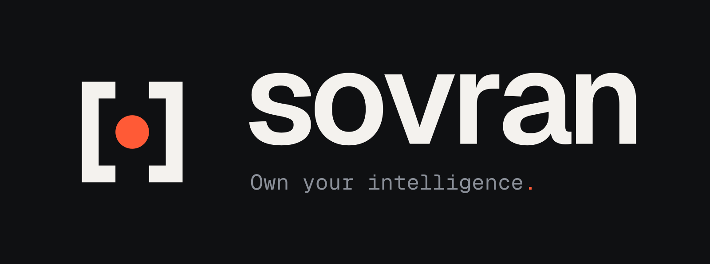
</p>

<p align="center">An agentic AI coding assistant for VS Code that runs on the models <em>you</em> control:<br>
local, self-hosted, or behind your company's AI gateway.</p>

<p align="center">
  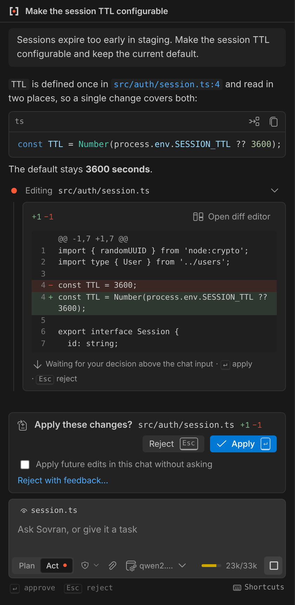
  &nbsp;
  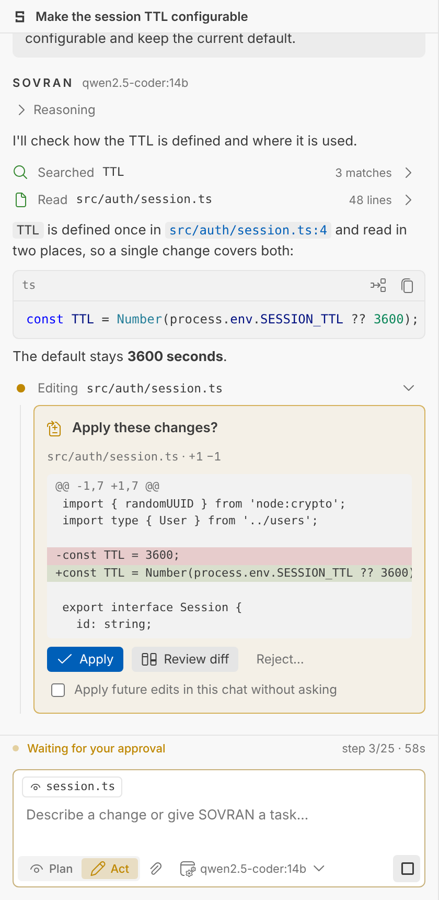
</p>

> **Status: preview (0.1).** The core engine, tools, UI and security controls are implemented and covered by automated
> tests. Real-world compatibility testing against every server type is ongoing. See [Known limitations](#known-limitations).

---

## Why Sovran

Most AI coding tools assume a specific vendor, a cloud account or a separate editor. Sovran assumes none of that.

- **Your models.** Sovran works with any OpenAI-compatible Chat Completions endpoint, including Ollama, LM Studio, vLLM, LiteLLM, llama.cpp, LocalAI and internal gateways.
- **Your infrastructure.** The extension talks directly to your endpoint. There is no Sovran server, no account and no telemetry.
- **Your code.** Nothing leaves your machine except the requests you send to endpoints you configured.
- **Your control.** By default every file change is previewed in VS Code's diff editor and every command needs your approval. When you trust the task, Auto-edit and Auto hand over more, while guardrails in code still stop risky actions. Plan mode is read-only by construction, not by prompt.

## Features

**A real agent, not a chat box.** Sovran runs a full agent loop:

1. It reads and searches the workspace.
2. It proposes edits and runs commands.
3. It reads the results and continues until the task is done, with a step limit, a loop guard and cancellation at any time.

It works through ten built-in tools:

| Tool | What it does |
|---|---|
| `read_file` | Reads a file or a line range of it |
| `list_directory` | Lists the contents of a folder |
| `find_files` | Finds files by glob pattern |
| `search_files` | Searches file contents for text or a regular expression |
| `get_workspace_info` | Reports the workspace layout, OS, shell and git branch |
| `get_active_editor_context` | Reads the open file, selection, tabs and diagnostics |
| `write_file` | Creates a new file or replaces one |
| `edit_file` | Replaces one exact piece of text in a file |
| `apply_diff` | Applies several exact edits to one file at once |
| `execute_terminal` | Runs a shell command after you approve it |

**Native Git inspection.** In trusted workspaces, Plan and Act can use `git_status`, `git_diff`, `git_log`,
`git_show` and `git_branches` without an MCP server. They are read-only and never fetch. Select the repository root
explicitly with `repository` (`"."` for a single root, `"rootName/nested"` in multi-root workspaces). Nested repositories
and linked worktrees are supported; native Git does not discover a parent outside your selected root.

Paths are separate, literal repository-relative arguments. `git_diff` supports `scope: "unstaged"`, `"staged"`, or
`"revision"` with `from` and optional `to` (default `HEAD`). Use `names_only`, `offset` and `limit` for concise results.
`git_show` accepts a separate `path` and `start_line`/`end_line` to inspect historical text; `REV:path`, flags and
revision ranges are not accepted as a revision. Commit IDs, branch/tag names and `HEAD~2`/`HEAD^` ancestry are supported.
Bulk patches omit protected paths and detected renames from protected sources. An exact protected-file request uses
the ordinary approval card, including in Auto. Status/history metadata may still name protected files.

Git is resolved from the extension host's PATH outside workspace roots. The host Git must support `--no-lazy-fetch`
(documented in Git 2.48); if it does not, update Git rather than falling back to an unsafe read. Native inspection
disables pagers, fsmonitor, textconv, external diff and configured clean/process filters. Results are bounded, with a
15-second maximum command budget per inspection and 2 MiB maximum historical blob. Very large metadata sets fail
explicitly; large patches are marked truncated. Structured Git output is filtered before it reaches chat and is not
mirrored raw to a terminal. Git runs on the extension host in Remote environments too.

Stage, unstage and commit remain a separate planned increment. Existing custom MCP servers and the terminal retain
their own policies. Native Git settings use the same disabled/always-review controls as other native tools.

**MCP servers for more tools.** Connect [Model Context Protocol](https://modelcontextprotocol.io) servers, local
commands or remote URLs, from **Settings → MCP**, and the agent can use their tools in Act mode: issues, databases,
documentation, browsers, anything a server offers. Each tool asks before it runs until you allow it, in every approval
mode. See [MCP servers](#mcp-servers).

**Plan and Act modes.**

| | Plan | Act |
|---|---|---|
| Read & search the workspace | ✓ | ✓ |
| Produce a structured plan | ✓ | ✓ |
| Edit files | ✗ (tools are not even offered) | ✓ (see approvals below) |
| Run commands | ✗ | ✓ (see approvals below) |

**Approvals in Act mode: Ask, Auto-edit and Auto.** Pick how much Sovran may do without asking from the composer
(<kbd>Alt+A</kbd> cycles), from Settings or with `Sovran: Change Approval Mode…`:

| | Ask (default) | Auto-edit | Auto |
|---|---|---|---|
| File changes | Diff review for each | Applied without asking | Applied without asking |
| Commands | Approve each (allowed commands run directly) | Approve each | Run without asking |
| Protected files, risky commands | Ask | Ask | **Still ask** |

Auto works like Claude Code's auto-accept, with guardrails enforced in code: commands that delete recursively, push or
force-push, publish, use `sudo`, run downloaded or hidden scripts, reach the network, read credentials or touch paths
outside the workspace always stop for you, and so do protected files. The card says why. Everything that ran without
asking carries an *auto* badge, and each response can still be undone with **Undo changes**. Turning Auto on asks for
confirmation once per window, and new windows start in the mode set by `sovran.approvals.mode` (Ask by default).

<p align="center">
  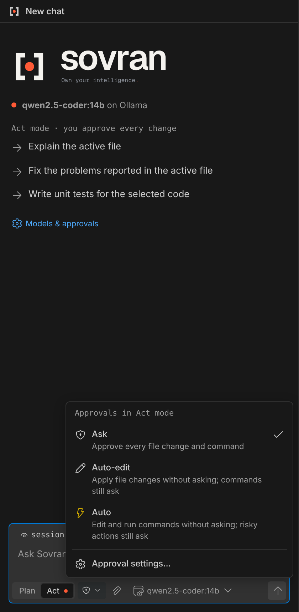
  &nbsp;
  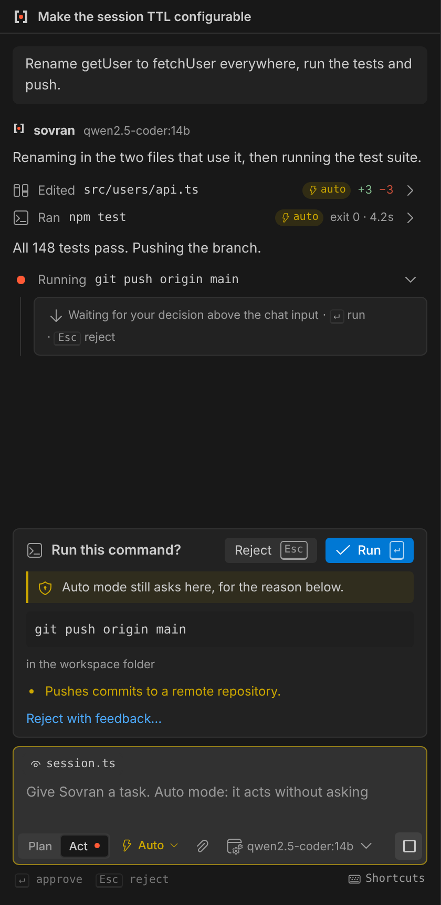
</p>

When Sovran needs you, a **bar right above the chat input** asks: it never scrolls away, and **Reject** and **Apply**
(or **Run**, **Allow**) sit on its right. Press <kbd>Enter</kbd> to approve or <kbd>Esc</kbd> to reject, from the empty chat input or
anywhere in the chat; text you are typing keeps its keys. The diff itself is in the conversation, with line numbers and
wrapped lines, and the proposal's diff editor has **Apply** and **Reject** buttons too (<kbd>Ctrl+Enter</kbd> applies).
**Always allow…** adds a command's prefix (for example `npm test`) to your allowed commands after showing you exactly
what will be allowed, and **Reject with feedback…** tells Sovran what to do instead.

The current mode is always visible in the composer and the status bar.

**Built for imperfect servers.** "OpenAI-compatible" covers a wide range of behavior, so Sovran detects what each model supports:

- **Rejected tool definitions:** when a server rejects native tool calling, Sovran switches that model to a prompted tool protocol automatically and remembers it.
- **Unusual response formats:** it handles servers that ignore streaming and models that emit `<tool_call>` or `<think>` tags as text.
- **Reasoning output:** reasoning streams (`reasoning_content`) are shown separately and never sent back to the model.

Errors tell you what went wrong and how to fix it.

**Native to VS Code.** Proposed edits open in the native diff editor and are applied as undoable edits (Ctrl+Z works). Commands are mirrored in a Sovran terminal. Other native touches:

- The model picker is a Quick Pick, and the status bar shows the model and mode.
- The UI follows your theme, including high contrast.
- Keyboard first: <kbd>Enter</kbd> sends, <kbd>Shift+Enter</kbd> adds a newline, <kbd>Esc</kbd> stops, <kbd>Alt+M</kbd> switches mode, <kbd>Alt+A</kbd> cycles approvals, and while Sovran waits for you <kbd>Enter</kbd> approves and <kbd>Esc</kbd> rejects. A hint line under the composer shows what the keys do right now, and **Shortcuts** lists them all.
- **A start page for every chat:** the model and where it runs, the current mode, starters built from the active file or selection, your latest chats and a tip.
- **Settings in the panel.** The gear in the view title opens Sovran Settings: Act and Plan models, providers, approvals, allowed commands, protected files, limits and context options, without editing JSON.

**Context you can see.** The active file or selection is attached as a chip you can toggle. Files outside the workspace and protected files are never attached automatically, and their chip says so. The paperclip opens the **attach menu**: search the workspace, pick a suggested file (the active editor and open tabs), browse folders from the workspace root, or **upload from your computer** through the system file dialog. Protected files ask before they are attached. Large files are paged and long conversations are trimmed to the model's context window.

**Documents, not just code.** Attach a **PDF**, **Word**, **Excel** or **PowerPoint** file, an **OpenDocument** file (`.odt`, `.ods`, `.odp`) or a **ZIP** archive and Sovran sends the model its text as Markdown: headings, lists, tables, links, every sheet and slide, speaker notes and Excel dates as dates. A ZIP is listed, not extracted. The conversion runs on your machine, in a separate thread with memory and time limits, and nothing is uploaded anywhere. Files are recognized by their content, not their name, and UTF-16 text (what Windows PowerShell writes with `>`) is read too. The chip shows what Sovran found (*PDF document, 12 pages*). The agent reads documents in the workspace the same way: `read_file` returns a PDF or an Office file as Markdown and pages through it. Audio, video and old binary Office files (`.doc`, `.xls`, `.ppt`) are refused with a message that says what to do instead.

**Screenshots for vision models.** Paste a screenshot into the chat input (<kbd>Ctrl+V</kbd>), or attach a PNG, JPEG, WebP or GIF file, and a vision model sees it with your question: each image is sent after its name, so the model can tell several apart. Up to 8 images of 8 MB each per message. Sovran finds out by itself whether a model accepts images: if the server refuses them, it remembers the model as text-only, says so and sends only the images' names (set `"vision"` on the model to decide yourself). Images are kept with the chat in the workspace storage, never in the chat file, and are deleted with the chat.

<p align="center">
  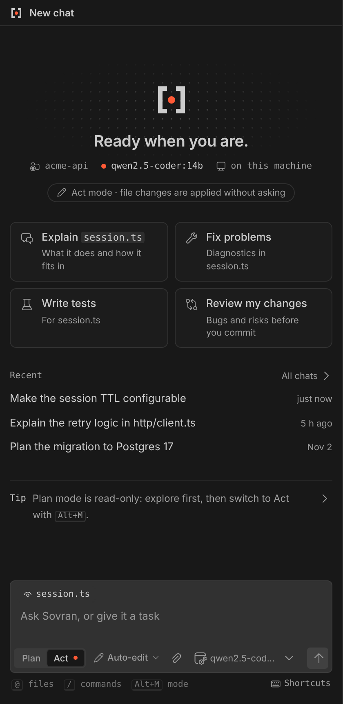
  &nbsp;
  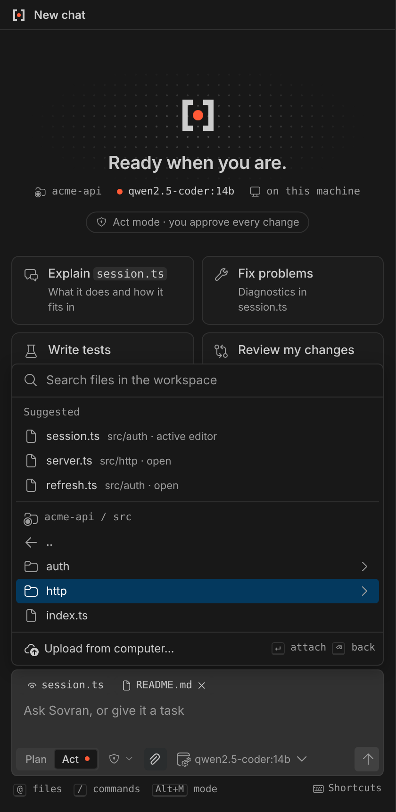
</p>

**Conversations that persist.** Chats are saved per workspace and restored after restart, and you can search, rename or delete them.
While you scroll, the message that started the answer you are reading stays pinned at the top, and the next message
pushes it out, so you always see where each answer starts and ends. Select the pinned message to go back to it.

**Chats in editor tabs, in parallel.** **Open Chat in Editor** (the arrow in the view title) moves the current chat into
an editor tab, beside your code, and **New Chat in Editor** opens another. Each chat runs on its own, so you can let one
work while you talk to another. The chat list in the view shows which chats are working, waiting for your approval or
open in a tab, and selecting one focuses its tab. Tabs come back with their chat after a restart. Lists and settings
stay in the view; the mode, approval mode and models are shared by all chats in the window.

<p align="center">
  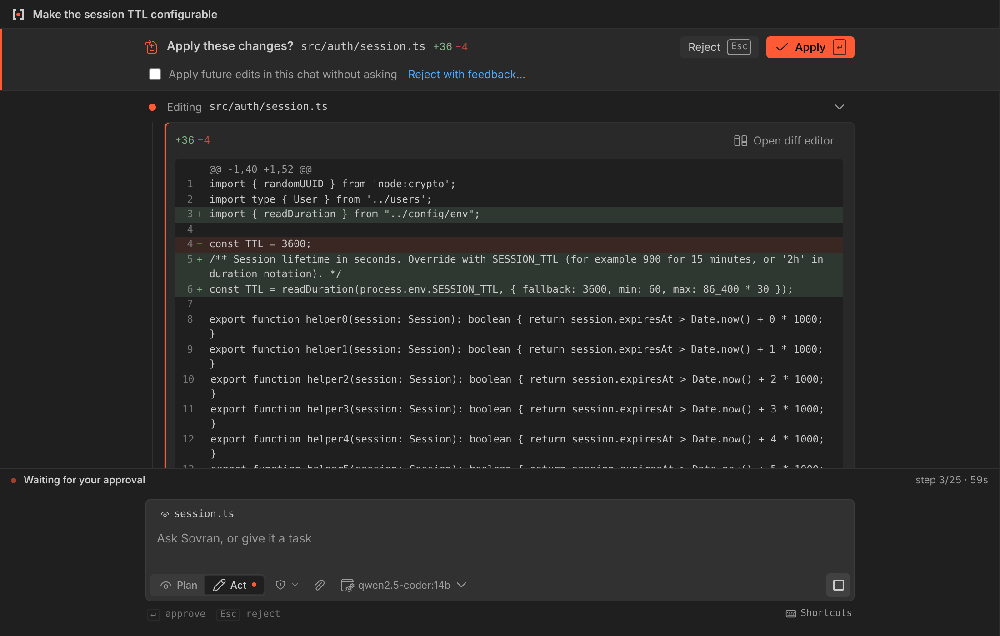
  &nbsp;
  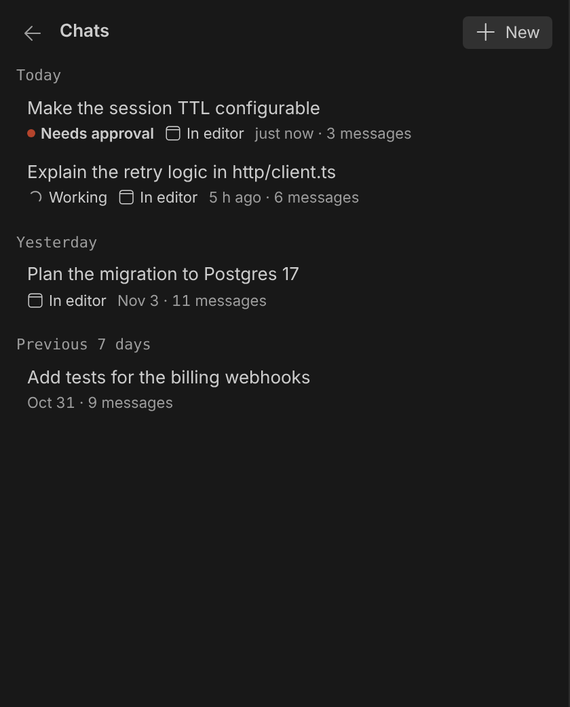
</p>

**Mistakes are cheap to undo.** Every response that changed files ends with a footer: *2 files changed · Undo changes*. Undo puts every file back the way it was before that response and deletes files the agent created. If you edited a file afterwards, Sovran asks before overwriting it.
- **Retry** generates a response again. It sits next to **Copy** under the last response and appears when you hover it or reach it with the keyboard.
- **Edit** (pencil on any message) rewrites a message and continues from there, and can undo the file changes of the discarded responses too.

**You can see the context window.** A meter in the composer shows how full the model's context is. When it fills up, Sovran **summarizes older messages** instead of silently forgetting them. The full transcript stays visible to you. You can also summarize on demand with `/compact` or by clicking the meter.

**`@` files and `/` commands.**
- **`@`:** type `@` to fuzzy-find a workspace file and attach it.
- **Built-in commands:** type `/` for `/explain`, `/fix`, `/test`, `/review`, `/doc`, `/compact` and `/new`.
- **Your own commands:** add Markdown files to `.sovran/commands/` (for example `.sovran/commands/release-notes.md`, using `$ARGUMENTS` for the text you type after the command). They load only in trusted workspaces.

<p align="center">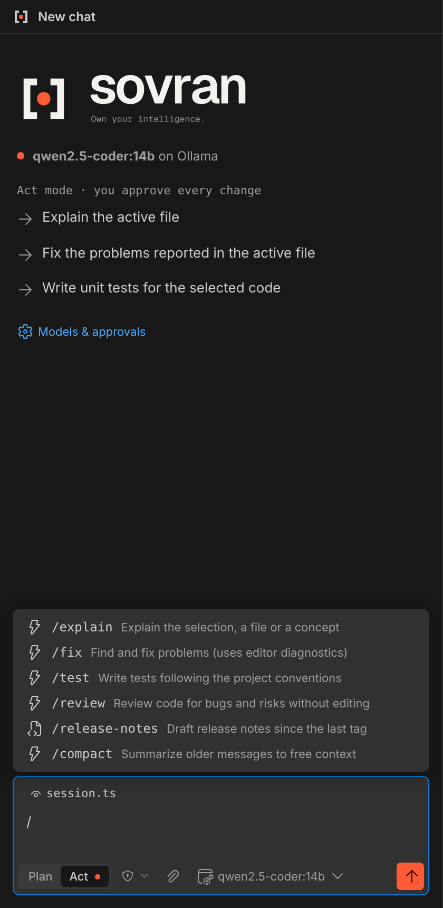</p>

**A model for each mode.** Plan can use a larger reasoning model while Act uses a fast coder. In Plan mode, pick the model from the composer, or choose *Same as Act model*.

**Chat titles written by the model.** Sovran asks the model for a short title in the language you wrote in, while the
answer streams; the first words of your message are shown until it arrives. A small, fast *Title model* is enough, and
models that always reason (such as GLM or DeepSeek-R1) get room to think before they answer. Turn it off in
*Settings → Models → Name chats with the model* to keep the first words.

## Installation

From the VS Code Marketplace (once published): search for **Sovran** in the Extensions view.

From a VSIX file:

```bash
code --install-extension sovran-0.1.0.vsix
```

Requires VS Code 1.95 or later.

## Quick start

1. Click the **Sovran** icon in the Activity Bar. A three-step setup opens.
2. **Choose** where your model runs: Ollama, LM Studio, vLLM, LiteLLM or a **custom endpoint** such as your company gateway.
3. **Connect**: check the URL and authentication. If the endpoint needs a key, VS Code asks for it in a secure input. Keys are stored in VS Code Secret Storage, never in settings. Sovran tests the connection right away.
4. **Choose a model** from the ones the server reports (or type its ID) and start chatting.

Everything else (a separate Plan model, more providers, approvals and limits) lives behind the gear in the view title.

Prefer a text file? Skip the setup and describe your models in [`~/.sovran/config.yaml`](#configuration-file-configyaml).

<p align="center">
  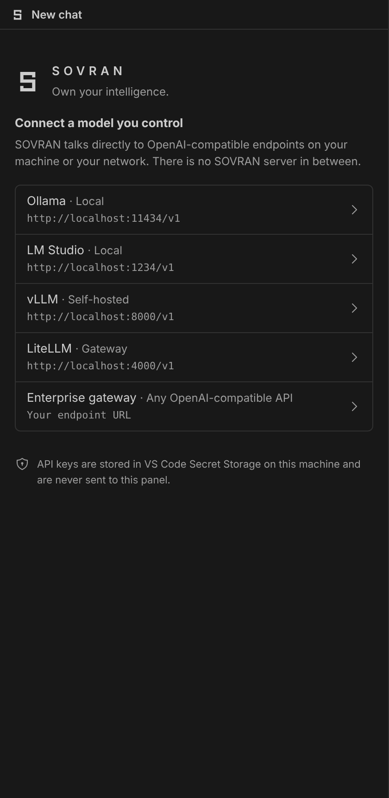
  &nbsp;
  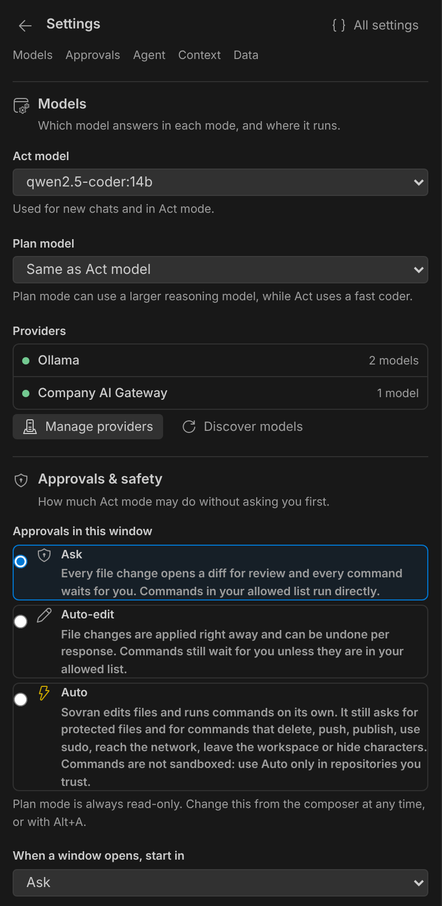
</p>

## Provider setup examples

Providers live in your **user** settings (`sovran.providers`). Workspace settings are ignored for security; see [Security](#security). The guided setup and **Settings → Manage providers** write these entries for you; the examples below are for reference and for advanced options such as extra headers.

**Ollama (local)**
```jsonc
{ "id": "ollama", "name": "Ollama", "baseUrl": "http://localhost:11434/v1",
  "auth": { "type": "none" }, "models": [{ "id": "qwen2.5-coder:14b", "contextWindow": 32768 }] }
```

**LM Studio (local)**
```jsonc
{ "id": "lmstudio", "name": "LM Studio", "baseUrl": "http://localhost:1234/v1", "auth": { "type": "none" },
  "models": [{ "id": "your-loaded-model" }] }
```

**vLLM on a GPU server**
```jsonc
{ "id": "vllm", "name": "GPU cluster", "baseUrl": "https://vllm.internal.example/v1",
  "auth": { "type": "bearer" }, "timeoutSeconds": 300,
  "models": [{ "id": "my-coder", "contextWindow": 131072, "toolMode": "native" }] }
```
For native tool calling, start vLLM with tool parsing enabled (for example `--enable-auto-tool-choice --tool-call-parser <parser>`). Otherwise use `"toolMode": "prompted"`.

**Enterprise gateway with a custom auth header**
```jsonc
{ "id": "corp", "name": "Company AI Gateway", "baseUrl": "https://ai-gateway.example.com/v1",
  "auth": { "type": "header", "headerName": "api-key" },
  "headers": { "X-Team": "platform" },
  "models": [{ "id": "coder-large", "contextWindow": 128000 }] }
```

### Authentication and "HTTP 401"

**API key** (the default) sends the key as `Authorization: Bearer <key>`, the OpenAI standard that gateways, LiteLLM,
vLLM and SDKs such as Continue use. Choose **Custom header** only when your gateway documents another header (for example
Azure's `api-key`). When a server answers 401 or 403, Sovran says what the request carried: no key stored, the key in
the `Authorization` header, or the key in a custom header. Paste the key alone: a `Bearer ` prefix or quotes copied with
it are removed. Some gateways let a key chat but not list models; the connection test then checks chat directly and
says so. To see what your gateway accepts, try from the same machine:

```bash
curl -sS https://your-gateway.example/v1/chat/completions -H "Authorization: Bearer $KEY" -H "Content-Type: application/json" -d '{"model":"your-model","messages":[{"role":"user","content":"ping"}],"max_tokens":16}'
```

### Model options

| Field | Meaning |
|---|---|
| `contextWindow` | Tokens the model accepts (prompt and reply). When unset, Sovran uses what the server reports, else 32 768 |
| `maxOutputTokens` | Tokens kept for the reply, also sent as `max_tokens`. When unset, 4 096 are kept (less if the server's cap or a quarter of the window is smaller) and `max_tokens` is not sent |
| `toolMode` | `auto` (detect, the default), `native`, `prompted` or `none` |
| `vision` | `true` sends attached images, `false` sends only their names. Unset (the default), Sovran sends them and stops if the server refuses |
| `temperature` | Sent only when set |

Both limits can be set per model in **Manage providers** (the *Context* and *Max output* fields), in `config.yaml` or in
`sovran.providers`; a value you set always wins. An empty field shows what Sovran will use and where it comes from
(*server* or *default*), and **Settings → Models** shows the limits of the selected model.

**Limits reported by the server.** Sovran reads them when it tests a connection, discovers models, starts, or sees a new
provider: vLLM and SGLang `max_model_len`, OpenRouter `context_length` and `max_completion_tokens`, `context_window`,
LM Studio's `max_context_length`, and LiteLLM's `/model/info`. Ollama and llama.cpp are not read on purpose: they report
the context the model was trained with, not the one it runs with (Ollama's `num_ctx`), and trusting that would overflow
the real window. A server's maximum output is used as a ceiling, not as the reserve: reserving 32K tokens for every reply
would take them from the conversation. For models that always reason (GLM, DeepSeek-R1), set `maxOutputTokens`
generously, since the reasoning shares that budget.

## Configuration file (`config.yaml`)

You can configure providers in the panel, in a YAML file, or both: the two stay in sync.

- **In the panel:** the guided setup and **Settings → Models → Manage providers** (stored in `sovran.providers`).
- **In a YAML file:** **Settings → Models → Create config.yaml** (or `Sovran: Open Model Config File`) creates
  `~/.sovran/config.yaml` with the providers you already have, followed by commented examples.

From then on, saving the file updates Settings (and Sovran connects to new or changed providers, asking for a key when
one is needed), and changing providers in the panel, or the model you pick, updates the file, keeping your comments and
formatting. To go back to the panel only, choose **Stop using config.yaml…**: keep the file (it is ignored) or move it
to the trash. Your providers stay in Settings either way, and **Use config.yaml again** brings the file back.

```yaml
providers:
  - id: ollama
    name: Ollama
    baseUrl: http://localhost:11434/v1
    auth: none                       # shorthand for { type: none }
    models:
      - id: qwen2.5-coder:14b
        contextWindow: 32768
      - devstral:24b                 # a plain string is a model id

  - id: vllm
    name: GPU cluster
    baseUrl: https://vllm.internal.example/v1
    auth: bearer                     # the key is asked for once and kept in Secret Storage
    timeoutSeconds: 300
    models:
      - id: my-coder
        contextWindow: 131072
        toolMode: native

  - id: corp
    name: Company AI Gateway
    baseUrl: https://ai-gateway.example.com/v1
    auth:
      type: header
      headerName: api-key
    headers:
      X-Team: platform
    models: [coder-large]

# Optional: the models to select when this file is applied (providerId/modelId).
defaultModel: ollama/qwen2.5-coder:14b
planModel: vllm/my-coder
titleModel: ollama/qwen2.5-coder:14b
```

The fields are the same as in `sovran.providers` (see the examples above and [Model options](#model-options)); `name`
defaults to the `id`.

How the sync works:

- **The side you changed wins.** Save the file and Settings follow; change Settings and the file follows. Each side is
  written only when it differs, so the two never bounce changes back and forth.
- **Nothing is lost when syncing starts.** The first time (and when you use an ignored file again) both sides are
  joined: a provider on one side only is added to the other. Where both define the same `id`, a new file wins and a
  file you turn back on loses to Settings, since it was not in use.
- **All or nothing.** The file is applied only when it is entirely valid. Mistakes are underlined in the editor and
  listed in the Problems panel and in Settings, with hints such as *Unknown field "base_url". Did you mean "baseUrl"?*;
  meanwhile Settings keep the last valid version. Sovran never writes into a file that has problems or unsaved edits in
  the editor; it tells you, and keeps your change in Settings.
- **Model choices** (`defaultModel`, `planModel`, `titleModel`) are applied when the file content changes, and the model
  you pick in Sovran is written back, but only to the keys the file already declares.
- **No secrets.** API keys are never read from the file: a field such as `apiKey`, or a header such as `Authorization`,
  is reported as a problem. Keys stay in VS Code Secret Storage.
- **Never from a repository.** The file lives in your home folder, not in the workspace, so a cloned repository cannot
  ship one (the same reason `sovran.providers` is user scope only). `sovran.configFile.enabled` turns the file off.

Changes saved in VS Code apply immediately; changes saved with another program (or through a symbolic link) within
about two seconds, since Sovran also checks the file's date and size besides watching it. A file event for content that
is already in sync changes nothing, and a hand edit is never overwritten: if the file and Settings change at the same
moment, the file wins and Sovran says so.

## MCP servers

[MCP](https://modelcontextprotocol.io) servers give the agent tools from other programs and services. Add them in
**Sovran Settings → MCP**: pick a common server, fill in the form, or paste the JSON snippet from the server's README
(the Claude Desktop, Cursor, Cline and VS Code formats all work, and a token in it moves to Secret Storage).

- **Local servers** are commands Sovran starts, such as
  `npx -y @modelcontextprotocol/server-filesystem ${workspaceFolder}`. They talk MCP over stdin and stdout, start in
  the first workspace folder and receive a minimal environment (`PATH`, `HOME` and the like, plus proxy and
  certificate variables) and what you list in `env`.
- **Remote servers** are reached over Streamable HTTP at their URL. Redirects to another address are not followed, so
  tokens and headers reach only the server you entered.
- **Tokens** live in VS Code Secret Storage, never in settings: as `Authorization: Bearer`, in a header of your choice,
  or in an environment variable for local servers. `${workspaceFolder}`, `${userHome}` and `${env:NAME}` are expanded.

Every tool of a connected server is listed with what the server says about it (*read-only*, *can change data*) and a
choice: **Off** (never offered to the model), **Ask** (the default) or **Allow** (runs without asking; also from
*Always allow* on the approval card). The approval card shows the tool, its server and the exact arguments. Tools are
named `mcp__<server>__<tool>`, are offered only in Act mode, and cost context in every request: Settings shows an
estimate per server, so you can turn off what you do not need on a small local model.

The same list is the `sovran.mcp.servers` user setting:

```jsonc
"sovran.mcp.servers": [
  {
    "id": "github",
    "name": "GitHub",
    "url": "https://api.githubcopilot.com/mcp/",
    "auth": { "type": "bearer" },            // the token itself: Set token, in Settings → MCP
    "allowedTools": ["search_issues"]
  },
  {
    "id": "files",
    "command": "npx",
    "args": ["-y", "@modelcontextprotocol/server-filesystem", "${workspaceFolder}"],
    "disabledTools": ["move_file"]
  }
]
```

Servers start in the background when a window opens, only in trusted workspaces, and stop with the window. Their
output, including errors, is in **Show logs**.

## Settings

In **Settings → Agent**, **Disabled native tools** removes the named tools from model requests and blocks their
execution, including actions already awaiting approval. **Always review native tools** requires confirmation for
those tools even for reads and in Auto mode. Use names such as `read_file`, `write_file` or `execute_terminal`.
These are user settings (`sovran.tools.disabled` and `sovran.tools.forceAsk`); repository settings cannot change them.
MCP tools retain their separate Off / Ask / Allow controls in **Settings → MCP**.

Tool availability, workspace trust and permissions are checked again after approval. If a definition or permission
changes while the model responds or an approval is open, Sovran can refuse that pending call and ask the model to
request it again with the current tools. Plan mode remains read-only.

| Setting | Default | Description |
|---|---|---|
| `sovran.providers` | `[]` | Model endpoints. User scope only |
| `sovran.defaultModel` | `""` | `providerId/modelId` for new chats (the Act model) |
| `sovran.planModel` | `""` | Model for Plan mode. Empty means the same as Act |
| `sovran.configFile.enabled` | `true` | Use `~/.sovran/config.yaml` when it exists, kept in sync with `sovran.providers`. User scope only |
| `sovran.agent.maxIterations` | `25` | Maximum model round-trips per request |
| `sovran.tools.disabled` / `sovran.tools.forceAsk` | `[]` | Native tool names to disable or always approve; user scope only |
| `sovran.mcp.servers` | `[]` | MCP servers whose tools the agent can use in Act mode (see [MCP servers](#mcp-servers)). User scope only |
| `sovran.approvals.mode` | `ask` | Approval mode a new window starts in: `ask`, `edits` (Auto-edit) or `auto`. User scope only |
| `sovran.approvals.allowedCommands` | `[]` | Commands that run without asking, for example `npm test`. Never applies to commands that contain shell operators or trip a guardrail |
| `sovran.security.protectedPaths` | `.env`, keys, `.git/` and others | Always ask before reading, changing or naming these in a command, in every mode. Their contents are excluded from search |
| `sovran.terminal.timeoutSeconds` | `120` | Command timeout |
| `sovran.terminal.mirrorToTerminal` | `true` | Show command output in a Sovran terminal |
| `sovran.context.includeActiveEditor` | `true` | Attach the active file or selection by default |
| `sovran.context.maxToolResultChars` | `20000` | Size cap for each tool result sent to the model |
| `sovran.context.autoCompact` | `true` | Summarize older messages when the context window is full |
| `sovran.context.projectInstructions` | `true` | Use `AGENTS.md` from the workspace root (trusted workspaces only) |
| `sovran.sessions.persist` | `true` | Save chats in VS Code workspace storage |
| `sovran.sessions.generateTitles` | `true` | Name new chats with the model (one short extra request with the first message) instead of using its first words. User scope only |
| `sovran.sessions.titleModel` | `""` | `providerId/modelId` that writes the titles, for example a small fast model. Empty means the chat's model |
| `sovran.diff.openOnProposal` | `true` | Open the diff editor automatically for proposed edits |
| `sovran.approvals.fileEdits` | `ask` | *Deprecated*: use `sovran.approvals.mode`. `auto` here still starts windows in Auto-edit |

All of these can be changed from **Sovran Settings** (the gear in the view title). Its areas, *Models*, *Approvals*,
*Agent*, *MCP*, *Context* and *Data*, stay at the top as tabs: pick one to see only its settings (arrow keys move
between them). The VS Code Settings editor groups them under *Models*, *Approvals & Safety*, *Agent*, *MCP*, *Context*
and *Chats*.

## Security

Sovran executes actions on your behalf, so its safety controls are enforced in code rather than in the prompt:

- **Credentials:** API keys stay in Secret Storage and in the extension host. They are never sent to the UI and are redacted from logs and errors.
- **Approvals:** in Ask mode every file write is reviewed in a diff and checked for changes made while it waited, and every command is previewed with warnings about risky patterns and invisible characters. Auto-edit and Auto skip those questions, but protected files and risky commands still ask, and the transcript marks what ran unattended.
- **Endpoints:** requests never follow redirects, so your key and code only go to the address you configured. A key sent over plain `http` to another machine is flagged in the UI.
- **Workspace boundary:** paths are confined to the workspace, including through symlinks. Commands run inside the workspace with a timeout and can be cancelled.
- **Untrusted repositories:** a cloned repository cannot change your providers, approval policy or allow-list, because those settings are read from user scope only. In Restricted Mode, Sovran stays in Plan mode.
- **MCP servers:** only you can add them (user scope), they start only in trusted workspaces, and their tools ask before each call in every approval mode until you allow a tool. Their tokens stay in Secret Storage and are masked in results and logs; what they return is treated as untrusted data.

Read [SECURITY.md](../SECURITY.md) for the threat model and known limitations. Choose endpoints you trust: everything the agent reads is sent to the model you configured.

## Known limitations

- **Quality depends on the model.** Tool-trained coding models work best. Small models may need `"toolMode": "prompted"`, and some still struggle with multi-step tasks.
- **Undo covers only what the agent writes.** Changes made by terminal commands, such as code generators or `git checkout`, are not covered.
- **MCP covers tools.** Resources, prompts and sampling are not used yet. Remote servers must speak Streamable HTTP (the older SSE-only transport is not supported) and take a token: OAuth sign-in flows are not implemented. Images a tool returns are described to the model, not shown to it. MCP servers are configured in Settings, not in `config.yaml`.
- **Documents arrive as text only.** The images, charts and page layout inside a document are not sent, and scanned PDFs (no text layer) cannot be read. Each attachment is cut at 50 000 characters, and the model is told when it is.
- **Some servers ignore images instead of refusing them**, and their model then answers without having seen the image. Set `"vision": false` for such a model. BMP, TIFF and HEIC images are not sent: save them as PNG or JPEG.
- **Search uses VS Code's bundled ripgrep.** It falls back to a slower built-in scan when ripgrep cannot be found.
- **Long-running commands time out.** Watchers and dev servers are not supported as agent commands.
- **Parallel chats share the workspace.** Two chats can edit the same file; a change made while another waits for approval is detected and refused rather than overwritten, but Sovran does not coordinate the chats' plans.
- **Session files are plaintext.** They are not encrypted at rest.
- **Not yet verified on every server.** Compatibility is covered by mocked-server tests, and the real-server compatibility matrix is still being run. See [docs/IMPLEMENTATION_STATUS.md](IMPLEMENTATION_STATUS.md).

## Development

```bash
npm install
npm run build
npm run check
```

`npm run check` runs typecheck, lint and tests. Press <kbd>F5</kbd> in VS Code to launch an Extension Development Host. See [docs/DEVELOPMENT.md](DEVELOPMENT.md) for the architecture, the UI dev harness and the testing strategy, and [CONTRIBUTING.md](../CONTRIBUTING.md) for guidelines.

Documentation: [Architecture](ARCHITECTURE.md) · [Product requirements](PRODUCT_REQUIREMENTS.md) · [Roadmap](ROADMAP.md) · [Decisions](DECISIONS.md) · [Releasing](RELEASING.md)

## License

Sovran is released under the [MIT License](../LICENSE). Third-party components and their licenses are listed in [THIRD_PARTY_NOTICES.md](../THIRD_PARTY_NOTICES.md).
