# SOVRAN user guide

Detailed extension reference. For a quick introduction, see the [project README](../README.md) or the [official website](https://minells.github.io/Sovran-Website/).

<p align="center">
  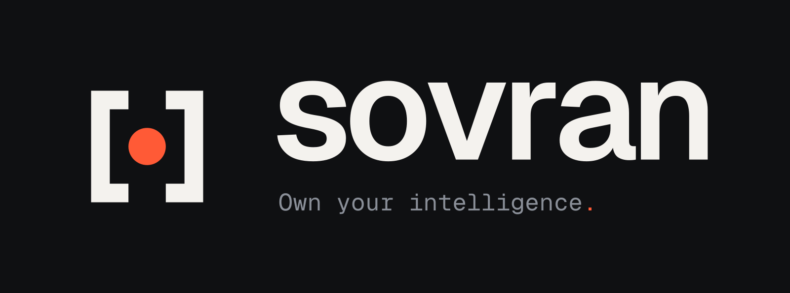
</p>

<p align="center">An agentic AI coding assistant for VS Code that runs on the models <em>you</em> control:<br>
local, self-hosted, or behind your company's AI gateway.</p>

<p align="center">
  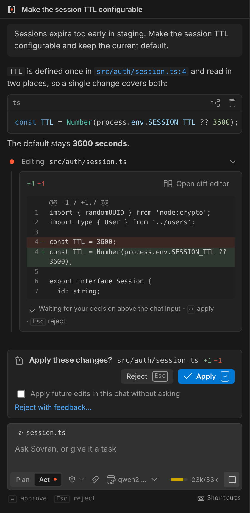
  &nbsp;
  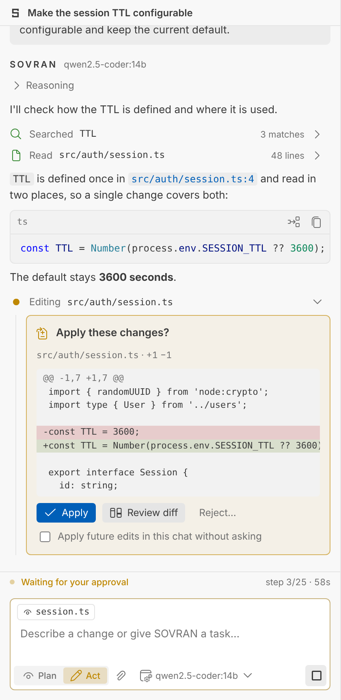
</p>

> **Status: preview (0.1).** The core engine, tools, UI and security controls are implemented and covered by automated
> tests. Real-world compatibility testing against every server type is ongoing. See [Known limitations](#known-limitations).

---

## Why Sovran

Most AI coding tools assume a specific vendor, a cloud account or a separate editor. Sovran assumes none of that.

- **Your models.** Sovran works with any OpenAI-compatible Chat Completions endpoint, including Ollama, LM Studio, vLLM, LiteLLM, llama.cpp, LocalAI and internal gateways.
- **Your infrastructure.** The extension talks directly to your endpoint. There is no Sovran server, no account and no telemetry.
- **Your code.** Nothing leaves your machine except the requests you send to endpoints you configured.
- **Your control.** By default every file change is previewed in VS Code's diff editor and every command needs your approval. When you trust the task, Auto-edit and Auto hand over more, while guardrails in code still stop risky actions. Plan mode is read-only by construction, not by prompt.

## Features

**A real agent, not a chat box.** Sovran runs a full agent loop:

1. It reads and searches the workspace.
2. It proposes edits and runs commands.
3. It reads the results and continues until the task is done, with a step limit, a loop guard and cancellation at any time.

Core workspace tools include:

| Tool | What it does |
|---|---|
| `read_file` | Reads a file or a line range of it |
| `list_directory` | Lists the contents of a folder |
| `find_files` | Finds files by glob pattern |
| `search_files` | Searches file contents for text or a regular expression |
| `get_workspace_info` | Reports the workspace layout, OS, shell and git branch |
| `get_active_editor_context` | Reads the open file, selection, tabs and diagnostics |
| `write_file` | Creates a new file or replaces one |
| `edit_file` | Replaces one exact piece of text in a file |
| `apply_diff` | Applies several exact edits to one file at once |
| `execute_terminal` | Runs a shell command after you approve it |

**Semantic navigation.** In a trusted workspace, Plan and Act can list named symbols in a file with
`list_document_symbols`, locate a definition with `go_to_definition`, and find usages with `find_references`.
Pass a workspace file as `path` (use `rootName/path` in a multi-root workspace). Definition and reference calls
also take `line` and `column`, both one-based. Columns count UTF-16 code units. Reference results may include
the declaration. All three tools accept `max_results` from 1 to 200, defaulting to 50.

Sovran uses the language provider already available in VS Code, including unsaved edits to an open file. Results
contain locations and symbol names. Protected and outside-workspace files are excluded. If the provider is
unavailable or still indexing, the agent can fall back to `search_files`. You can control these tools under
**Settings → Tools → Built-in tools → Editor and diagnostics**.

**Native Git inspection.** In trusted workspaces, Plan and Act can use `git_status`, `git_diff`, `git_log`,
`git_show` and `git_branches` without an MCP server. They are read-only and never fetch. Select the repository root
explicitly with `repository` (`"."` for a single root, `"rootName/nested"` in multi-root workspaces). Nested repositories
and linked worktrees are supported; native Git does not discover a parent outside your selected root.

Paths are separate, literal repository-relative arguments. `git_diff` supports `scope: "unstaged"`, `"staged"`, or
`"revision"` with `from` and optional `to` (default `HEAD`). Use `names_only`, `offset` and `limit` for concise results.
`git_show` accepts a separate `path` and `start_line`/`end_line` to inspect historical text; `REV:path`, flags and
revision ranges are not accepted as a revision. Commit IDs, branch/tag names and `HEAD~2`/`HEAD^` ancestry are supported.
Bulk patches omit protected paths and detected renames from protected sources. An exact protected-file request uses
the ordinary approval card, including in Auto. Status/history metadata may still name protected files.

Git is resolved from the extension host's PATH outside workspace roots. Sovran passes `--no-lazy-fetch`
(documented in Git 2.48) so a read can never download missing objects. A host Git that predates the option, as on
current LTS distributions, still works for ordinary repositories; only a partial clone (a repository with a promisor
remote) is refused there, because it is the one case where a read could fetch. Update Git to use those. Native inspection
disables pagers, fsmonitor, textconv, external diff and configured clean/process filters. Results are bounded, with a
15-second maximum command budget per inspection and 2 MiB maximum historical blob. Very large metadata sets fail
explicitly; large patches are marked truncated. Structured Git output is filtered before it reaches chat and is not
mirrored raw to a terminal. Git runs on the extension host in Remote environments too.

**Controlled Git changes.** In Act mode, `git_stage` and `git_unstage` accept an explicit `repository` and a `paths`
array of individual files. `git_commit` accepts `repository` and a non-empty `message`, including multiple lines.
It commits only staged changes. Paths use forward slashes; edge whitespace and backslash filenames are refused rather
than silently normalized.

Every operation shows a repository/branch/file preview and asks for one-time approval, even in Auto or with a chat
edit grant. For commits, the full message appears with the change preview in the transcript. Use **Review files and
commit message** above the input before approving. There is no Always allow option for native Git changes.

A changed raw index, HEAD, branch, administrative directory, configuration or selected saved content invalidates the
pending action. Stage refuses known unsaved buffers, directory-wide selections and files over 5 MiB. A raw index over
16 MiB or a commit involving more than 100 files requires another workflow. Native Git writes on the same repository
are serialized within Sovran; other Git programs still have their own concurrency and locks.

Git filters may run while staging; hooks/signing may run while committing. Approved commits retain the host
signing-agent/key-store location variables without disabling configured signing. These programs have your privileges and
can change files/index or contact services, so inspect the warnings and verify the resulting status/log. Previews use
read-only settings with filters disabled and can be shortened. Git changes are not covered by checkpoint undo. After
failure, timeout or cancellation, inspect status/log before retrying: a commit may already exist. No rollback is implied.

**Synchronize a branch.** In trusted Act mode, these operations each show the affected refs and ask for one-time approval.

- `git_fetch` takes `repository` and `remote`. It updates that remote’s branch-tracking refs.
- `git_push` takes `repository`, `remote` and the short destination `branch`. Set `set_upstream` to `true` to track
  that branch. Pushes are limited to a single branch and fast-forward updates.
- `git_pull` fetches the checked-out branch’s configured upstream, then advances the branch only if a fast-forward is
  possible. Save your open editors and start with a clean worktree and index.
- `git_rebase` takes `repository` and a local `upstream` ref or commit ID, for example `origin/main` after fetching.
  Start with a clean worktree and index. If Git stops for conflicts, resolve them and use Git’s `rebase --continue`
  or `rebase --abort` from the terminal or Source Control.

Remote Git operations accept a configured HTTPS or SSH remote or an absolute local destination in the workspace.
Authentication uses Git’s SSH agent or HTTPS credential helper on the extension host. The PAT saved for GitHub or
GitLab MCP is used by the corresponding MCP connection. After push, ask the connected MCP to create a pull request
or merge request using the published branch and the intended base branch.

The old basic Git MCP shortcut is removed; saved Git MCP servers, custom/import routes and their policies remain.
Existing MCP servers and the terminal retain their own policies. Native Git settings use the same disabled/always-review
controls as other native tools.

**MCP servers for more tools.** Connect [Model Context Protocol](https://modelcontextprotocol.io) servers, local
commands or remote URLs, from **Settings → Tools**, and the agent can use their tools in Act mode: issues, databases,
documentation, browsers, anything a server offers. Each tool asks before it runs until you allow it, in every approval
mode. See [MCP servers](#mcp-servers).

**Plan and Act modes.**

| | Plan | Act |
|---|---|---|
| Read & search the workspace | ✓ | ✓ |
| Produce a structured plan | ✓ | ✓ |
| Edit files | ✗ (tools are not even offered) | ✓ (see approvals below) |
| Run commands | ✗ | ✓ (see approvals below) |

**Approvals in Act mode: Ask, Auto-edit and Auto.** Pick how much Sovran may do without asking from the composer
(<kbd>Alt+A</kbd> cycles), from Settings or with `Sovran: Change Approval Mode…`:

| | Ask (default) | Auto-edit | Auto |
|---|---|---|---|
| File changes | Diff review for each | Applied without asking | Applied without asking |
| Commands | Approve each (allowed commands run directly) | Approve each | Run without asking |
| Protected files, risky commands | Ask | Ask | **Still ask** |

Auto works like Claude Code's auto-accept, with guardrails enforced in code: commands that delete recursively, push or
force-push, publish, use `sudo`, run downloaded or hidden scripts, reach the network, read credentials or touch paths
outside the workspace always stop for you, and so do protected files. The card says why. Everything that ran without
asking carries an *auto* badge, and each response can still be undone with **Undo changes**. Turning Auto on asks for
confirmation once per window, and new windows start in the mode set by `sovran.approvals.mode` (Ask by default).

<p align="center">
  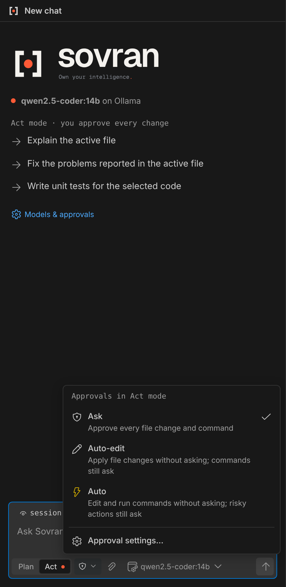
  &nbsp;
  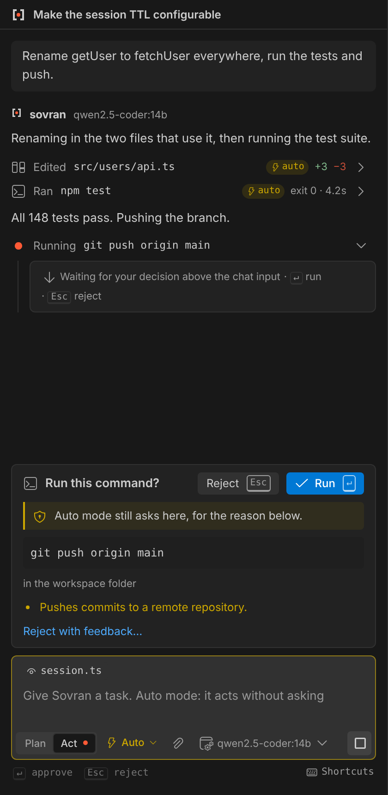
</p>

When Sovran needs you, a **bar right above the chat input** asks: it never scrolls away, and **Reject** and **Apply**
(or **Run**, **Allow**) sit on its right. Press <kbd>Enter</kbd> to approve or <kbd>Esc</kbd> to reject, from the empty chat input or
anywhere in the chat; text you are typing keeps its keys. The diff itself is in the conversation, with line numbers and
wrapped lines, and the proposal's diff editor has **Apply** and **Reject** buttons too (<kbd>Ctrl+Enter</kbd> applies).
**Always allow…** adds a command's prefix (for example `npm test`) to your allowed commands after showing you exactly
what will be allowed, and **Reject with feedback…** tells Sovran what to do instead.

The current mode is always visible in the composer and the status bar.

**Built for imperfect servers.** "OpenAI-compatible" covers a wide range of behavior, so Sovran detects what each model supports:

- **Rejected tool definitions:** when a server rejects native tool calling, Sovran switches that model to a prompted tool protocol automatically and remembers it.
- **Unusual response formats:** it handles servers that ignore streaming and models that emit `<tool_call>` or `<think>` tags as text.
- **Reasoning output:** reasoning streams (`reasoning_content`) are shown separately and never sent back to the model.

Errors tell you what went wrong and how to fix it.

**Native to VS Code.** Proposed edits open in the native diff editor and are applied as undoable edits (Ctrl+Z works). Commands are mirrored in a Sovran terminal. Other native touches:

- The model picker is a Quick Pick, and the status bar shows the model and mode.
- The UI follows your theme, including high contrast.
- Keyboard first: <kbd>Enter</kbd> sends, <kbd>Shift+Enter</kbd> adds a newline, <kbd>Esc</kbd> stops, <kbd>Alt+M</kbd> switches mode, <kbd>Alt+A</kbd> cycles approvals, and while Sovran waits for you <kbd>Enter</kbd> approves and <kbd>Esc</kbd> rejects. A hint line under the composer shows what the keys do right now, and **Shortcuts** lists them all.
- **A start page for every chat:** the model and where it runs, the current mode, starters built from the active file or selection, your latest chats and a tip.
- **Settings in the panel.** The gear in the view title opens Sovran Settings: Act and Plan models, providers, approvals, allowed commands, protected files, limits and context options, without editing JSON.

**Context you can see.** The active file or selection is attached as a chip you can toggle. Files outside the workspace and protected files are never attached automatically, and their chip says so. The paperclip opens the **attach menu**: search the workspace, pick a suggested file (the active editor and open tabs), browse folders from the workspace root, or **upload from your computer** through the system file dialog. Protected files ask before they are attached. Large files are paged and long conversations are trimmed to the model's context window.

**Documents, not just code.** Attach a **PDF**, **Word**, **Excel** or **PowerPoint** file, an **OpenDocument** file (`.odt`, `.ods`, `.odp`) or a **ZIP** archive and Sovran sends the model its text as Markdown: headings, lists, tables, links, every sheet and slide, speaker notes and Excel dates as dates. A ZIP is listed, not extracted. The conversion runs on your machine, in a separate thread with memory and time limits, and nothing is uploaded anywhere. Files are recognized by their content, not their name, and UTF-16 text (what Windows PowerShell writes with `>`) is read too. The chip shows what Sovran found (*PDF document, 12 pages*). The agent reads documents in the workspace the same way: `read_file` returns a PDF or an Office file as Markdown and pages through it. Audio, video and old binary Office files (`.doc`, `.xls`, `.ppt`) are refused with a message that says what to do instead.

**Screenshots for vision models.** Paste a screenshot into the chat input (<kbd>Ctrl+V</kbd>), or attach a PNG, JPEG, WebP or GIF file, and a vision model sees it with your question: each image is sent after its name, so the model can tell several apart. Up to 8 images of 8 MB each per message. Sovran finds out by itself whether a model accepts images: if the server refuses them, it remembers the model as text-only, says so and sends only the images' names (set `"vision"` on the model to decide yourself). Images are kept with the chat in the workspace storage, never in the chat file, and are deleted with the chat.

<p align="center">
  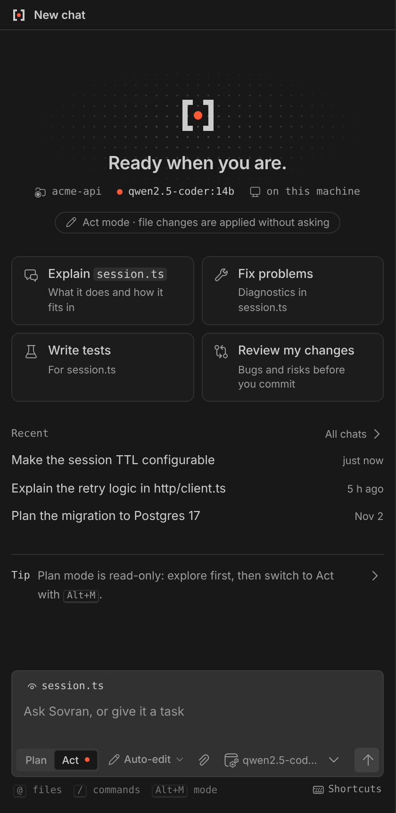
  &nbsp;
  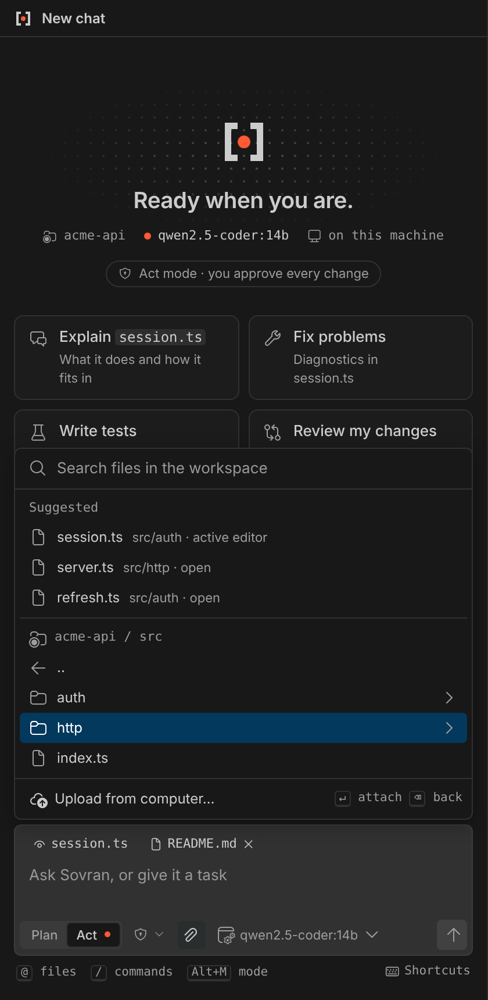
</p>

**Conversations that persist.** Chats are saved per workspace and restored after restart, and you can search, rename or delete them.
While you scroll, the message that started the answer you are reading stays pinned at the top, and the next message
pushes it out, so you always see where each answer starts and ends. Select the pinned message to go back to it.

**Chats in editor tabs, in parallel.** **Open Chat in Editor** (the arrow in the view title) moves the current chat into
an editor tab, beside your code, and **New Chat in Editor** opens another. Each chat runs on its own, so you can let one
work while you talk to another. The chat list in the view shows which chats are working, waiting for your approval or
open in a tab, and selecting one focuses its tab. Tabs come back with their chat after a restart. Lists and settings
stay in the view; the mode, approval mode and models are shared by all chats in the window.

<p align="center">
  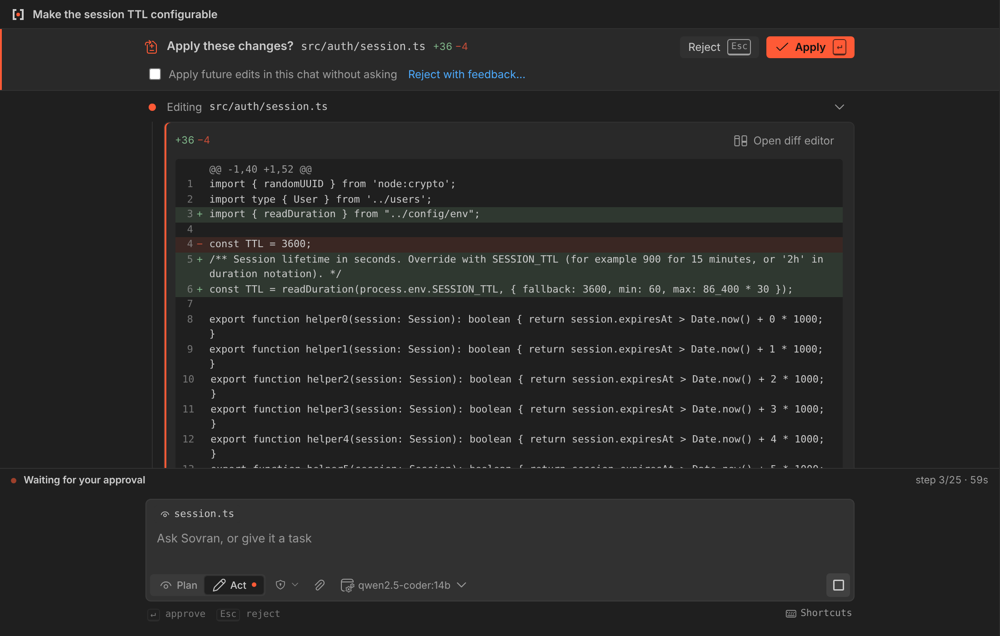
  &nbsp;
  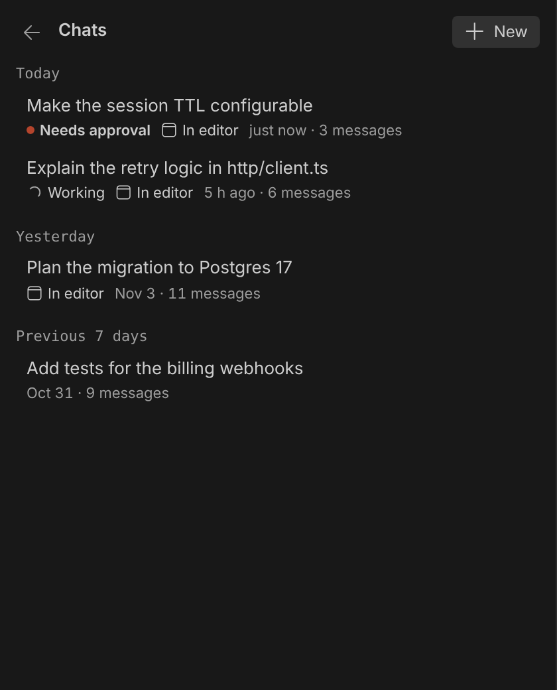
</p>

**Mistakes are cheap to undo.** Every response that changed files ends with a footer: *2 files changed · Undo changes*. Undo puts every file back the way it was before that response and deletes files the agent created. If you edited a file afterwards, Sovran asks before overwriting it.

**See what the model received.** Open **Context sent in the last request** under your prompt to see the paths,
line ranges and sources that fit the model's input budget. Attachments you add take priority. In trusted
workspaces, Sovran uses stack frames and failing-test locations for fixes, and definitions and references for
refactors. It can also use cached editor diagnostics, text search and Git diff locations. Automatic context
skips protected and excluded paths and respects per-chat tool selection and **Always ask**.

**Check the result and resume.** Open **Task summary** below the response for the combined diff of Sovran's editor
changes and the observed terminal commands, exit codes and errors. The test status reflects recognized test
commands. A timeout or interrupted test may leave the outcome unknown. A command follows the existing approval
mode. **Undo changes** restores checkpointed editor edits, while terminal, Git and MCP effects require separate
review. If the run stops, choose **Resume** to continue using the existing transcript, recorded actions and current
workspace. New actions with side effects ask again in every approval mode. Session and checkpoint data added while
`sovran.sessions.persist` is off stay in the current window.

To try the flow, ask in Act mode to fix a failing test using a file and line from its stack trace. Approve the
edit and test command, then open the context and task summary. Stop a later run after it runs a command and
choose **Resume**. To check the undo conflict, edit the same file yourself before choosing **Undo changes**.

- **Retry** generates a response again. It sits next to **Copy** under the last response and appears when you hover it or reach it with the keyboard.
- **Edit** (pencil on any message) rewrites a message and continues from there, and can undo the file changes of the discarded responses too.

**You can see the context window.** A meter in the composer shows how full the model's context is. When it fills up, Sovran **summarizes older messages** instead of silently forgetting them. The full transcript stays visible to you. You can also summarize on demand with `/compact` or by clicking the meter.

**`@` files and `/` commands.**
- **`@`:** type `@` to fuzzy-find a workspace file and attach it.
- **Built-in commands:** type `/` for `/explain`, `/fix`, `/test`, `/review`, `/doc`, `/compact` and `/new`.
- **Your own commands:** add Markdown files to `.sovran/commands/` (for example `.sovran/commands/release-notes.md`, using `$ARGUMENTS` for the text you type after the command). They load only in trusted workspaces. An optional front matter block can set the description and the tools the command needs, which then load with it:

  ```markdown
  ---
  description: Commit and push the current work
  tools: [git.changes, git.remote]
  ---
  Commit the changes in $ARGUMENTS with a clear message, then push the branch.
  ```

  Tool units are `git`, `git.changes`, `git.remote`, `diagnostics`, `symbols`, `web` and `mcp:<server id>`.

<p align="center">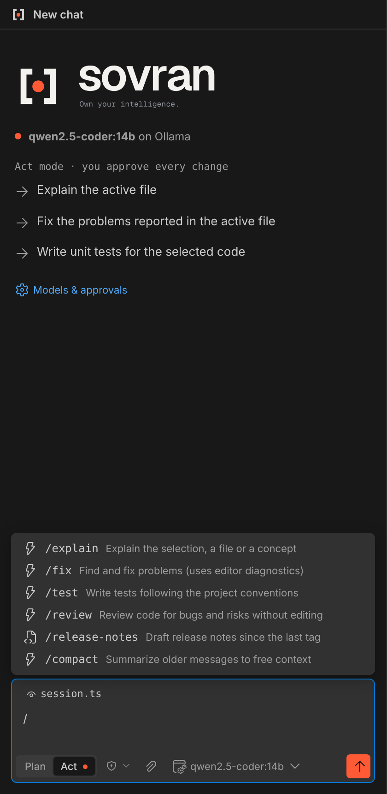</p>

**A model for each mode.** Plan can use a larger reasoning model while Act uses a fast coder. In Plan mode, pick the model from the composer, or choose *Same as Act model*.

**Chat titles written by the model.** Sovran asks the model for a short title in the language you wrote in, while the
answer streams; the first words of your message are shown until it arrives. A small, fast *Title model* is enough, and
models that always reason (such as GLM or DeepSeek-R1) get room to think before they answer. Turn it off in
*Settings → Models → Name chats with the model* to keep the first words.

## Installation

Download `sovran-<version>.vsix` from the latest [GitHub Release](https://github.com/Minells/sovran/releases), then:

```bash
code --install-extension sovran-0.1.0.vsix
```

or choose **Extensions → … → Install from VSIX…**. Each release lists the file's SHA-256 so you can check the download.
Once the Marketplace listing is published, you can also search for **Sovran** in the Extensions view.

Requires VS Code 1.95 or later.

## Quick start

1. Click the **Sovran** icon in the Activity Bar. A three-step setup opens.
2. **Choose** where your model runs: Ollama, LM Studio, vLLM, LiteLLM or a **custom endpoint** such as your company gateway.
3. **Connect**: check the URL and authentication. If the endpoint needs a key, VS Code asks for it in a secure input. Keys are stored in VS Code Secret Storage, never in settings. Sovran tests the connection right away.
4. **Choose a model** from the ones the server reports (or type its ID) and start chatting.

Everything else (a separate Plan model, more providers, approvals and limits) lives behind the gear in the view title.

Prefer a text file? Skip the setup and describe your models in [`~/.sovran/config.yaml`](#configuration-file-configyaml).

<p align="center">
  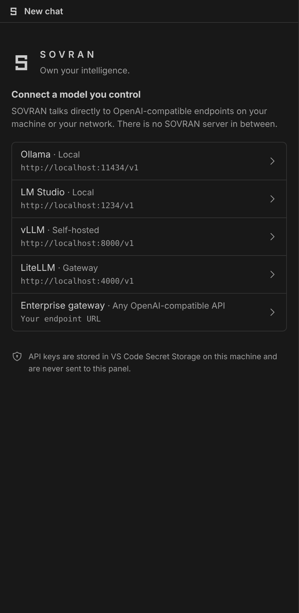
  &nbsp;
  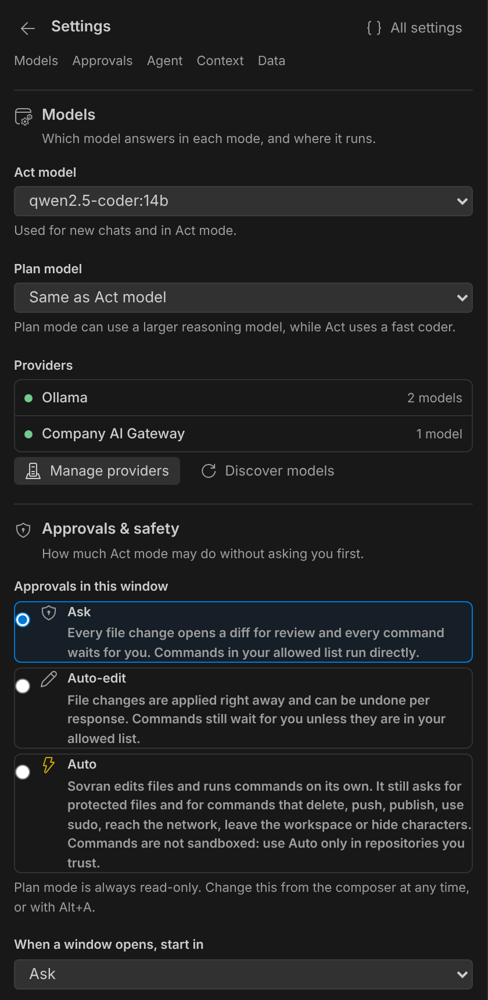
</p>

## Provider setup examples

Providers live in your **user** settings (`sovran.providers`). Workspace settings are ignored for security; see [Security](#security). The guided setup and **Settings → Manage providers** write these entries for you; the examples below are for reference and for advanced options such as extra headers.

**Ollama (local)**
```jsonc
{ "id": "ollama", "name": "Ollama", "baseUrl": "http://localhost:11434/v1",
  "auth": { "type": "none" }, "models": [{ "id": "qwen2.5-coder:14b", "contextWindow": 32768 }] }
```

**LM Studio (local)**
```jsonc
{ "id": "lmstudio", "name": "LM Studio", "baseUrl": "http://localhost:1234/v1", "auth": { "type": "none" },
  "models": [{ "id": "your-loaded-model" }] }
```

**vLLM on a GPU server**
```jsonc
{ "id": "vllm", "name": "GPU cluster", "baseUrl": "https://vllm.internal.example/v1",
  "auth": { "type": "bearer" }, "timeoutSeconds": 300,
  "models": [{ "id": "my-coder", "contextWindow": 131072, "toolMode": "native" }] }
```
For native tool calling, start vLLM with tool parsing enabled (for example `--enable-auto-tool-choice --tool-call-parser <parser>`). Otherwise use `"toolMode": "prompted"`.

**Enterprise gateway with a custom auth header**
```jsonc
{ "id": "corp", "name": "Company AI Gateway", "baseUrl": "https://ai-gateway.example.com/v1",
  "auth": { "type": "header", "headerName": "api-key" },
  "headers": { "X-Team": "platform" },
  "models": [{ "id": "coder-large", "contextWindow": 128000 }] }
```

### Authentication and "HTTP 401"

**API key** (the default) sends the key as `Authorization: Bearer <key>`, the OpenAI standard that gateways, LiteLLM,
vLLM and SDKs such as Continue use. Choose **Custom header** only when your gateway documents another header (for example
Azure's `api-key`). When a server answers 401 or 403, Sovran says what the request carried: no key stored, the key in
the `Authorization` header, or the key in a custom header. Paste the key alone: a `Bearer ` prefix or quotes copied with
it are removed. Some gateways let a key chat but not list models; the connection test then checks chat directly and
says so. To see what your gateway accepts, try from the same machine:

```bash
curl -sS https://your-gateway.example/v1/chat/completions -H "Authorization: Bearer $KEY" -H "Content-Type: application/json" -d '{"model":"your-model","messages":[{"role":"user","content":"ping"}],"max_tokens":16}'
```

### Model options

| Field | Meaning |
|---|---|
| `contextWindow` | Tokens the model accepts (prompt and reply). When unset, Sovran uses what the server reports, else 32 768 |
| `maxOutputTokens` | Tokens kept for the reply, also sent as `max_tokens`. When unset, 4 096 are kept (less if the server's cap or a quarter of the window is smaller) and `max_tokens` is not sent |
| `toolMode` | `auto` (detect, the default), `native`, `prompted` or `none` |
| `vision` | `true` sends attached images, `false` sends only their names. Unset (the default), Sovran sends them and stops if the server refuses |
| `temperature` | Sent only when set |

Both limits can be set per model in **Manage providers** (the *Context* and *Max output* fields), in `config.yaml` or in
`sovran.providers`; a value you set always wins. An empty field shows what Sovran will use and where it comes from
(*server* or *default*), and **Settings → Models** shows the limits of the selected model.

**Limits reported by the server.** Sovran reads them when it tests a connection, discovers models, starts, or sees a new
provider: vLLM and SGLang `max_model_len`, OpenRouter `context_length` and `max_completion_tokens`, `context_window`,
LM Studio's `max_context_length`, and LiteLLM's `/model/info`. Ollama and llama.cpp are not read on purpose: they report
the context the model was trained with, not the one it runs with (Ollama's `num_ctx`), and trusting that would overflow
the real window. A server's maximum output is used as a ceiling, not as the reserve: reserving 32K tokens for every reply
would take them from the conversation. For models that always reason (GLM, DeepSeek-R1), set `maxOutputTokens`
generously, since the reasoning shares that budget.

### Inline autocomplete

Inline autocomplete starts off. Its **Autocomplete model** follows the **Act model** by default when that model
has a supported fill-in-the-middle (FIM) transport. You can also select a dedicated FIM model.
Autocomplete sends a short prefix and suffix from the active editor to the effective model endpoint, local or
remote. Completion requests leave no entry in your chats.
Sovran skips protected and excluded files and disables inline autocomplete in Restricted Mode. In SSH, WSL
and containers, `localhost` refers to the extension host.

The first supported combination is **llama.cpp with Qwen2.5-Coder-1.5B base Q8_0 GGUF**, exposed through
`POST /infill`. Start a dedicated local server with the
[Q8_0 GGUF model](https://huggingface.co/ggml-org/Qwen2.5-Coder-1.5B-Q8_0-GGUF):

```bash
llama-server --model /path/to/qwen2.5-coder-1.5b-q8_0.gguf \
  --alias qwen-fim --host 127.0.0.1 --port 8012 --ctx-size 4096
```

1. Under **Manage providers**, add or edit the provider. Use `http://127.0.0.1:8012/v1` as its base URL and
   **No key** for this server. Add model ID `qwen-fim` and select **llama.cpp /infill** as its autocomplete transport.
   In `config.yaml`, the equivalent model entry is `{ id: qwen-fim, fim: llama.cpp-infill }`.
2. Under **Settings → Models → Model options**, enable inline autocomplete. Keep **Same as Act model** if your
   Act model has a supported FIM transport, or select `qwen-fim` as the dedicated model. Keep
   `editor.inlineSuggest.enabled` on in VS Code.
3. Open a source file in a trusted folder, place the cursor in a gap in the code and run
   **Sovran: Trigger Inline Completion**. Accept the ghost text with VS Code's inline suggestion keybinding
   (normally Tab). Try the same command in a protected file and confirm the server sees no request.

For a private gateway, expose `/infill` alongside `/v1` on the same origin and path prefix. For example,
a base URL ending in `/llama/v1` uses `/llama/infill`. The chat compatibility of a server does not establish
its FIM compatibility.

## Configuration file (`config.yaml`)

You can configure providers in the panel, in a YAML file, or both: the two stay in sync.

- **In the panel:** the guided setup and **Settings → Models → Manage providers** (stored in `sovran.providers`).
- **In a YAML file:** **Settings → Models → Configuration file → Create config.yaml** (or `Sovran: Open Model Config File`) creates
  `~/.sovran/config.yaml` with the providers you already have, followed by commented examples.

From then on, saving the file updates Settings (and Sovran connects to new or changed providers, asking for a key when
one is needed), and changing providers in the panel, or the model you pick, updates the file, keeping your comments and
formatting. To go back to the panel only, choose **Stop using config.yaml…**: keep the file (it is ignored) or move it
to the trash. Your providers stay in Settings either way, and **Use config.yaml again** brings the file back.

```yaml
providers:
  - id: ollama
    name: Ollama
    baseUrl: http://localhost:11434/v1
    auth: none                       # shorthand for { type: none }
    models:
      - id: qwen2.5-coder:14b
        contextWindow: 32768
      - devstral:24b                 # a plain string is a model id

  - id: vllm
    name: GPU cluster
    baseUrl: https://vllm.internal.example/v1
    auth: bearer                     # the key is asked for once and kept in Secret Storage
    timeoutSeconds: 300
    models:
      - id: my-coder
        contextWindow: 131072
        toolMode: native

  - id: corp
    name: Company AI Gateway
    baseUrl: https://ai-gateway.example.com/v1
    auth:
      type: header
      headerName: api-key
    headers:
      X-Team: platform
    models: [coder-large]

# Optional: the models to select when this file is applied (providerId/modelId).
defaultModel: ollama/qwen2.5-coder:14b
planModel: vllm/my-coder
titleModel: ollama/qwen2.5-coder:14b
```

The fields are the same as in `sovran.providers` (see the examples above and [Model options](#model-options)); `name`
defaults to the `id`.

How the sync works:

- **The side you changed wins.** Save the file and Settings follow; change Settings and the file follows. Each side is
  written only when it differs, so the two never bounce changes back and forth.
- **Nothing is lost when syncing starts.** The first time (and when you use an ignored file again) both sides are
  joined: a provider on one side only is added to the other. Where both define the same `id`, a new file wins and a
  file you turn back on loses to Settings, since it was not in use.
- **All or nothing.** The file is applied only when it is entirely valid. Mistakes are underlined in the editor and
  listed in the Problems panel and in Settings, with hints such as *Unknown field "base_url". Did you mean "baseUrl"?*;
  meanwhile Settings keep the last valid version. Sovran never writes into a file that has problems or unsaved edits in
  the editor; it tells you, and keeps your change in Settings.
- **Model choices** (`defaultModel`, `planModel`, `titleModel`) are applied when the file content changes, and the model
  you pick in Sovran is written back, but only to the keys the file already declares.
- **No secrets.** API keys are never read from the file: a field such as `apiKey`, or a header such as `Authorization`,
  is reported as a problem. Keys stay in VS Code Secret Storage.
- **Never from a repository.** The file lives in your home folder, not in the workspace, so a cloned repository cannot
  ship one (the same reason `sovran.providers` is user scope only). `sovran.configFile.enabled` turns the file off.

Changes saved in VS Code apply immediately; changes saved with another program (or through a symbolic link) within
about two seconds, since Sovran also checks the file's date and size besides watching it. A file event for content that
is already in sync changes nothing, and a hand edit is never overwritten: if the file and Settings change at the same
moment, the file wins and Sovran says so.

## MCP servers

[MCP](https://modelcontextprotocol.io) servers give the agent tools from other programs and services. Open
**Sovran Settings → Tools → MCP integrations**. Choose **Browse Catalog** for a preset or **Custom MCP Server**
to enter a command or URL. The custom server form can also import a JSON snippet in the Claude Desktop, Cursor,
Cline or VS Code format and move its token to Secret Storage. Save the server, then choose **Connect**.
Sovran shows the command before launching a custom local server. Environment, working folder, plain HTTP headers,
and request timeout are under **Advanced connection settings**.

- **Local servers** are commands Sovran starts, such as
  `npx -y @modelcontextprotocol/server-filesystem ${workspaceFolder}`. They talk MCP over stdin and stdout, start in
  the first workspace folder and receive a minimal environment (`PATH`, `HOME` and the like, plus proxy and
  certificate variables) and what you list in `env`.
- **Remote servers** are reached over Streamable HTTP at their URL. Redirects to another address are not followed, so
  tokens and headers reach only the server you entered.
- **Tokens** live in VS Code Secret Storage, never in settings: as `Authorization: Bearer`, in a header of your choice,
  or in an environment variable for local servers. `${workspaceFolder}`, `${userHome}` and `${env:NAME}` are expanded.

Open **Tool permissions** on a connected server to see what the server says about each tool (*read-only*,
*can change data*) and choose **Off** (excluded from model requests), **Ask** (the default) or **Allow**
(runs without asking). You can also choose **Always allow** from the approval card, which shows the tool,
its server and the exact arguments. MCP tools are named `mcp__<server>__<tool>` and offered only in Act mode.
See **Tools for this chat** for the estimated context cost of the selected groups.

The same list is the `sovran.mcp.servers` user setting:

```jsonc
"sovran.mcp.servers": [
  {
    "id": "github",
    "name": "GitHub",
    "url": "https://api.githubcopilot.com/mcp/",
    "auth": { "type": "bearer" },            // the token itself: Set token, in Settings → Tools
    "allowedTools": ["search_issues"]
  },
  {
    "id": "files",
    "command": "npx",
    "args": ["-y", "@modelcontextprotocol/server-filesystem", "${workspaceFolder}"],
    "disabledTools": ["move_file"]
  }
]
```

Enabled servers start in the background when a trusted window opens and stop with the window. **Disconnect** stops
the connection and withdraws its tools from the agent. **Connection failed** offers **Try again** and **Show logs**.
Editing a server’s command or endpoint in Settings saves it disconnected and clears the previous credential unless
you supply a replacement.

### Optional managed integrations

In **Browse Catalog**, each entry shows where it runs, what it requires, and its configuration state. **Configure**
saves it disconnected. For browser integrations, **Install dependencies** downloads a locked package with npm scripts
disabled after confirmation. **Connect** starts the server or opens its remote connection. Sovran shows **Connected**
after MCP initialization and tool discovery complete.

- **Playwright MCP** uses a separate system Chrome session by default. It offers navigation, snapshots and interactions.
  Call `browser_snapshot` for inline content after an action; action responses may link a snapshot file that Sovran
  does not open. Existing-profile mode is an advanced local choice: name the Chrome profile, install the companion
  extension there and confirm the tab. It may expose signed-in accounts and is unavailable on Remote hosts.
- **Chrome DevTools MCP** uses separate system Chrome for console, network and performance inspection. The managed
  profile disables usage statistics, CrUX, update checks, JavaScript evaluation and file navigation.
- **GitHub MCP** uses the hosted service and a PAT stored in Secret Storage. The default exposes a small read-only
  set for issues and PRs. Collaboration adds issue writes/comments and PR creation on Ask. **Repositories, reviews
  and Actions** adds PR updates, review, merge, repository discovery, Actions status and release lookup. Each write
  in this profile requires approval. Restrict token permissions and repository access.
- **GitLab MCP** uses the official server on GitLab.com or a Self-Managed/Dedicated instance with MCP enabled. Choose
  **Configure**, enter the instance’s base HTTPS URL, then use **Set token** and **Connect**. In GitLab, create a
  fine-grained PAT with **User → MCP tool → Execute**. Sovran derives `/api/v4/mcp`, keeps a distinct token for each
  connection and endpoint, and requires approval for each collaboration write. The extension host must be able to
  resolve the instance and trust its HTTPS certificate. [GitLab MCP configuration](https://docs.gitlab.com/user/model_context_protocol/mcp_server/)
- **Context7 MCP** looks up documentation and examples in the hosted Context7 index. You can try it without a key.
  If the service requires authentication or you hit the anonymous limit, choose **Set API key (optional)**. The free
  keyed plan covers public libraries and has a monthly quota. Keep credentials and private code out of lookup queries.
  [Context7 plans](https://context7.com/plans)
- **Grafana MCP** connects to an operator-managed **Streamable HTTP endpoint**, compatible with
  **mcp-grafana 2.3.0**. Enter the full MCP endpoint (for example `https://grafana-mcp.example.com/mcp`),
  not the Grafana website/API URL. Set the **MCP caller bearer token**, then Connect. No local executable,
  Node.js or npm is required. The operator configures `GRAFANA_URL`, a scoped Grafana service account token,
  caller authentication (`MCP_GRAFANA_SERVER_TOKEN`), TLS and telemetry on the remote server. For example,
  the server can run with `-t streamable-http --usage-stats=disabled`; protect its endpoint with HTTPS.
  Sovran cannot enforce telemetry settings on an external server. The read profile exposes reviewed
  dashboard/datasource discovery and Prometheus/Loki queries. **Dashboards and annotations with writes**
  adds reviewed dashboard/annotation reads and `update_dashboard`, `create_annotation`, `update_annotation`
  and `delete_annotation`. Each write requires approval; forced dashboard overwrite remains blocked.
  The operator must grant the corresponding Grafana permissions. A shared service account gives its callers
  that account's privileges: use appropriately scoped deployments or an identity-aware gateway.
  [Grafana deployment and caller authentication](https://github.com/grafana/mcp-grafana/tree/v2.3.0)
- **Terraform MCP** connects to an operator-managed **Streamable HTTP endpoint**, compatible with
  **terraform-mcp-server 1.4.1**, behind an authenticating gateway. No local executable is required.
  Enter the MCP gateway URL, not an HCP/TFE website or REST API URL, and store its **gateway bearer token**.
  The gateway must authenticate the caller and replace the inbound `Authorization` header with the authorized
  user's/scoped backend TFE token before forwarding to the native server. The native server interprets HTTP
  bearer authentication as a **TFE API token**; merely configuring `TFE_TOKEN` in its environment while forwarding
  an unrelated gateway token does not implement this separation. Keep the native server private behind the gateway,
  strip client-supplied credential/connection override headers, and configure `TFE_ADDRESS` and TLS server-side.
  Preserve user/resource authorization when mapping identities to backend credentials; a shared token does not
  provide per-user TFE permissions. The gateway must also authenticate Registry-only access.
  The default **Public Registry documentation** profile exposes documentation reads. **Registry and HCP/TFE
  workspace and run reads** adds reviewed workspace, run and plan reads; missing HCP tools fail setup rather than
  silently falling back to Registry. **HCP/TFE workspace and run operations** adds `create_workspace`,
  `update_workspace`, `create_run` and `action_run`, plus apply details/logs. The operator must enable
  `ENABLE_TF_OPERATIONS=true` and the required tools and permissions on the server. Workspace changes require
  `auto_apply: "false"`; create_run requires explicit `plan_only` or `plan_and_apply` with automatic apply disabled.
  Read the plan before separately approving apply/cancel/discard for one run. An approved plan can create, modify
  or delete infrastructure. Destroy-run creation, workspace deletion, forced unlock and variable/secret operations
  remain excluded. The operator controls telemetry (for example `OTEL_METRICS_ENABLED=false`).
  [Terraform HTTP deployment](https://github.com/hashicorp/terraform-mcp-server/tree/v1.4.1)
- **OpenSearch MCP** connects to an **existing external Streamable HTTP MCP endpoint**, such as
  `https://search-mcp.example.com/mcp`. Enter the MCP URL, not the cluster REST API URL or a legacy `/sse` endpoint.
  No Python environment is installed by Sovran. The operator must configure the cluster, its credentials/IAM/TLS
  and `OPENSEARCH_DYNAMIC_CONNECTION=false` on the server; use an authenticating proxy when exposing it remotely.
  **Set token (optional)** stores a bearer token for that MCP proxy, not the OpenSearch cluster password.
  The profile permits `ListIndexTool`, `IndexMappingTool`, `SearchIndexTool`, `CountTool`, `MsearchTool`,
  `ClusterHealthTool` and `GetShardsTool`. Per-call connection/authentication overrides are rejected even if the
  upstream schema hides them. A registered `opensearch_cluster_name` can select an operator-configured cluster.
  Start with explicit indexes, time filters, small result sizes and server-side aggregations.
  The optional **Index and document operations** mode exposes a constrained `GenericOpenSearchApiTool`.
  Its allowed method/path combinations are `PUT /index` (settings/mappings), `PUT /index/_mapping`,
  `PUT /index/_doc/id`, `POST /index/_doc`, `POST /index/_update/id` (a `doc` object and optional boolean
  `doc_as_upsert`) and `DELETE /index/_doc/id`. Names must target one concrete non-system index/document;
  wildcard targets, encoded paths, custom headers, scripted updates, bulk operations and index deletion are rejected.
  Document options support `refresh`, `op_type: "create"`, or paired integer `if_seq_no`/`if_primary_term`
  for optimistic concurrency. The operator must enable `OPENSEARCH_SETTINGS_ALLOW_WRITE=true` on the MCP
  server and grant the cluster identity the required index/document permissions. A visible tool alone does
  not prove that the cluster permits writes; upstream errors remain errors in Sovran.
  [External server setup](https://github.com/opensearch-project/opensearch-mcp-server-py/blob/ec714bb377372cb66f140143d8376fb452ab7975/USER_GUIDE.md)

Write access is opt-in: select the access mode under **Browse Catalog → Advanced settings**, then configure
the new connection, token and **Connect**. Existing connections retain their read profiles; **Configure another**
adds a separate connection. Every mutation in these three write profiles requires approval in all approval modes,
and cannot be changed to **Allow**. **Off** still blocks a tool. Sovran classifies these tools as writes independently of upstream
annotations, and shows the operation target before large payloads in the approval preview. Trust revocation,
disconnecting, changing profiles or turning a tool Off while approval is open prevents execution.
Missing required write tools fail connection setup with instructions to check permissions/server configuration.

Grafana, Terraform and OpenSearch use external MCP endpoints. Sovran does not install or execute their servers;
operators install/update them centrally. The documented reference versions describe the reviewed tool contracts,
not a remotely verified binary version. Sovran checks offered capabilities and restricts discovery/dispatch;
required write capabilities missing from a selected profile fail the connection.
MCP URLs accept HTTPS, or HTTP on literal loopback hosts only, without credentials, query parameters or fragments.
In SSH/WSL/container windows, reachability and `localhost` refer to the extension host. Destination/auth/profile
changes invalidate the stored credential binding. Product API credentials are not transferred to new MCP gateways.

**Migrating older connections:** Sentry is removed from the catalog. Existing managed Sentry entries remain visible
with a removal message and cannot reconnect. Old local Grafana/Terraform entries are disabled, retain their saved
fields, and offer **Configure remote replacement**. Create a new connection and set its MCP gateway token, then remove
the old entry to delete its stored token. No old executable is launched and no old token is sent to a new destination.
Custom servers remain available through explicit custom setup; they do not inherit catalog protections.

**Licenses, permissions and data:** Browse Catalog shows the reference server license/source, provider terms and
required permissions. The same disclosures appear in native connection/download confirmations. These integrations
are supplied by third parties; Sovran's MIT license does not replace their licenses, trademarks, hosting agreements
or website/account terms. Remote deployment does not waive the operator's license obligations. In particular,
Terraform MCP's MPL-2.0 covers the MCP server, separately from Terraform products and service terms. Redistributions
of covered executables require the applicable source-availability and notice obligations; this does not automatically
relicense Sovran. Provider names identify compatibility and do not imply endorsement.
Tool results may contain personal/confidential data and are sent to the configured model. Organizations should
review account authorization, confidentiality, applicable privacy requirements, processing agreements and transfers.
Write approval is an operational control, not a substitute for those agreements.

Browser MCP downloads retain original license/NOTICE files. [Optional MCP package notices](../MCP_THIRD_PARTY_NOTICES.md)
list locked packages separately from the VSIX's [bundled dependency notices](../THIRD_PARTY_NOTICES.md). New installations
also save `third-party-inventory.json` and `THIRD_PARTY_NOTICES.txt` in their versioned directory under extension global
storage. Reinstall an existing browser integration to generate these inventories. Bundled dependency declarations and
notices are preserved when supplied upstream; their presence is not a blanket legal clearance.

For the browser integrations, Node/npm and Chrome must exist on the **extension host**, which can be a Remote SSH/WSL/container machine. Missing
components produce instructions. There is no automatic bridge to your desktop browser. Managed profile limits remain
in force even if an individual tool is set to Allow. To use other launch settings, edit explicitly as a custom server.
Browser integrations have wider network/session access than `web_fetch` and can initiate downloads. Playwright output
is separate from chats in extension global storage (`mcp/artifacts`), with a 20 MiB eviction threshold, not a hard quota.
Deleting a chat does not remove browser output. The managed tool surface excludes screenshots-to-model, arbitrary code
and upload/install tools; no returned local path is opened automatically.

### Optional custom setups

- **Serena.** Follow the upstream instructions to install the reviewed version you want using uv and initialize its
  language backend. In **Custom MCP Server**, choose **Local command**, use the installed `serena` executable and add
  `start-mcp-server` as its first argument. To select one project explicitly, add `--project` and an absolute path on
  separate lines. Review its language-server downloads and keep tool permissions on Ask while evaluating it.
  [Serena installation](https://oraios.github.io/serena/02-usage/010_installation.html),
  [running Serena](https://oraios.github.io/serena/02-usage/020_running.html)
- **DBHub.** Obtain and unpack the pinned upstream v1.6.1 MCP bundle. Use a Node.js 22.5+ executable and pass the
  absolute `server/index.js` path, `--transport`, `stdio`, `--config`, and the absolute path to the bundle's
  `dbhub.toml` as separate arguments. In **Token**, choose **Environment variable**, name it `DBHUB_DSN`, and
  enter the DSN there to store it in VS Code Secret Storage. The bundle configures read-only SQL and a row cap.
  Use a dedicated read-only database account with access to curated schemas or views and keep SQL calls on Ask.
  Query results may reach your configured model provider and be saved in chats.
  [DBHub v1.6.1](https://github.com/bytebase/dbhub/releases/tag/v1.6.1), [DBHub bundle](https://dbhub.ai/mcpb)

### Tools for each chat

Open **Tools** beside the chat input, or **Settings → Tools → Tools for this chat**, to choose native groups and
configured integrations. Estimates show how much the available definitions add before selecting a group. Off,
disconnected, Plan-incompatible and untrusted tools contribute no offered definitions. The estimate covers tool
definitions, not the whole prompt or actual billed tokens. Selecting a disconnected group never connects it.

Choices are saved with the chat when chat persistence is enabled. Older chats and new chats start with all groups
selected, preserving existing behavior. A new integration starts selected unless excluded in that chat; its separate
Connect and per-tool policies still apply. Deselecting a group also blocks pending calls. Global permissions and
Plan/Restricted Mode remain in force. Re-enable a group and make a fresh model request to use definitions not offered
in the previous request. No model request is used to select tools.

### Tools loaded when needed

Every tool definition a request carries takes room in the model's context window: Sovran's 27 native tools take about
4,500 tokens, and MCP servers often take more. With **Settings → Tools → Load tools when needed** (on by default,
`sovran.tools.loading: auto`), each request carries the file, editing, terminal and editor-context tools, and the other
tools join a chat when it needs them:

- **When everything fits.** If all tool definitions take less than a tenth of the model's input budget, every tool is
  sent, as with the setting off. A model with a large window works as before; a 32k local model starts with about
  1,400 tokens of tools instead of 4,500.
- **From your message.** Before the first request, Sovran reads what you typed, in English or Italian, and loads what it
  asks for: commit or push wording loads the Git tools, a public URL loads Web fetch, a `localhost` URL the browser
  integration, compile errors the diagnostics, usages and renames the symbol tools, and the name or topic of a
  configured MCP server that server. `/review` loads Git and `/fix` the diagnostics. Attachments, files and tool results
  never load tools.
- **From the model.** The model sees a short index of what it can load and calls `load_tools`. If it calls a tool that
  is not loaded yet, Sovran loads it and asks the model to call it again: that call does not run, because the model had
  not seen the tool's definition.

Loaded tools stay for the chat. Keeping the start of each request the same lets local servers (Ollama, LM Studio, vLLM
and others) reuse their prompt cache. When that cache is gone anyway, after a compaction or when you switch models,
Sovran keeps only the tools the visible conversation used or loaded and lets the others load again when needed. Loading appears as *loaded Git* in the **Explored** row of the chat,
the context meter's tooltip shows how the last request split into instructions, tools and conversation, and **Tools
for this chat** shows which groups are loaded and what the others would add. The Sovran output channel logs what
loaded each group and why.

Loading never changes permissions. Excluded groups, disabled tools, Off MCP tools, Plan mode and Restricted Mode still
apply, and every MCP call still asks until you allow it. Turn the setting off to send every available tool with every
request.

## Settings

In **Settings → Tools → Built-in tools**, open a group to enable a tool or require confirmation with **Always ask**.
In **Advanced native overrides**, **Disabled native tools** removes the named tools from model requests and blocks
their execution, including actions already awaiting approval. **Always ask for native tools** requires confirmation
even for reads and in Auto mode. Use names such as `read_file`, `write_file` or `execute_terminal`.
These are user settings (`sovran.tools.disabled` and `sovran.tools.forceAsk`); repository settings cannot change them.
MCP tools have their own **Off / Ask / Allow** controls under **MCP integrations**.

Tool availability, workspace trust and permissions are checked again after approval. If a definition or permission
changes while the model responds or an approval is open, Sovran can refuse that pending call and ask the model to
request it again with the current tools. Plan mode remains read-only.

| Setting | Default | Description |
|---|---|---|
| `sovran.providers` | `[]` | Model endpoints. User scope only |
| `sovran.defaultModel` | `""` | `providerId/modelId` for new chats (the Act model) |
| `sovran.planModel` | `""` | Model for Plan mode. Empty means the same as Act |
| `sovran.autocomplete.enabled` | `false` | Enable ghost-text suggestions with a compatible model. Sends a bounded active-file prefix and suffix to its endpoint |
| `sovran.autocomplete.model` | `""` | Follow the Act model when empty, or set a dedicated `providerId/modelId` with a supported FIM transport |
| `sovran.configFile.enabled` | `true` | Use `~/.sovran/config.yaml` when it exists, kept in sync with `sovran.providers`. User scope only |
| `sovran.agent.maxIterations` | `25` | Maximum model round-trips per request |
| `sovran.tools.loading` | `auto` | `auto` sends the core tools and loads the others when a chat needs them ([details](#tools-loaded-when-needed)); `all` sends every tool with every request. User scope only |
| `sovran.tools.disabled` / `sovran.tools.forceAsk` | `[]` | Native tool names to disable or always approve; user scope only |
| `sovran.mcp.servers` | `[]` | MCP servers whose tools the agent can use in Act mode (see [MCP servers](#mcp-servers)). User scope only |
| `sovran.approvals.mode` | `ask` | Approval mode a new window starts in: `ask`, `edits` (Auto-edit) or `auto`. User scope only |
| `sovran.approvals.allowedCommands` | `[]` | Commands that run without asking, for example `npm test`. Never applies to commands that contain shell operators or trip a guardrail |
| `sovran.security.protectedPaths` | `.env`, keys, `.git/` and others | Always ask before reading, changing or naming these in a command, in every mode. Their contents are excluded from search |
| `sovran.terminal.timeoutSeconds` | `120` | Command timeout |
| `sovran.terminal.mirrorToTerminal` | `true` | Show command output in a Sovran terminal |
| `sovran.terminal.hideSecretVariables` | `false` | Remove credential-like environment variables (`*TOKEN*`, `*SECRET*`, `*API_KEY*`…) from the agent's commands |
| `sovran.context.includeActiveEditor` | `true` | Attach the active file or selection by default |
| `sovran.context.maxToolResultChars` | `20000` | Size cap for each tool result sent to the model. Small windows get less: at most about 15% of the model's input budget, so tools page sooner |
| `sovran.context.autoCompact` | `true` | Summarize older messages when the context window is full |
| `sovran.context.projectInstructions` | `true` | Use `AGENTS.md` from the workspace root (trusted workspaces only) |
| `sovran.sessions.persist` | `true` | Save chats in VS Code workspace storage |
| `sovran.sessions.generateTitles` | `true` | Name new chats with the model (one short extra request with the first message) instead of using its first words. User scope only |
| `sovran.sessions.titleModel` | `""` | `providerId/modelId` that writes the titles, for example a small fast model. Empty means the chat's model |
| `sovran.diff.openOnProposal` | `true` | Open the diff editor automatically for proposed edits |
| `sovran.approvals.fileEdits` | `ask` | *Deprecated*: use `sovran.approvals.mode`. `auto` here still starts windows in Auto-edit |

All of these can be changed from **Sovran Settings** (the gear in the view title). The tabs are **Models**,
**Approvals**, **Agent**, **Tools**, **Context** and **Data**. Use the arrow keys to move between tabs and open a
section to see its additional options. **All settings** opens the Sovran settings in the VS Code Settings editor.

## Security

Sovran executes actions on your behalf, so its safety controls are enforced in code rather than in the prompt:

- **Credentials:** API keys stay in Secret Storage and in the extension host. They are never sent to the UI and are redacted from logs and errors.
- **Approvals:** in Ask mode every file write is reviewed in a diff and checked for changes made while it waited, and every command is previewed with warnings about risky patterns and invisible characters. Auto-edit and Auto skip those questions, but protected files and risky commands still ask, and the transcript marks what ran unattended.
- **Endpoints:** requests never follow redirects, so your key and code only go to the address you configured. A key sent over plain `http` to another machine is flagged in the UI.
- **Workspace boundary:** paths are confined to the workspace, including through symlinks. Commands run inside the workspace with a timeout and can be cancelled.
- **Untrusted repositories:** a cloned repository cannot change your providers, approval policy or allow-list, because those settings are read from user scope only. In Restricted Mode, Sovran stays in Plan mode.
- **MCP servers:** only you can add them (user scope), they start only in trusted workspaces, and their tools ask before each call in every approval mode until you allow a tool. Their tokens stay in Secret Storage and are masked in results and logs; what they return is treated as untrusted data.

Read [SECURITY.md](../SECURITY.md) for the threat model and known limitations. Choose endpoints you trust: everything the agent reads is sent to the model you configured.

Workspace search filters and `files.exclude` use ordinary file globs: `*`, `**`, `?`, character classes and
brace alternatives such as `**/*.{ts,tsx}`. Parentheses are literal, so `app/(auth)/**` matches that route folder.
Bash extglobs and regex groups are not evaluated in these filters; use `{a,b}` instead of `@(a|b)` and note that
leading `!` is literal. Personal `sovran.security.protectedPaths` rules retain their existing matcher syntax and
always-review behavior.

## Known limitations

- **Quality depends on the model.** Tool-trained coding models work best. Small models may need `"toolMode": "prompted"`, and some still struggle with multi-step tasks.
- **Undo covers only what the agent writes.** Changes made by terminal commands, such as code generators or `git checkout`, are not covered.
- **MCP covers tools.** Resources, prompts and sampling are not used yet. Remote servers must speak Streamable HTTP (the older SSE-only transport is not supported) and may use a static token. OAuth sign-in flows are not implemented. Images a tool returns are described to the model, not shown to it. MCP servers are configured in Settings, not in `config.yaml`.
- **Documents arrive as text only.** The images, charts and page layout inside a document are not sent, and scanned PDFs (no text layer) cannot be read. Each attachment is cut at 50 000 characters, and the model is told when it is.
- **Some servers ignore images instead of refusing them**, and their model then answers without having seen the image. Set `"vision": false` for such a model. BMP, TIFF and HEIC images are not sent: save them as PNG or JPEG.
- **Search uses VS Code's bundled ripgrep.** It falls back to a slower built-in scan when ripgrep cannot be found.
- **Long-running commands time out.** Watchers and dev servers are not supported as agent commands.
- **Parallel chats share the workspace.** Two chats can edit the same file; a change made while another waits for approval is detected and refused rather than overwritten, but Sovran does not coordinate the chats' plans.
- **Session files are plaintext.** They are not encrypted at rest.
- **Not yet verified on every server.** Compatibility is covered by mocked-server tests, and the real-server compatibility matrix is still being run. See [docs/IMPLEMENTATION_STATUS.md](IMPLEMENTATION_STATUS.md).

## Development

```bash
npm install
npm run build
npm run check
```

`npm run check` verifies the MCP license inventory, typecheck, lint and tests. Press <kbd>F5</kbd> in VS Code to launch an Extension Development Host. See [docs/DEVELOPMENT.md](DEVELOPMENT.md) for the architecture, the UI dev harness and the testing strategy, and [CONTRIBUTING.md](../CONTRIBUTING.md) for guidelines.

Documentation: [Architecture](ARCHITECTURE.md) · [Product requirements](PRODUCT_REQUIREMENTS.md) · [Roadmap](ROADMAP.md) · [Decisions](DECISIONS.md) · [Releasing](RELEASING.md)

## License

Sovran is released under the [MIT License](../LICENSE). Bundled components are listed in [THIRD_PARTY_NOTICES.md](../THIRD_PARTY_NOTICES.md); optional MCP downloads in [MCP_THIRD_PARTY_NOTICES.md](../MCP_THIRD_PARTY_NOTICES.md).
