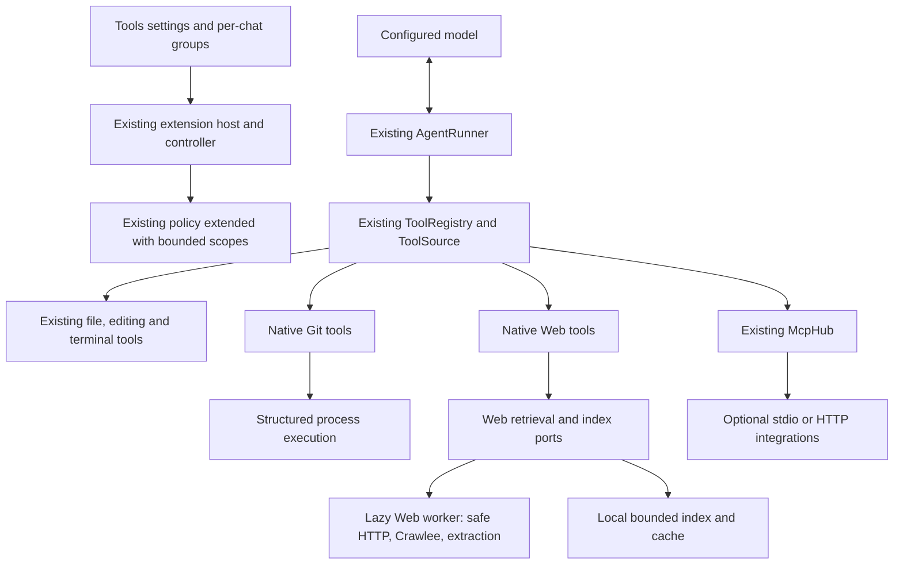

# Native Git, native Web and optional MCP integrations

Architectural assessment and implementation plan · 9 November 2026

**Status: approved for implementation by the owner on 9 November 2026; Stage 2 started.**
The original audit, baseline branch descriptions and proposed roadmap below record Stage 1. The checkpoint here
records implementation separately; later-phase APIs and limits remain design choices until their own gates pass.

Branch labels and future roadmap branches use the owner's `feature/` naming convention. The branch rename
does not change the implementation commits or their dependency order.

### Implementation checkpoint — 9 November 2026

| Phase | Implemented / evidence | Automated checks observed | Manual / remaining gates |
| --- | --- | --- | --- |
| P1 | `feature/tool-availability-policy`, implementation commit `6b4886a`; native disable/force-Ask controls, offered-definition enforcement and live permission rechecks | 417 tests in 25 files, typecheck/lint/build, real VS Code 1.145.2 smoke suite, VSIX packaging | No manual layout review, minimum VS Code, Windows/Linux or Remote matrix |
| P2a | `feature/native-git-read`, stacked on unmerged P1; five native Git reads and structured argv execution | 447 tests in 28 files on Node 22, typecheck/lint/build, real VS Code 1.145.2 smoke suite, VSIX packaging | Windows/Linux, Remote, minimum VS Code and fresh VSIX install not exercised |
| P2b | `feature/native-git-write`, stacked on unmerged P2a; controlled stage/unstage/commit, typed approval card and stale-state/late permission checks | 480 tests in 29 files on Node 22, typecheck/lint/build, real VS Code 1.145.2 smoke suite, VSIX packaging | Real signing, manual Git-card/model checks, Windows/Linux, Remote and minimum VS Code not exercised |
| P3 | `feature/workspace-diagnostics`, stacked on unmerged P2b at `12aa10f`; cached native diagnostics with workspace/active, literal path, severity and result filters; optional port/adapter/checkpoint capability | 506 tests in 30 files on Node 22, typecheck/lint/build, real VS Code 1.145.2 diagnostics and regression smoke suite, VSIX packaging | Manual model calls, Windows/Linux, Remote, minimum VS Code and fresh VSIX installation not exercised |
| P4 | Independent `feature/web-runtime-spike`, commit `4fb1405`; locked experiment, transport/configuration reproducers, extraction/index fixture, bundle and VSIX measurements | Bundled worker on actual Node 20.18.0, root 392 tests in 23 files, typecheck/lint/build, two VSIX packages | **Adoption gate closed**: safe DNS-bound transport and helper routing remain unproven; default helpers/configuration cannot be adopted directly |
| Website | Fetched and fast-forward checked `main` at `45381b3`; no feature/source change required by these increments | `npm run verify`: diagnostics/build and generated-site checks passed | Product Web claims wait for an implemented, verified feature |

P1 details: [implementation status](2026-11-09-tool-availability-policy-status.md).
P4 details are committed on its own branch under `docs/plans/2026-11-09-web-runtime-spike-status.md` and
`experiments/web-runtime/README.md`; its worktree is `/Users/luca.minelli/sovran/.worktrees/web-runtime-spike`.
P2a details: [native Git inspection status](2026-11-09-native-git-read-status.md).
P2b details: [controlled native Git write status](2026-11-09-native-git-write-status.md).
P3 details: [workspace diagnostics status](2026-11-09-workspace-diagnostics-status.md).
No phase was merged or pushed. P8a and the remaining Web feasibility work are subsequent increments;
P5 stays gated. The original plan was retained and versioned with this progress update.

## 1. Baseline and working branch

- Extension repository: `Sovran/`, a Git repository independent of the parent directory and `Sovran-Website/`.
- Base: `main` at `84954828aac2f5a1b7b09ebbda6687ed697bf7dd`.
- `git fetch origin main` completed; local `main`, `origin/main` and `FETCH_HEAD` matched.
- Created and checked out **`feature/native-tools-mcp-plan`**, directly from that `main`.
- The extension working tree was clean before the audit. Only this plan is added by this stage.
- No production dependencies added, existing MCP configurations modified, servers installed or browsers launched.
- No changes to the website or parent repository. No push or pull request performed.

Checks actually run against the baseline:

| Check                      | Observed result                                                                                                                  |
| -------------------------- | -------------------------------------------------------------------------------------------------------------------------------- |
| `npm run check`            | Typecheck, lint and all 392 tests in 23 files passed                                                                             |
| `npm run build`            | Host, document worker and webview builds passed                                                                                  |
| VSIX packaging             | `vsce package --no-dependencies --pre-release --out /tmp/sovran-native-tools-audit.vsix` passed: 24 files, reported size 1.12 MB |
| Production host bundle     | `dist/extension.js`: 1,172,732 bytes; gzip 309,798 bytes                                                                         |
| Production document worker | `dist/documentWorker.js`: 1,562,652 bytes; gzip 470,662 bytes                                                                    |
| Test environment           | macOS, Node 25.9.0; this is not the supported minimum runtime                                                                    |

Real VS Code smoke tests,
Windows/Linux execution, Remote SSH, WSL, containers and third-party browser servers were not run in this audit.
Existing CI covers three operating systems, but that is distinct from a test observed in this session.

## 2. Resolve the supplied prompt before implementation

The direction is sound: essential coding tools native, specialized integrations through MCP.
The prompt nevertheless combines a product roadmap with an initial implementation request.
The following interpretation keeps the work bounded and resolves internal contradictions.

| Prompt point                                                            | Decision for this plan                                                                                   |
| ----------------------------------------------------------------------- | -------------------------------------------------------------------------------------------------------- |
| Rebuild a unified tool architecture                                     | Extend the registry and execution pipeline already present; do not replace them                          |
| Native Web without external search APIs                                 | Binding requirement: no Brave, SearXNG, Tavily or search-result scraping in this feature                 |
| Later references to configurable search providers and provider failures | Replace with configured **sources**, crawl failures and local-index failures                             |
| Autonomous Web discovery                                                | Starts from supplied URLs, configured sources, links and sitemaps; cannot promise global Internet search |
| Crawlee as primary orchestrator                                         | Adopt through a compatibility/security spike; do not assume its defaults satisfy extension requirements  |
| SQLite FTS5                                                             | Evaluate against the actual extension runtime; prefer a small JavaScript index initially                 |
| Read-only Git initially                                                 | Deliver reads first; a separate increment adds stage/unstage/commit, already requested by the owner      |
| Reset, checkout, merge, rebase, push                                    | Not native in the initial release; existing terminal remains governed by its existing policy             |
| GitHub preset                                                           | Keep as optional collaboration integration, replacing its current position among basic-tool shortcuts    |
| Filesystem/Git/Fetch presets                                            | Remove from the new catalog after the native replacements land; preserve manually configured servers     |
| New filesystem/editing/search systems                                   | Reuse existing tools; missing peripheral features are separate follow-ups                                |
| Browser automation                                                      | Optional Playwright MCP; Chrome DevTools MCP for debugging; neither is a native Web dependency           |
| Code Mode / QuickJS                                                     | Explicitly out of scope; no speculative runtime or second dispatcher                                     |

**Initial release:** existing core tools, native Git reads and controlled stage/commit, workspace diagnostics,
`web_fetch`, bounded `web_crawl`, local `web_search`, simpler tool settings and three optional MCP presets.
No promise of authenticated native crawling, whole-Internet discovery or sandboxing arbitrary MCP servers.

## 3. Repository audit: implementation status and evidence

Paths below are relative to the extension repository. Existing architecture and security documents are useful
context; the observations were checked against source and the baseline tests, not inferred from the roadmap.

| Area                       | Status today                           | Source and consequence                                                                                                                                                                    |
| -------------------------- | -------------------------------------- | ----------------------------------------------------------------------------------------------------------------------------------------------------------------------------------------- |
| Composition and lifecycle  | Implemented                            | `src/extension/extension.ts:24`: adapters, shared controller, MCP host, session storage and document worker                                                                               |
| Agent lifecycle            | Implemented                            | `src/core/agent/agentRunner.ts`: request/context → model stream → validation → prepare → policy → approval → execution → result; sequential calls, abort, iteration and repetition limits |
| LLM tool calling           | Implemented                            | `agentRunner.ts:238`, `providers/capabilities.ts`, `agent/promptedTools.ts`: native function calling, prompted fallback, auto detection and none                                          |
| Native tool registry       | Implemented, already unified           | `src/core/tools/registry.ts:11`: static tools plus dynamic `ToolSource`; `SovranController.ts:298` adds `McpHub` to that registry                                                         |
| Native files and context   | Implemented                            | `builtin/index.ts`: `read_file`, `list_directory`, `find_files`, `search_files`, `get_workspace_info`, `get_active_editor_context`                                                        |
| Editing                    | Implemented, single file per tool call | `builtin/writeTools.ts`: `write_file`, `edit_file`, `apply_diff`; exact replacements, multiple replacements in one file, diff preview and staleness check                                 |
| Multi-file edits           | Partial                                | Agent can execute several edit calls and checkpoints span a run; no atomic multi-file transaction or general unified-patch tool                                                           |
| Delete and metadata        | Partial                                | `WorkspacePort.stat/deleteFile` and checkpoint restore exist; no standalone `delete_file` or `stat_file` tool                                                                             |
| Multi-root and path checks | Implemented                            | `security/paths.ts`: named roots, boundary checks, realpath and nearest existing ancestor; no user-granted external-directory access                                                      |
| VS Code file APIs          | Implemented with an undo caveat        | `VscodeWorkspace.ts:102`: existing-file writes use `WorkspaceEdit`; new files use `workspace.fs`; delete uses `WorkspaceEdit`. Do not claim identical native undo for all creation paths  |
| Code search                | Implemented                            | `RipgrepSearch.ts`, `readTools.ts:205`: bundled ripgrep, ignores, regex/literal search, excerpt/result caps and protected-path re-filtering; bounded fallback if rg unavailable           |
| Terminal                   | Implemented                            | `NodeProcessRunner.ts:87`, `terminalTool.ts`: shell, output cap, timeout, cancellation and process-tree kill; no structured argv execution API in `ProcessPort`                           |
| Git                        | Missing as dedicated native tools      | Workspace info reads basic branch metadata and terminal can run git, but there are no `git_status/diff/log/show` tools                                                                    |
| Diagnostics                | Partial                                | `VscodeWorkspace.ts:122` and active-editor tool expose current document diagnostics; no workspace-wide filtered diagnostic tool or document-symbol tool                                   |
| Native Web                 | Missing                                | No native fetch, crawler, Web cache, index, URL grants or SSRF-aware transport                                                                                                            |
| MCP transports             | Implemented                            | `McpTransports.ts`: official SDK client, local stdio and Streamable HTTP; no legacy SSE-only client or OAuth flow                                                                         |
| MCP discovery/lifecycle    | Implemented                            | `mcp/hub.ts`: client per server, tool listing and list changes, restart, timeout/progress, cancellation, connection generations and stop/cleanup                                          |
| MCP configuration          | Implemented                            | `mcpHost.ts`, `extension/config.ts:67`: user-scope `sovran.mcp.servers`, trusted workspaces only, serialized updates, secrets and state projection                                        |
| Import formats             | Implemented                            | `shared/mcpImport.ts`: `mcpServers`, `servers`, nested `mcp.servers`, server map, single entry and fragments; JSONC and limited command-line splitting                                    |
| MCP tool permissions       | Implemented                            | `mcp/config.ts:62`, `permissions/policy.ts:83`: Off / Ask / Allow, Ask even in Auto, MCP only in Act; annotations remain claims                                                           |
| MCP names/results          | Implemented, with limits               | `mcp/naming.ts`: `mcp__server__tool`, normalization/hash and 64-character limit; `results.ts`: textual results and labels for images/audio                                                |
| Tool selection             | Partial                                | MCP Off excludes definitions and shows estimated cost; native tools cannot be disabled individually; no per-chat group selection or source-aware availability snapshot                    |
| Tests                      | Implemented baseline                   | `tests/unit`, `tests/integration`, `webview/src/App.test.tsx`, `tests/extension`; 392 tests observed passing                                                                              |

### Existing boundaries to preserve

- `src/core` cannot import `vscode` or host/UI modules; adapters implement ports.
- User settings govern providers, permissions, commands and MCP configuration. A repository cannot authorize itself.
- Plan/Act and workspace trust are enforced in runtime policy, independently of model instructions.
- Protected paths, symlinks, command guardrails, secret masking, checkpoint conflicts and bounded outputs already exist.
- `config.yaml` synchronizes **model providers**, not all extension settings; this project does not need a second
  configuration source for native tools or MCP.
- Provider network traffic has different authentication/redirect semantics from unauthenticated public Web reads.
  Do not reuse the provider client as a crawler or relax its redirect policy.

### Gaps that matter to the proposed extension

1. **Preparation runs before permission evaluation.** `agentRunner.ts:448` calls `prepare()` first. New tools must not
   fetch URLs, crawl, install packages or perform repository mutations while preparing an approval.
2. **Read does not mean network authorization.** `policy.ts:72` automatically permits ordinary read tools and ignores
   `risks` in that branch. New Web tools need explicit network scope handling, not just `risk: 'read'`.
3. **Listing is not enforcement.** `registry.list()` filters visibility but `get()` resolves by name. New native Off,
   group selection and availability rules must be checked by the execution path too, including after approval.
4. **MCP policy can change during approval.** `hub.ts:379` checks Off in prepare, while `callTool()` at line 407 checks
   connection state but not the current Off policy. Add a regression test and a final check immediately before dispatch;
   re-evaluate changed Ask/Allow policy as well. The existing documentation's broader statement needs tightening.
5. **MCP argument validation differs from native validation.** The current local MCP schema accepts an object, passes
   the server's JSON Schema to the model and relies on server-side validation. Preserve this distinction; do not claim
   complete client-side validation against arbitrary server schemas.
6. **One secret per server.** README import moves one detected token to Secret Storage; additional environment secrets
   may remain plaintext with a warning (`mcpImport.ts:161`). Presets should need at most one token. A multi-secret map
   is a separately testable hardening change, not a claim that already holds.
7. **Current MCP side effects are outside the native guardrails.** A subprocess runs with user privileges; environment
   minimization and browser flags are not an OS sandbox. Retain per-tool confirmations and document this limit.
8. **Security documentation changes with Web.** `SECURITY.md` T11 currently says only configured endpoints are contacted.
   Add user-authorized public-Web scopes and cached Web content to the threat model and Data UI copy.

These are scoped audit findings, not a complete security audit or a claim of an exploit reproduced during this stage.

## 4. Target architecture: extend the current components

| Component                                                | Extend or introduce               | Concrete responsibility                                                                                                                                 |
| -------------------------------------------------------- | --------------------------------- | ------------------------------------------------------------------------------------------------------------------------------------------------------- |
| `ToolDefinition`, `ToolRegistry`, `ToolSource`           | Extend                            | Optional provenance/group metadata, availability and consistent selection; keep existing names and schemas                                              |
| `AgentRunner`                                            | Extend                            | Same dispatch path; capture offered tools per model request, enforce enabled state and trust before prepare, recheck scope/permissions before execution |
| `permissions/policy.ts`, `PreparedAction`                | Extend                            | Explicit network scope and repository-write context; typed approval data; existing hard denials remain authoritative                                    |
| `ProcessPort`, `NodeProcessRunner`                       | Extend                            | `runFile(executable, argv, options)` without shell; shared output/timeout/cancellation plumbing                                                         |
| `builtin/gitTools.ts`, `core/git/`                       | New                               | Structured Git operations and output formatting using the existing process port                                                                         |
| `WorkspacePort`, `VscodeWorkspace`, checkpoint decorator | Extend                            | Optional filtered workspace diagnostics; pass capability through decorators                                                                             |
| `builtin/webTools.ts`, `core/web/`                       | New                               | Tool arguments, scope planning, page/result contracts, URL rules and local-source semantics                                                             |
| `WebRetrievalPort`, `WebIndexPort`                       | New, only concrete methods needed | Retrieval/crawl I/O and bounded local storage; no general plugin framework                                                                              |
| `WorkerWebService`, `webWorker.ts`                       | New host adapters                 | Lazy Crawlee/extraction execution, resource bounds and worker lifecycle, following the existing document-worker pattern                                 |
| Existing MCP host/transports                             | Extend lightly                    | Managed preset provenance, explicit install/connect workflow and dependency checks; retain custom servers                                               |
| `shared/protocol.ts`, store and settings                 | Extend                            | Validated intents/state for native switches, Web sources/limits and integration catalog                                                                 |
| Build/package scripts                                    | Extend                            | Ship a separate Web worker/assets and verify every runtime file enters the VSIX                                                                         |

Keep `risk: read | write | execute` for existing mode behavior. Add only the contextual fields needed for network
and Git effects; a full new permission language is unnecessary. Any deferred service capability is optional in
`ToolContext` so existing fake hosts and non-Web environments continue working.

Do not rename `apply_diff` to `apply_patch`, `execute_terminal` to `execute_command`, or MCP tools to dotted names.
The current naming is compatible with the supported model APIs; the prompt's illustrative interface is not a migration spec.
Leave tool execution in `AgentRunner`; extract a reusable executor only when a second caller actually exists.

## 5. Native Git scope and execution

First increment: `git_status`, `git_diff`, `git_log`, `git_show`, `git_branches`.
Changed-file listing belongs to status/diff arguments, not another near-duplicate tool.

- Explicit repository/root selection, including multi-root workspaces and nested repositories; do not silently inspect
  a parent repository outside the allowed roots. Support worktrees where `.git` is a file.
- Execute Git with argv arrays, not interpolated shell strings. Resolve revisions to commit IDs where appropriate;
  use literal pathspecs and argument terminators; accept neither arbitrary flags nor model-supplied Git configuration.
- Resolve the executable from trusted user configuration or host PATH, never a repository-provided executable.
- Disable pagers, optional write locks, lazy network fetch, fsmonitor, external diff and textconv for inspection.
  Review remaining Git configuration effects in tests; a read-only command name alone is insufficient protection.
- Bulk diff/show excludes protected file contents. Explicit protected-file reads require the existing approval;
  revision/path syntax must not create a route around that check. Log/metadata output is bounded and redacted.
- Initially allow these controlled process-backed reads in Plan only in a **trusted** workspace. In Restricted Mode
  continue offering existing pure file/context reads, not repository-configured process execution.

Second increment: `git_stage`, `git_unstage`, `git_commit`. This preserves the owner's earlier request for stage/commit
but separates their implementation from inspection. Require selected files for staging; no implicit stage-all,
amend, force, reset-hard or history rewrite. Preview repository, files and commit message; detect index changes while
approval is pending. Explain that commit hooks, filters and signing can execute programs. Repository mutations ask
in every mode initially, including Auto, and are not represented as recoverable by file checkpoints.

Push/pull, checkout, merge, rebase and reset remain outside the initial native surface. The terminal remains available
under its existing policy; GitHub issues/PRs/Actions remain optional MCP capabilities.

## 6. Native Web: three honest capabilities

| Tool         | Initial contract                                                                                                    | Does not do                                                 |
| ------------ | ------------------------------------------------------------------------------------------------------------------- | ----------------------------------------------------------- |
| `web_fetch`  | Fetch one authorized public HTTP(S) URL; title, readable structured text, source and optional links; bounded paging | Search the Internet, execute JS, use browser cookies        |
| `web_crawl`  | One or a few seed URLs; bounded related links and sitemaps; optional query ranks candidates/results locally         | Unrestricted traversal or automatic access to other origins |
| `web_search` | Keyword/full-text search of this workspace's cached/indexed pages; title, URL, excerpt and freshness metadata       | Global search-engine coverage or hidden network refresh     |

`web_search` is offline by default. With an explicit `refresh` and an already authorized source selection it can call
the same bounded crawl service before searching; it does not invent another crawler or silently start a background job.
If no source or indexed page exists, return that state and request a URL/source, rather than fabricating search results.
Configured documentation sources are opt-in templates, not permission for a repository file to cause outbound requests.

### Crawlee and extraction

Use `@crawlee/cheerio` for crawling and its resolved Cheerio version for parsing, subject to the compatibility spike.
Do not add the `crawlee` umbrella package or browser crawlers. Reuse the same safe HTTP and extraction path for fetch
and crawl; do not build separate fetchers with different SSRF checks.

Extraction must preserve headings, code blocks, lists, tables and source links on documentation fixtures.
Start with the Cheerio DOM already available. Evaluate Readability on the same fixture corpus, but add it and a DOM
implementation only if it improves extraction without dropping technical content. A Cheerio tree is not the browser
DOM expected by Readability. Do not promote the existing dev-only jsdom to production as an accidental shortcut.
See [CheerioCrawler](https://crawlee.dev/js/api/cheerio-crawler/class/CheerioCrawler) and
[Readability's Node requirements](https://github.com/mozilla/readability#nodejs-usage).

Crawlee handles queues/dedup/retry scheduling; Sovran owns authorization, strict budgets, network transport and data
retention. Its documented page limit can overshoot with parallel requests, so reserve a budget slot before dispatch.
Set depth/page/concurrency/retry limits explicitly and disable blocked-session/proxy-rotation workarounds.
See [BasicCrawler options](https://crawlee.dev/js/api/basic-crawler/interface/BasicCrawlerOptions).

Use an isolated configuration/storage per job. Default Crawlee configuration is a singleton and can load cwd config
and environment overrides. Do not allow repository `crawlee.json`, default `storage/`, environment defaults or implicit
dataset writes to determine policy, storage location or network behavior. Verify this in the spike and tests.
See [Crawlee Configuration](https://crawlee.dev/js/api/core/class/Configuration).

### Discovery and ranking

- Seed URLs, opted-in documentation roots, extracted links, bounded sitemap indexes and existing cached pages only.
- Default scope: the seed's **origin and path subtree**. `sameDomainOnly` alone is ambiguous; sibling subdomains and
  arbitrary ports do not become authorized automatically. Broader configured sources are user-granted explicitly.
- Resolve relative links against the effective page URL; remove fragments and known tracking parameters, preserve
  meaningful query parameters and path semantics. Bound candidates before adding to the queue.
- Deduplicate canonical URLs and content hashes. Skip non-text downloads, logout/action URLs, endless calendars and
  repeated parameter combinations. Ranking favors titles, headings, link text, URL tokens and body terms.
- Sitemap URLs are hints, not authorization. Apply the same origin, DNS, redirect and size rules to sitemap/robots
  requests. Bound nested indexes and compressed XML; disable external entities. Reuse the safe XML tokenizer only
  after sitemap fixtures prove it sufficient, otherwise choose one small maintained parser.

### Local index and persistence

Prefer **MiniSearch plus bounded JSON page records** for the initial corpus. No vector store, embeddings or native
database addon. Candidate fields: URL/id, title, headings and body; deterministic term ranking and title boosts.
`WebIndexPort` hides storage details so a later SQLite FTS implementation can replace this without tool changes.
See [MiniSearch](https://lucaong.github.io/minisearch/).

Use workspace-specific `ExtensionContext.storageUri`, not files in the repository. Without a workspace, use an isolated
temporary store rather than a shared global corpus. No cross-workspace cache reuse by default. Atomic writes, schema
version, corruption recovery, TTL/LRU eviction and a visible **Clear Web data** action are required. Default to memory
when chat persistence is disabled. Private-network exceptions are memory-only initially; never persist credentials,
cookies, token-bearing URLs or raw HTML unnecessarily. Ordinary disk cache is not encrypted: say so in Data settings.

Search results identify `fetchedAt`, effective source URL, cache/live status and expiration. Offline cache hits never
claim that the source was revalidated. Re-index/delete on content changes, eviction or cache clearing.

### Proposed initial resource limits

These are starting defaults for fixture/benchmark validation, not measurements of current functionality.

| Resource                       | Default                                  | User-configurable hard ceiling                              |
| ------------------------------ | ---------------------------------------- | ----------------------------------------------------------- |
| Pages per crawl                | 10                                       | 50                                                          |
| Link depth, seeds at depth 0   | 2                                        | 3                                                           |
| Concurrent requests            | 2 total, 1 per origin                    | 4 total, 2 per origin                                       |
| Per-origin delay               | At least 1 second                        | User may increase, not disable the minimum                  |
| Page decoded response          | 2 MiB                                    | 5 MiB                                                       |
| Total decoded bytes per crawl  | 20 MiB                                   | 50 MiB                                                      |
| Redirect hops                  | 5                                        | 5                                                           |
| Per-request / total crawl time | 15 s / 60 s                              | 30 s / 180 s                                                |
| Retries                        | 1 for transient errors                   | 2; no retries for policy denials/CAPTCHA                    |
| Links examined per page        | 500                                      | 1,000                                                       |
| Sitemap discovery              | 4 documents, 1,000 candidate URLs        | Same; bounded decompression                                 |
| Persisted local corpus         | 500 pages / 50 MiB, TTL 7 days           | Explicit quota, validated against memory benchmark          |
| Model output                   | Existing 20,000-character default budget | Existing user limit; crawl returns excerpts, not all bodies |

Limits cover failed attempts, retries, redirects and discovery traffic, not only successfully extracted pages.
Use a shared limiter across chats and a bounded worker queue (one active Web job initially) so concurrent runs cannot
multiply resource limits. Emit progress and partial results with an explicit stop reason.

## 7. Security design before exposing Web tools

The network transport is a prerequisite, not a final hardening task.

1. Parse URLs with the standard URL parser; HTTP(S) only, no embedded user/password. Public native retrieval is GET-only,
   without browser cookies, authorization headers or model-supplied arbitrary headers.
2. Validate all DNS A/AAAA results. Reject loopback, private, link-local, multicast, unspecified, reserved and metadata
   destinations, including IPv4-mapped IPv6 and alternative IP encodings. Reject mixed public/private answers.
3. **Bind the socket to a validated address** while preserving hostname TLS verification/SNI. A DNS precheck followed
   by an independent fetch lookup is insufficient against rebinding. Revalidate every new connection, retry and redirect.
4. Follow redirects manually and re-authorize their effective destination/scope before connecting. No automatic
   HTTPS downgrade or widening from a documentation subtree to an unrelated site/private host.
5. Force robots, sitemap and Crawlee helper requests through the same safe client. Verify actual custom-client hooks
   against the pinned Crawlee release. Disable alternative outbound paths. If this cannot be demonstrated, Web stays
   disabled until resolved; do not replace the guarantee with a pre-navigation hostname check.
6. Proxy/CA support is explicit. Never disable TLS verification. If a proxy makes destination validation unenforceable,
   fail clearly or require a separately documented trusted egress policy; do not claim end-to-end SSRF protection.
7. Check robots rules before page retrieval, identify the crawler honestly, honor disallow/rate limits and stop on access
   challenges. Robots errors and sitemap recursion are bounded; no CAPTCHA bypass or automatic switch to a browser.
8. Enforce decoded-byte and time limits while streaming, before HTML/XML parsing. Worker heap/time limits bound CPU
   and memory damage. A worker thread protects responsiveness; **it is not an OS security sandbox**.
9. Extend the existing policy with a typed network request scope: origin, path boundary, operation and budgets. Prepare
   shows scope without performing network I/O. Public Web reads can run in trusted Plan/Act after approval; Auto alone
   never grants arbitrary Internet access. An optional session grant is restricted to the displayed source/budget.
10. Private endpoints require a separate user-defined exception and explicit approval. No model argument can set
    `allowPrivateNetwork=true`; metadata services stay blocked in this release. No native network use in Restricted Mode.
11. Recheck tool enablement, trust, URL scope and cancellation immediately before dispatch. Web content and cache records
    cannot modify permissions, add trusted sources, install integrations or become system instructions.
12. Results pass through existing redaction and untrusted-data wrapping. Preserve source references under truncation;
    do not put complete crawled pages or hundreds of link definitions into every model request.

Browser MCP is a separate trust domain: native safe HTTP does not constrain a browser's subrequests or an arbitrary MCP
process. Keep Ask per tool by default and explain this difference instead of promising a universal network sandbox.

## 8. Simpler MCP product model and verified preset candidates

Keep the protocol and host. Change its **presentation and defaults**, not its role.

- Replace the current MCP settings tab with **Tools**, containing two sections: **Built-in** and **Integrations (MCP)**.
  Keep the old internal settings route as a compatible alias. No additional top-level tab is needed.
- Built-in groups: Files & code, Git, Web, Editor and Terminal; show availability and compact descriptions.
- Native tools: enable/disable plus **Default / Ask**; Default uses the existing policy. Do not add a universal Allow
  switch that bypasses protected paths, Plan, trust, Git mutations or network authorization.
- Integrations: three catalog cards, a generic **Add server** action and existing connection/tool details.
  Advanced fields stay collapsed. Retain MCP **Off / Ask / Allow** with its current semantics.
- Generic connection formats remain **Local command (stdio)**, **Remote URL (Streamable HTTP)** and **Import JSON**.
  Explain transport as a connection method, not a different capability or kind of model.
- Preserve all saved server IDs, tokens, enabled flags and policies; removing a preset never uninstalls a configured server.
- Remove Filesystem, Git and Fetch from the new catalog after native equivalents are shipped. Keep GitHub only under
  optional integrations, rather than presenting it as a prerequisite for Git.

### Initial catalog

| Integration         | Preset design                                                                        | Limit and verification needed                                                                          |
| ------------------- | ------------------------------------------------------------------------------------ | ------------------------------------------------------------------------------------------------------ |
| Playwright MCP      | Local stdio, isolated profile, explicit browser executable/mode; installed on demand | Candidate `@playwright/mcp@0.0.84` from npm metadata; real launch/tool checks still pending            |
| Chrome DevTools MCP | Local stdio, debugging-focused tool selection, isolated session                      | Candidate `chrome-devtools-mcp@1.12.0`; verify flags against that pinned release and host Node         |
| GitHub MCP          | Existing hosted HTTP endpoint with PAT, narrow toolsets and read-only default        | No OAuth added in this phase; PAT scopes and real access tested manually with an opted-in test account |

The candidates are **documentation/metadata verified**, not yet executable-tested presets. Upstream main documentation
can differ from a published release: confirm flags with the exact package before enabling a catalog entry.

Playwright's documented default is persistent state; the preset must explicitly select isolation. Existing-browser
extension mode is a separate advanced opt-in flow requiring the companion browser extension and explicit session
selection. Never attach automatically to a personal profile. Start with navigation/snapshots; keep code evaluation,
upload/download and session-changing capabilities off until explicitly selected. Browser origin flags are not a
security boundary, particularly for redirects. See [Playwright MCP](https://github.com/microsoft/playwright-mcp).

Chrome DevTools currently enables usage statistics by default and can send trace URLs to CrUX. The preset must use
the pinned release's opt-out options (`--no-usage-statistics`, `--no-performance-crux`) and disable automatic update
checks where supported. Select debugging/network/performance tools rather than duplicating the Playwright navigation
surface. See its [README](https://github.com/ChromeDevTools/chrome-devtools-mcp) and
[configuration](https://github.com/ChromeDevTools/chrome-devtools-mcp/blob/main/docs/configuration.md).

GitHub can filter remote tools with `X-MCP-Toolsets`/`X-MCP-Tools` and enforce read-only through `X-MCP-Readonly` or a
readonly URL. Use a small verified set for issues/PRs and keep writes opt-in/Ask. These are **server filters**, distinct
from Sovran's tool policies. See [GitHub server configuration](https://github.com/github/github-mcp-server/blob/main/docs/server-configuration.md).

### Installation, consent and dependencies

Selecting a preset only prepares a configuration; it must not download or launch software. Provide explicit
**Install dependencies** and **Connect** actions, showing package/version, host and browser access before execution.
For managed local packages, use an extension-storage directory and reviewed lockfile/integrity entries; exact top-level
version alone does not pin transitive dependencies. Use `npm ci --ignore-scripts` where the selected packages permit it;
browser installation is a separate, explicit action. Launch the resolved installed entrypoint rather than repeatedly
running `npx -y ...@latest`. Never overwrite a custom user's command during an update.

All current custom-server behavior remains supported. New managed entries start disconnected; Connect records the
decision to run that component. Existing user-enabled servers retain their present startup behavior. Upgrades are
explicit and never reset tool permissions to Allow. Failed installs leave a retryable, disabled entry and no orphan process.

Playwright screenshots need a separate decision: current MCP results only describe images as text. Snapshot-driven
automation works with the current result path, but screenshot-to-model support must reuse bounded image storage and
vision capabilities before the product claims it. Do not infer or open arbitrary server-returned local file paths.

## 9. Context efficiency, settings and Remote environments

Start with deterministic choices: enabled native tools and selected integration groups for each chat. MCP definitions
remain absent for disconnected/Off tools. Persist native overrides in user settings; per-chat group selection is session
state. Show approximate definition cost before enabling large sets. Do not add another model request to select tools,
another registry, a tool-discovery meta-protocol or automatic routing heuristics in the initial release.

Capture names offered on each model round-trip. Calls must both have been offered and remain currently enabled;
reject stale or fabricated names instead of treating schema visibility as access control. Critical file/terminal tools
are never silently evicted by a token-budget heuristic. Return short Web/Git results and support explicit paging.

Proposed settings families, all validated and security-relevant values read from user scope only:

- `sovran.tools.*`: native disabled tools, force-Ask overrides; defaults preserve current native behavior.
- `sovran.web.*`: enabled state, configured source URLs, quotas, persistence and network exceptions; **no search providers**.
- `sovran.mcp.servers`: retain existing shape, optional preset/managed-version metadata without affecting custom entries.
- Data: Web storage usage, retention, clear data and the existing chat-persistence relationship.

This extension declares `extensionKind: workspace`. In Remote SSH/WSL/Dev Containers, Git, native Web, storage and stdio
servers run on the **extension host**, not necessarily the desktop. Show that location on installation/connect cards.
System Node/Chrome may be unavailable there. Existing desktop-browser attachment requires an explicit reachable bridge;
do not open a remote debugging port publicly or silently forward one. Initially mark unsupported connection modes
unavailable with instructions. See [VS Code Remote extension architecture](https://code.visualstudio.com/api/advanced-topics/remote-extensions).

## 10. Dependency and compatibility decisions

Current constraints: `engines.vscode: ^1.95.0`, Node >=20 declaration, build target Node 20 and CommonJS output.
ADR-027 records the minimum VS Code's Electron 32 / Node 20.18 runtime. Development/CI Node 22 or this audit's Node 25
does not prove compatibility with that minimum. No VS Code minimum bump is implicit in this plan.

Official npm metadata read on 9 November 2026, without installing these packages:

Reproducible metadata sources: [Crawlee Cheerio](https://registry.npmjs.org/@crawlee%2Fcheerio/3.18.2),
[Crawlee core](https://registry.npmjs.org/@crawlee%2Fcore/3.18.2),
[Cheerio](https://registry.npmjs.org/cheerio/1.2.0),
[Readability](https://registry.npmjs.org/@mozilla%2Freadability/0.6.0),
[MiniSearch](https://registry.npmjs.org/minisearch/7.2.0),
[Playwright MCP](https://registry.npmjs.org/@playwright%2Fmcp/0.0.84) and
[Chrome DevTools MCP](https://registry.npmjs.org/chrome-devtools-mcp/1.12.0).

| Candidate                    | Observed metadata                                                                | Proposed decision                                                                                              |
| ---------------------------- | -------------------------------------------------------------------------------- | -------------------------------------------------------------------------------------------------------------- |
| `@crawlee/cheerio@3.18.2`    | Node >=16 declaration; exact `cheerio: 1.0.0-rc.12`; Crawlee HTTP/utils packages | Primary candidate, subject to resolved-tree/runtime/bundle spike                                               |
| `@crawlee/core@3.18.2`       | Substantial transitive graph, including HTTP/storage utilities                   | Top-level engine field is insufficient; inspect resolved transitives and CJS behavior                          |
| Standalone `cheerio@1.2.0`   | Node >=20.18.1                                                                   | Do not independently add latest Cheerio; conflicts with a strict 20.18.0 floor and duplicates Crawlee's parser |
| `@mozilla/readability@0.6.0` | Node >=14; requires a DOM when used in Node                                      | Optional evaluation, not an automatic production dependency                                                    |
| `minisearch@7.2.0`           | MIT, no runtime dependencies                                                     | Initial local-index candidate; measure corpus memory and serialized size                                       |
| `@playwright/mcp@0.0.84`     | Node >=18; depends on Playwright `1.65.0-alpha-2026-10-30`                       | Optional managed external package; test its transitive/browser compatibility, not just the MCP package         |
| `chrome-devtools-mcp@1.12.0` | Node `^20.19.0                                                                   |                                                                                                                | ^22.12.0 |     | >=23` | Cannot assume minimum embedded runtime works; require a compatible system Node for this optional integration |

Do not assume that the latest version of every transitive package is selected: e.g. Crawlee's `@apify/utilities ^2.7.10`
does not resolve to its latest 3.x release. The spike must evaluate an actual lockfile.

SQLite's built-in Node module was introduced in Node 22.5, so it cannot be the baseline implementation on Node 20.
Native SQLite addons introduce Electron ABI/platform packaging and install-script issues; WASM introduces another runtime
asset and persistence path. Neither is justified for a bounded initial corpus. See [Node SQLite history](https://nodejs.org/api/sqlite.html).

The spike must produce a dependency lock, licenses, transitive engines, production bundle/VSIX delta, cold activation
measurements and a test of the **bundled** Web worker under the minimum runtime. Check for dynamic imports, external
assets and accidental browser packages. `vsce --no-dependencies` means non-bundled runtime files will otherwise be absent.
Update `THIRD_PARTY_NOTICES.md` with the existing script whenever a dependency is adopted.

Proposed performance gates to refine from the spike: Web code not loaded during ordinary activation, no browser binaries
in the VSIX, no network on activation and bounded memory on a 500-page fixture corpus. Report measured size/activation
deltas before deciding whether Crawlee's dependency cost is acceptable; do not claim it is small from package name alone.

## 11. Independently testable implementation roadmap

Use one reviewable PR per row, splitting the rows marked a/b rather than a single large feature branch.
The current branch contains only the plan. After plan approval, create each implementation branch from the latest
merged `main` using the suggested `feature/` names. If dependent work is stacked before merging, label that dependency
explicitly; do not merge an unreviewed umbrella branch into main.

| Phase / suggested branch                      | Work and type of change                                                                                                                             | Dependency          | Acceptance gate                                                                                                                                                            |
| --------------------------------------------- | --------------------------------------------------------------------------------------------------------------------------------------------------- | ------------------- | -------------------------------------------------------------------------------------------------------------------------------------------------------------------------- |
| **P0** `feature/native-tools-mcp-plan`          | This audit, decisions, backlog and acceptance criteria; docs only                                                                                   | None                | Owner reviews Stage 1; no application changes                                                                                                                              |
| **P1** `feature/tool-availability-policy`       | Extend registry/types/runner/policy and settings; native toggles/force-Ask, metadata, offered-tool enforcement, rechecks after approval             | P0                  | Off/disabled/stale tool cannot execute; existing Plan/Act, MCP and approvals tests remain green                                                                            |
| **P2a** `feature/native-git-read`               | Extend process port with argv execution; new Git reads/root resolution/protected-content filtering                                                  | P1                  | Tests on real temporary repos, worktrees, two roots, missing git, injection attempts, abort/timeout; Plan reads only in trusted workspace                                  |
| **P2b** `feature/native-git-write`              | New stage/unstage/commit tools and repository approval preview; reuse process/policy pipeline                                                       | P2a                 | Reject stale index and protected-file bypass; no stage-all; Ask even in Auto; hooks/signing warning; no remote/history rewrite operation                                   |
| **P3** `feature/workspace-diagnostics`          | Extend workspace port, adapter and checkpoint passthrough; add `get_diagnostics` with path/severity/result filters                                  | P1                  | Active/workspace diagnostics, unopened file, multi-root and protected/outside-path behavior tested; no language-server invocation unless needed                            |
| **P4** `feature/web-runtime-spike`              | Isolated dependency/packaging/security feasibility experiment; no exposed Web tool or automatic network                                             | P0                  | Actual Crawlee lock, minimum-runtime worker test, safe-client routing proof, extracted documentation fixtures and bundle/activation report; go/no-go recorded              |
| **P5** `feature/native-web-fetch`               | New Web contracts, network scope policy, safe HTTP client, worker and `web_fetch`; minimal Tools UI                                                 | P1 + P4             | DNS binding/redirect/proxy policy proven; no request before approval; robots/body/time limits; URLs and code blocks preserved; no browser/service/account needed           |
| **P6** `feature/native-web-crawl`               | Extend the same Web service with Crawlee queues, scoped links, bounded sitemaps, shared limiters and progress                                       | P5                  | Exact request budgets despite concurrency/retries; adversarial sitemap/redirect tests; stop cancels sockets/workers; no cwd storage or hidden HTTP path                    |
| **P7** `feature/local-web-index`                | New bounded workspace index/cache adapter and `web_search`; source management and clear-data UI                                                     | P6                  | Offline search sends zero requests; freshness explicit; persistence/eviction/restart/corruption/cross-workspace isolation tested; no complete-web claims                   |
| **P8a** `feature/mcp-integration-catalog`       | Extend existing MCP UI/host for optional preset metadata, compatibility checks and install/connect lifecycle; retain custom-server/import workflows | P1                  | Three catalog entries with pinned candidates; zero install/launch from selecting a card; saved user servers/policies preserved                                             |
| **P8b** `feature/browser-mcp-presets`           | Smoke and finalize Playwright isolated/extension modes, DevTools privacy flags and GitHub narrow/read-only profile                                  | P8a                 | Real pinned-server stdio handshake/list/call/cleanup; supported browser matrix; missing dependencies handled; authenticated modes explicit; no telemetry enabled by preset |
| **P9** `feature/native-tools-release-hardening` | Final settings consolidation, per-chat groups/context cost, docs/SECURITY/decisions, runtime assets and CI/VSIX checks                              | P2b + P3 + P7 + P8b | Cross-platform/Remote manual matrix, model native/prompted modes, no browser bundle, fresh installation and upgrade tests                                                  |

P4 and P8a may progress independently of Git. This is a dependency plan, not a request to start parallel agents.
Ship useful increments: Git need not wait for crawling, and `web_fetch` need not wait for local search.
Remove the old basic-tool preset cards when their native equivalents land, not in a prior PR that leaves users without
the replacement. Record “implemented”, “automated-tested” and “manually-verified” separately in implementation status.

Expected size is multiple focused PRs, not one coding session. The Web spike determines the largest uncertainty:
runtime compatibility, safe transport interception and packaging. Assign dates only after that gate has evidence.

## 12. Test and verification strategy

| Layer          | Required meaningful tests                                                                                                                                                                                                                        |
| -------------- | ------------------------------------------------------------------------------------------------------------------------------------------------------------------------------------------------------------------------------------------------ |
| Existing core  | Keep current file/search/edit/checkpoint/provider/terminal tests unchanged unless behavior intentionally changes                                                                                                                                 |
| Tool runtime   | Offered versus guessed names, native Off, source collisions, changed permissions during approval, live trust changes, cancellation before dispatch                                                                                               |
| Git            | Real disposable repositories and worktrees; paths with spaces/metacharacters; flags/pathspec/revision attacks; parent-root escape; fsmonitor/textconv helpers not executed; protected diffs; stale index; no repository mutation from read tools |
| Network policy | Fake resolver + controlled sockets: private/mapped/reserved IPs, mixed DNS, rebinding, redirect chains and scope changes, proxy rejection, no requests before approval                                                                           |
| Retrieval      | Controlled HTTP servers: HTML/text/MIME errors, encodings, relative links, code/tables, malformed/huge/compressed bodies, stalled streams, abort, robots allow/disallow/failure                                                                  |
| Crawl          | Fixture link graph with cycles, duplicate URLs, hostile base/canonical links, sitemap bombs, query traps, cross-domain candidates, retry-budget exhaustion and concurrent chats                                                                  |
| Local index    | Exact/prefix/full-text ranking, source filters, snippets, cached dates, expired items, persistence disabled, quota/LRU, atomic writes/corruption, clear data and workspace isolation; no network during ordinary search                          |
| MCP regression | Existing stdio/HTTP tests plus managed entry lifecycle, missing runtime, exact version/flags, install denied/cancelled, token masking, disconnect/restart, final policy check                                                                    |
| Webview        | Native switches, source permissions, fresh/cached labels, empty search, catalog custom/import routes, install/connect distinction, Remote location, keyboard and narrow layouts                                                                  |
| Distribution   | Bundled worker under minimum VS Code runtime, fresh VSIX install, all worker/assets present, Windows/Linux/macOS, activation cost and dependency notices                                                                                         |

Ordinary CI uses fixtures and local servers: no paid API, external crawling, user credentials or personal browser.
Tests may explicitly authorize loopback fixtures through an injected test policy, never a production environment variable
that disables SSRF checking. Opted-in external smoke checks are separate from deterministic CI.

For each implementation PR: targeted tests while developing, then `npm run check` and `npm run build`.
For host/command/preset changes also run real VS Code smoke tests and package verification as required by
`CONTRIBUTING.md`. Report any matrix item not actually exercised.

## 13. Deliberate simplifications and deferred backlog

- No filesystem MCP dependency, rewritten terminal, replacement search engine or duplicate registry.
- No new generic permission DSL, orchestration language, automatic model router, embedding service or Code Mode.
- No native browser, bundled Chromium, mandatory Docker, paid provider or centrally operated service.
- Native delete/stat tools, atomic multi-file patching, symbols and user-granted external directories are useful but
  are independent follow-ups. Do not expand path access or change edit semantics merely to satisfy a broad checklist.
- OAuth, MCP resources/prompts and multi-secret storage remain separate work; preserve current custom MCP compatibility.
- Future screenshot-to-model support must reuse image handling; current browser snapshots do not depend on it.
- Source templates can suggest known docs but cannot crawl until selected/authorized. Unknown global discovery remains
  an explicit product limitation, not a reason to add search scraping behind the user's chosen architecture.

## 14. Review decisions and next concrete action

The proposed choices ready for owner review are: retain the existing unified runtime; implement Git read then controlled
stage/commit; Web means fetch + bounded crawl + local search; evaluate Crawlee behind a runtime/security gate; initial
index is pure JavaScript; simplify the current settings into Tools with optional MCP integrations; preserve saved servers.

After this plan is approved, begin **P1** and the **P4 spike** as separately reviewable changes. No installation of
external browser components is part of approving the architecture: those remain explicit end-user product actions.

### Final audit verification

- [x] Latest remote `main` checked and dedicated branch created.
- [x] Existing execution pipeline, tools, adapters, settings, permissions, MCP and tests inspected.
- [x] Baseline typecheck, lint, 392 tests and production build passed.
- [x] External documentation and npm candidate metadata checked; untested assumptions labelled.
- [x] Baseline VSIX packaging passed: 24 files, reported size 1.12 MB; output written outside the repository.
- [x] Owner approval received on 9 November 2026; Stage 2 started (see implementation checkpoint above).
